# L1 compared with the previous release (V11)

Generated by `tools/compare_with_release.py` from `L1/hourly` (files written 2026-11-17 13:26 to 2026-11-17 16:51) and `old releases/V11/hourly`. 34 stations.

Every hour of every variable is *unchanged*, *modified* (valid in both, differing by more than the tolerance), *gained* (valid only now) or *lost* (valid only before). "Core variables" are the 18 columns counted in the tables: ISWR, OSWR, NR, Alb, TA1, TA2, TA3, TA4, RH1, RH2, VW1, VW2, DW1, DW2, P, HW1, HW2, HS_combined. The tolerances are radiation and fluxes (W/m^2) 1; temperatures and depths (degC, m) 0.1; relative humidity (%) 0.5; wind speed, voltage 0.1; wind direction (degrees) 1; pressure (hPa) 0.1; heights (m) 0.02; albedo 0.01; specific humidity (g/kg) 0.05; any other variable 0.01.

**Network**: 47,148,113 -> 48,329,400 valid core-variable hours (+2.5 %), 1,550,544 gained, 369,257 lost, 5,198,650 modified (11.11 % of the 46,778,856 shared hours).

Columns only in the new files: Alb, ISWR, NR, NR_cor, OSWR, P_adj_flag, TA5, TS1, TS10, TS2, TS3, TS4, TS5, TS6, TS7, TS8, TS9. Columns only in the old files: ISWR_adj_flag, OSWR_adj_flag.

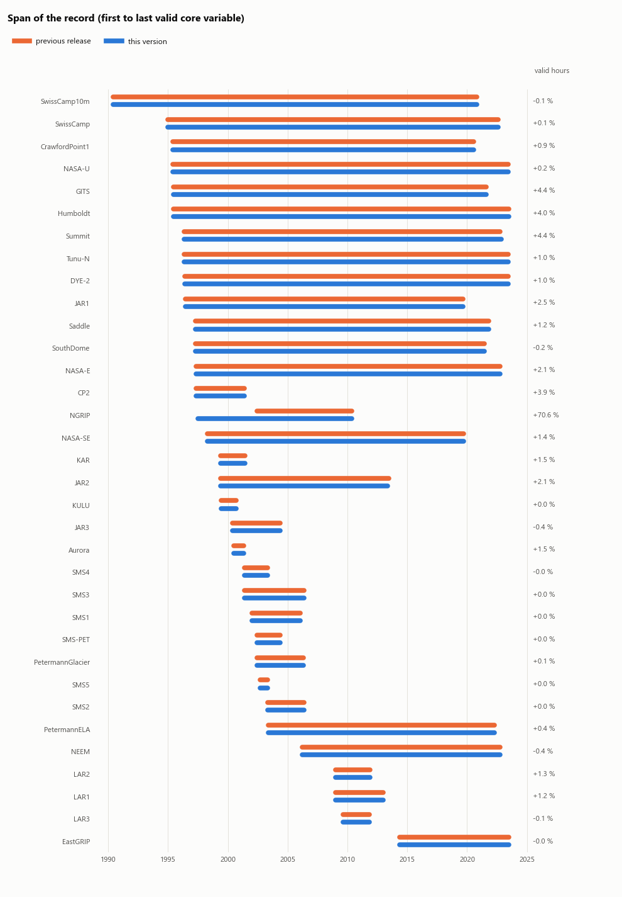

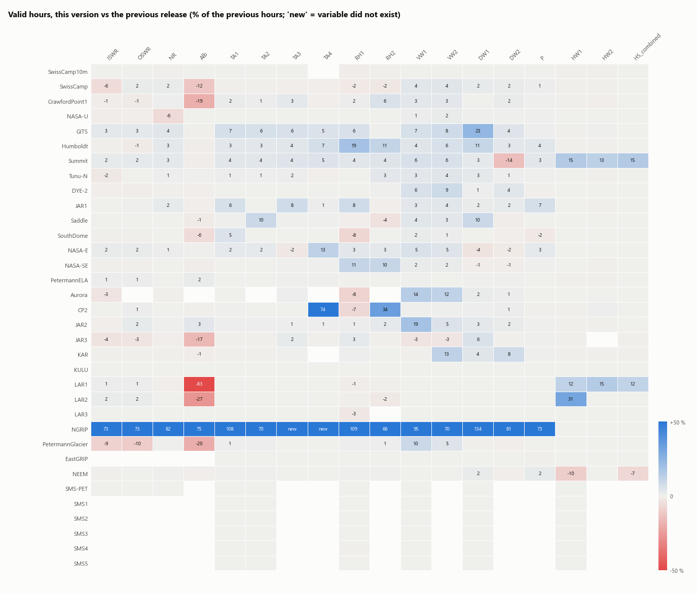

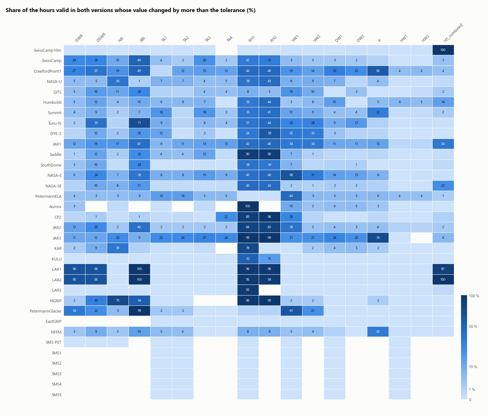

## Stations

| station | record before | record now | core hours before | now | change | gained | lost | modified | % of hours affected |
|---|---|---|---:|---:|---:|---:|---:|---:|---:|
| [SwissCamp10m](#swisscamp10m) | 1990-06-01 to 2020-11-03 | 1990-06-01 to 2020-11-03 | 2,428,496 | 2,426,674 | -0.1 % | 88 | 1,910 | 40,792 | 1.8 |
| [SwissCamp](#swisscamp) | 1995-01-01 to 2022-08-03 | 1995-01-01 to 2022-08-03 | 2,931,421 | 2,934,827 | +0.1 % | 58,280 | 54,874 | 299,042 | 13.8 |
| [CrawfordPoint1](#crawfordpoint1) | 1995-05-23 to 2020-07-22 | 1995-05-23 to 2020-07-22 | 2,527,797 | 2,549,867 | +0.9 % | 45,378 | 23,308 | 530,829 | 23.3 |
| [NASA-U](#nasa-u) | 1995-05-31 to 2023-06-18 | 1995-05-31 to 2023-06-18 | 2,739,881 | 2,745,832 | +0.2 % | 16,572 | 10,621 | 245,217 | 9.9 |
| [GITS](#gits) | 1995-06-07 to 2021-08-13 | 1995-06-07 to 2021-08-13 | 1,511,794 | 1,578,680 | +4.4 % | 74,114 | 7,228 | 83,918 | 10.4 |
| [Humboldt](#humboldt) | 1995-06-22 to 2023-06-30 | 1995-06-22 to 2023-06-30 | 2,634,872 | 2,739,018 | +4.0 % | 127,903 | 23,757 | 248,234 | 14.5 |
| [Summit](#summit) | 1996-05-13 to 2022-10-07 | 1996-05-13 to 2022-11-05 | 3,325,686 | 3,471,466 | +4.4 % | 202,379 | 56,599 | 381,335 | 18.1 |
| [Tunu-N](#tunu-n) | 1996-05-16 to 2023-06-20 | 1996-05-16 to 2023-06-20 | 3,114,998 | 3,147,571 | +1.0 % | 51,250 | 18,677 | 448,963 | 16.4 |
| [DYE-2](#dye-2) | 1996-05-24 to 2023-06-14 | 1996-05-24 to 2023-06-14 | 3,224,227 | 3,257,374 | +1.0 % | 41,552 | 8,405 | 330,346 | 11.6 |
| [JAR1](#jar1) | 1996-06-19 to 2019-09-08 | 1996-06-19 to 2019-09-08 | 2,549,064 | 2,613,300 | +2.5 % | 77,530 | 13,294 | 492,759 | 22.2 |
| [Saddle](#saddle) | 1997-04-20 to 2021-10-16 | 1997-04-20 to 2021-10-16 | 2,612,207 | 2,642,468 | +1.2 % | 45,076 | 14,815 | 246,972 | 11.5 |
| [SouthDome](#southdome) | 1997-04-23 to 2021-06-21 | 1997-04-23 to 2021-06-21 | 2,649,141 | 2,644,897 | -0.2 % | 28,190 | 32,434 | 167,427 | 8.5 |
| [NASA-E](#nasa-e) | 1997-05-03 to 2022-10-07 | 1997-05-03 to 2022-10-07 | 2,899,266 | 2,958,783 | +2.1 % | 87,748 | 28,231 | 477,995 | 19.9 |
| [NASA-SE](#nasa-se) | 1998-04-24 to 2019-09-26 | 1998-04-24 to 2019-09-26 | 2,433,481 | 2,467,662 | +1.4 % | 51,660 | 17,479 | 212,616 | 11.3 |
| [PetermannELA](#petermannela) | 2003-05-23 to 2022-04-12 | 2003-05-23 to 2022-04-12 | 1,100,982 | 1,105,322 | +0.4 % | 6,272 | 1,932 | 53,025 | 5.5 |
| [Aurora](#aurora) | 2000-06-24 to 2001-05-06 | 2000-06-24 to 2001-05-06 | 90,771 | 92,095 | +1.5 % | 2,198 | 874 | 7,409 | 11.3 |
| [CP2](#cp2) | 1997-05-13 to 2001-05-29 | 1997-05-12 to 2001-05-29 | 570,804 | 593,076 | +3.9 % | 25,112 | 2,840 | 67,484 | 16.0 |
| [JAR2](#jar2) | 1999-06-02 to 2013-06-16 | 1999-06-02 to 2013-05-16 | 1,347,691 | 1,375,693 | +2.1 % | 36,867 | 8,865 | 209,109 | 18.4 |
| [JAR3](#jar3) | 2000-05-28 to 2004-05-25 | 2000-05-29 to 2004-05-25 | 548,722 | 546,304 | -0.4 % | 4,544 | 6,962 | 169,165 | 32.7 |
| [KAR](#kar) | 1999-05-17 to 2001-06-07 | 1999-05-19 to 2001-06-07 | 264,648 | 268,642 | +1.5 % | 4,853 | 859 | 24,131 | 11.1 |
| [KULU](#kulu) | 1999-06-20 to 2000-09-14 | 1999-06-20 to 2000-09-14 | 105,930 | 105,930 | +0.0 % | 0 | 0 | 4,258 | 4.0 |
| [LAR1](#lar1) | 2008-12-23 to 2012-12-25 | 2008-12-23 to 2012-12-25 | 395,710 | 400,328 | +1.2 % | 9,729 | 5,111 | 97,867 | 27.8 |
| [LAR2](#lar2) | 2008-12-22 to 2011-11-15 | 2008-12-22 to 2011-11-15 | 322,528 | 326,714 | +1.3 % | 5,898 | 1,712 | 84,397 | 28.0 |
| [LAR3](#lar3) | 2009-08-10 to 2011-11-08 | 2009-08-10 to 2011-11-08 | 197,610 | 197,341 | -0.1 % | 81 | 350 | 11,848 | 6.2 |
| [NGRIP](#ngrip) | 2002-06-09 to 2010-05-08 | 1997-07-09 to 2010-05-08 | 743,895 | 1,269,175 | +70.6 % | 532,065 | 6,785 | 159,286 | 54.7 |
| [PetermannGlacier](#petermannglacier) | 2002-06-04 to 2006-05-01 | 2002-06-04 to 2006-05-05 | 520,565 | 521,197 | +0.1 % | 8,051 | 7,419 | 42,899 | 11.0 |
| [EastGRIP](#eastgrip) | 2014-05-17 to 2023-06-22 | 2014-05-17 to 2023-06-22 | 917,774 | 917,661 | -0.0 % | 0 | 113 | 0 | 0.0 |
| [NEEM](#neem) | 2006-03-29 to 2022-10-07 | 2006-03-29 to 2022-10-07 | 1,596,955 | 1,590,333 | -0.4 % | 7,151 | 13,773 | 61,327 | 5.1 |
| [SMS-PET](#sms-pet) | 2002-06-02 to 2004-05-14 | 2002-06-02 to 2004-05-14 | 151,486 | 151,486 | +0.0 % | 0 | 0 | 0 | 0.0 |
| [SMS1](#sms1) | 2002-01-01 to 2006-01-15 | 2002-01-01 to 2006-01-15 | 173,102 | 173,104 | +0.0 % | 2 | 0 | 0 | 0.0 |
| [SMS2](#sms2) | 2003-04-24 to 2006-05-10 | 2003-04-24 to 2006-05-10 | 151,551 | 151,551 | +0.0 % | 1 | 1 | 0 | 0.0 |
| [SMS3](#sms3) | 2001-05-22 to 2006-05-10 | 2001-05-22 to 2006-05-10 | 232,676 | 232,676 | +0.0 % | 0 | 0 | 0 | 0.0 |
| [SMS4](#sms4) | 2001-05-22 to 2003-04-27 | 2001-05-22 to 2003-04-27 | 101,248 | 101,219 | -0.0 % | 0 | 29 | 0 | 0.0 |
| [SMS5](#sms5) | 2002-09-20 to 2003-04-24 | 2002-09-20 to 2003-04-24 | 31,134 | 31,134 | +0.0 % | 0 | 0 | 0 | 0.0 |

## SwissCamp10m

Record 1990-06-01 to 2020-11-03 before, 1990-06-01 to 2020-11-03 now. Core variables: 2,428,496 -> 2,426,674 valid hours (-0.1 %); 1.8 % of the hours that exist in either version are gained, lost or modified.

| variable | unit | valid h before | now | change | gained | lost | modified | % of shared | shift of modified: median [5 %, 95 %] |
|---|---|---:|---:|---:|---:|---:|---:|---:|---|
| HS_combined | m | 40,669 | 40,669 | +0.0 % | 0 | 0 | 40,649 | 100.0 | +0.04 [+0.04, +0.05] |
| RH1 | % | 154,319 | 152,996 | -0.9 % | 21 | 1,344 | 0 | 0.0 | - |
| RH2 | % | 203,516 | 203,097 | -0.2 % | 21 | 440 | 0 | 0.0 | - |
| HW2 | m | 143,710 | 143,665 | -0.0 % | 0 | 45 | 18 | 0.0 | +0.04 [+0.03, +0.04] |
| NR | W/m^2 | 188,743 | 188,703 | -0.0 % | 8 | 48 | 1 | 0.0 | +1.64 [+1.64, +1.64] |
| HW1 | m | 145,361 | 145,329 | -0.0 % | 0 | 32 | 18 | 0.0 | +0.07 [+0.0585, +0.08] |
| P | mbar | 47,353 | 47,364 | +0.0 % | 11 | 0 | 13 | 0.0 | +48.2 [+48.2, +48.2] |
| TA2 | DegreesC | 47,749 | 47,764 | +0.0 % | 16 | 1 | 4 | 0.0 | +26.6 [+24, +30.6] |
| DW2 | Degrees | 152,018 | 152,018 | +0.0 % | 0 | 0 | 21 | 0.0 | +61.4 [+42.7, +66.6] |
| DW1 | Degrees | 216,499 | 216,506 | +0.0 % | 7 | 0 | 14 | 0.0 | +28.3 [+16.6, +94.9] |
| VW2 | m/s | 210,878 | 210,878 | +0.0 % | 0 | 0 | 21 | 0.0 | +3.74 [+3.49, +3.95] |
| VW1 | m/s | 225,173 | 225,173 | +0.0 % | 0 | 0 | 21 | 0.0 | +3.55 [+2.59, +4.49] |

10 other variables differ (derived, thermistors, humidity wrt ice or water...), most affected: HS1, HS2, RH1_wrt_ice_or_water, RH2_wrt_ice_or_water, VW10m, Q2; see `variable_summary.csv`.

## SwissCamp

Record 1995-01-01 to 2022-08-03 before, 1995-01-01 to 2022-08-03 now. Core variables: 2,931,421 -> 2,934,827 valid hours (+0.1 %); 13.8 % of the hours that exist in either version are gained, lost or modified.
Columns added: none; removed: OSWR_adj_flag.

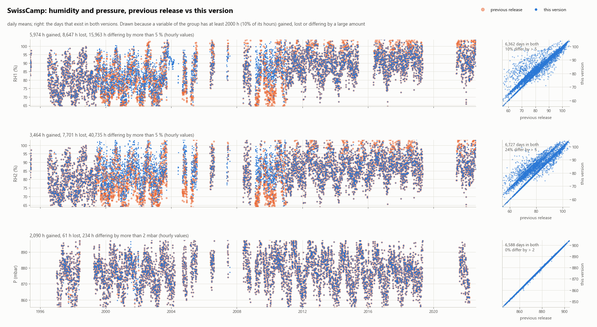

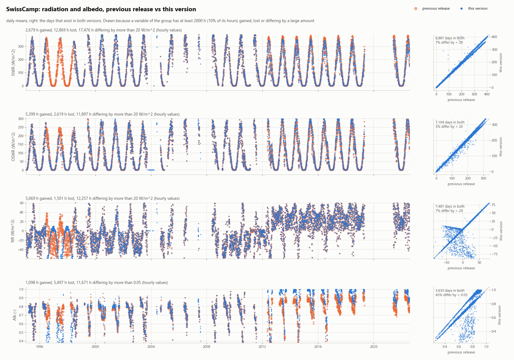

| variable | unit | valid h before | now | change | gained | lost | modified | % of shared | shift of modified: median [5 %, 95 %] |
|---|---|---:|---:|---:|---:|---:|---:|---:|---|
| RH1 | % | 165,808 | 163,135 | -1.6 % | 5,974 | 8,647 | 51,060 | 32.5 | +3.34 [-4.47, +15.8] |
| RH2 | % | 173,426 | 169,189 | -2.4 % | 3,464 | 7,701 | 51,994 | 31.4 | +6.67 [-2.1, +15.3] |
| ISWR | W/m^2 | 181,879 | 171,689 | -5.6 % | 2,679 | 12,869 | 40,710 | 24.1 | -12.2 [-45.4, +87] |
| OSWR | W/m^2 | 174,996 | 177,776 | +1.6 % | 5,399 | 2,619 | 44,141 | 25.6 | +9.9 [+1.24, +36.6] |
| TA3 | DegreesC | 177,087 | 175,887 | -0.7 % | 2,844 | 4,044 | 34,905 | 20.2 | -0.13 [-0.19, -0.1] |
| NR | W/m^2 | 183,360 | 186,928 | +1.9 % | 5,069 | 1,501 | 18,497 | 10.2 | +5.3 [-166, +65.4] |
| Alb | - | 36,289 | 31,890 | -12.1 % | 1,098 | 5,497 | 15,235 | 49.5 | +0.11 [-0.23, +0.13] |
| VW1 | m/s | 161,914 | 168,033 | +3.8 % | 6,356 | 237 | 7,537 | 4.7 | +0.15 [-1.16, +0.87] |
| TA1 | DegreesC | 167,985 | 167,887 | -0.1 % | 2,798 | 2,896 | 6,120 | 3.7 | +0.1 [-0.55, +0.54] |
| VW2 | m/s | 171,865 | 178,861 | +4.1 % | 7,042 | 46 | 4,572 | 2.7 | -0.12 [-1.06, +0.85] |
| TA4 | DegreesC | 167,145 | 165,948 | -0.7 % | 2,826 | 4,023 | 3,443 | 2.1 | -0.11 [-0.73, +0.75] |
| TA2 | DegreesC | 179,478 | 179,326 | -0.1 % | 2,792 | 2,944 | 3,352 | 1.9 | -0.11 [-0.71, +0.75] |

34 other variables differ (derived, thermistors, humidity wrt ice or water...), most affected: RH1_wrt_ice_or_water, RH2_wrt_ice_or_water, Q2, LHF, Q1, SHF; see `variable_summary.csv`.

## CrawfordPoint1

Record 1995-05-23 to 2020-07-22 before, 1995-05-23 to 2020-07-22 now. Core variables: 2,527,797 -> 2,549,867 valid hours (+0.9 %); 23.3 % of the hours that exist in either version are gained, lost or modified.
Columns added: none; removed: OSWR_adj_flag.

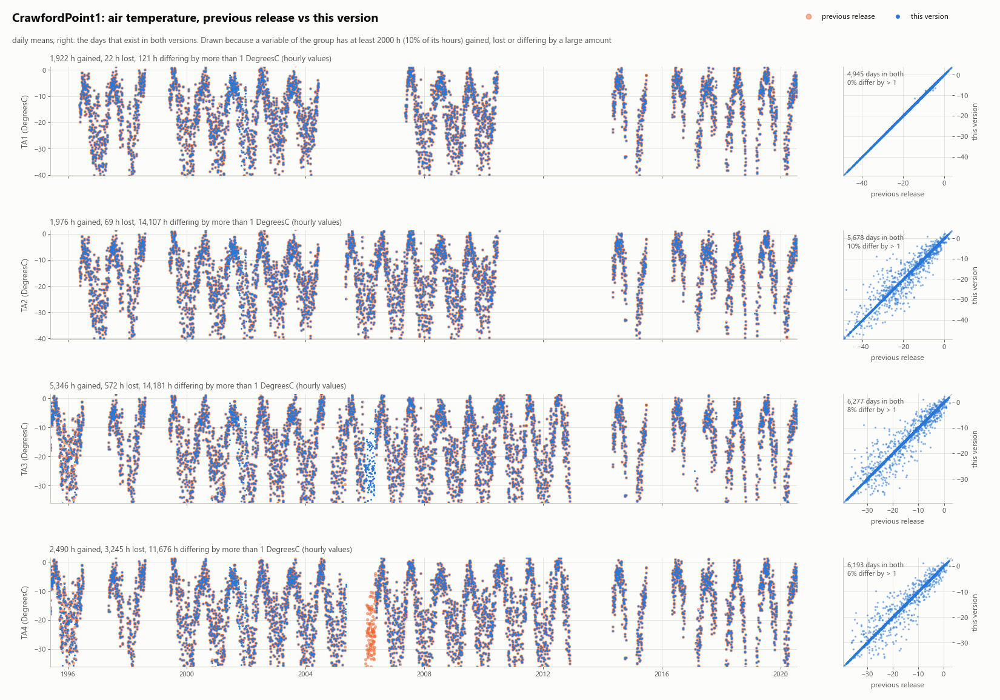

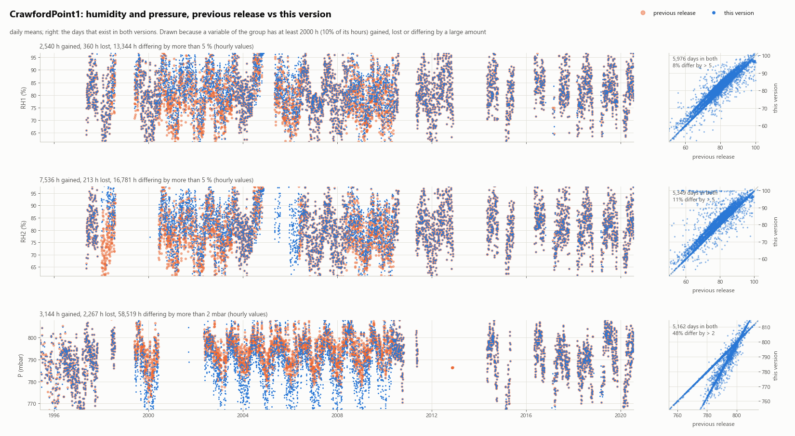

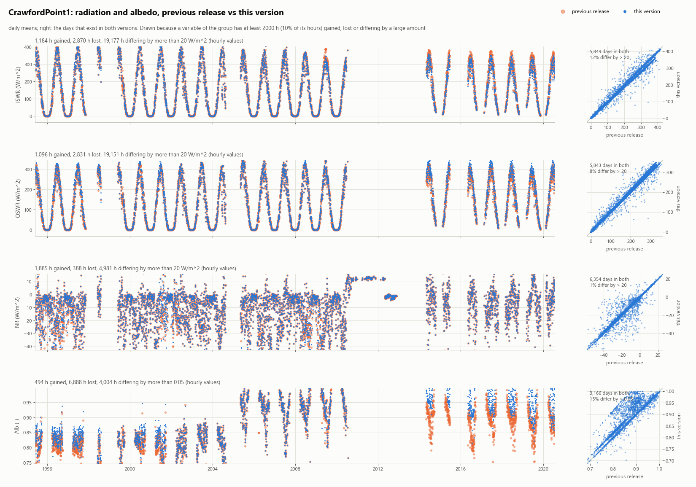

| variable | unit | valid h before | now | change | gained | lost | modified | % of shared | shift of modified: median [5 %, 95 %] |
|---|---|---:|---:|---:|---:|---:|---:|---:|---|
| P | mbar | 127,399 | 128,276 | +0.7 % | 3,144 | 2,267 | 72,834 | 58.2 | -5.35 [-15.9, +2.8] |
| RH1 | % | 144,932 | 147,112 | +1.5 % | 2,540 | 360 | 64,269 | 44.5 | +2.47 [-5.73, +8.7] |
| RH2 | % | 129,616 | 136,939 | +5.6 % | 7,536 | 213 | 59,346 | 45.9 | +3.05 [-5.89, +14.5] |
| OSWR | W/m^2 | 144,444 | 142,709 | -1.2 % | 1,096 | 2,831 | 52,902 | 37.4 | +9.81 [-44.6, +60.3] |
| ISWR | W/m^2 | 144,542 | 142,856 | -1.2 % | 1,184 | 2,870 | 38,865 | 27.4 | -11.5 [-87.4, +80.6] |
| DW1 | Degrees | 118,965 | 119,103 | +0.1 % | 1,312 | 1,174 | 35,147 | 29.8 | +8.5 [-84.5, +135] |
| VW1 | m/s | 155,477 | 160,722 | +3.4 % | 5,939 | 694 | 30,143 | 19.5 | +1.25 [-4.84, +6.81] |
| DW2 | Degrees | 129,958 | 132,091 | +1.6 % | 2,677 | 544 | 29,368 | 22.7 | +1.3 [-68.5, +65.7] |
| NR | W/m^2 | 155,267 | 156,764 | +1.0 % | 1,885 | 388 | 29,973 | 19.4 | +1.73 [-29.7, +28.7] |
| TA3 | DegreesC | 154,381 | 159,155 | +3.1 % | 5,346 | 572 | 22,890 | 14.9 | -0.15 [-7.97, +8.25] |
| VW2 | m/s | 158,710 | 164,141 | +3.4 % | 5,789 | 358 | 22,122 | 14.0 | -0.18 [-5.85, +6.02] |
| TA4 | DegreesC | 155,063 | 154,308 | -0.5 % | 2,490 | 3,245 | 19,311 | 12.7 | -0.12 [-7.98, +8.26] |

34 other variables differ (derived, thermistors, humidity wrt ice or water...), most affected: RH1_wrt_ice_or_water, RH2_wrt_ice_or_water, DTS6, DTS7, DTS1, DTS2; see `variable_summary.csv`.

## NASA-U

Record 1995-05-31 to 2023-06-18 before, 1995-05-31 to 2023-06-18 now. Core variables: 2,739,881 -> 2,745,832 valid hours (+0.2 %); 9.9 % of the hours that exist in either version are gained, lost or modified.
Columns added: none; removed: OSWR_adj_flag.

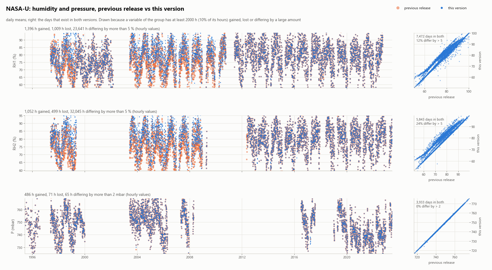

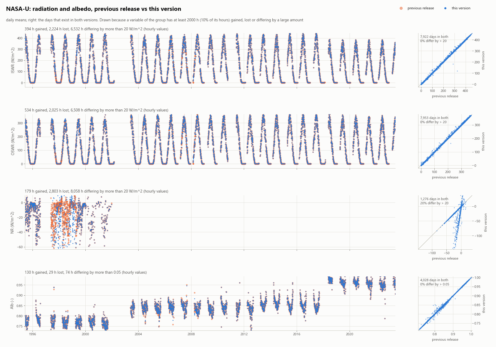

| variable | unit | valid h before | now | change | gained | lost | modified | % of shared | shift of modified: median [5 %, 95 %] |
|---|---|---:|---:|---:|---:|---:|---:|---:|---|
| RH1 | % | 181,813 | 182,200 | +0.2 % | 1,396 | 1,009 | 68,056 | 37.6 | +4.35 [-1.73, +6.9] |
| RH2 | % | 142,036 | 142,589 | +0.4 % | 1,052 | 499 | 60,393 | 42.7 | +5.1 [+1.06, +8.25] |
| VW2 | m/s | 176,987 | 180,405 | +1.9 % | 3,473 | 55 | 15,670 | 8.9 | +0.64 [-0.9, +2.77] |
| VW1 | m/s | 171,010 | 173,472 | +1.4 % | 3,310 | 848 | 13,682 | 8.0 | -0.1 [-1.26, +1.25] |
| NR | W/m^2 | 41,502 | 38,878 | -6.3 % | 179 | 2,803 | 13,879 | 35.9 | -20.2 [-177, +40.9] |
| DW1 | Degrees | 165,479 | 166,584 | +0.7 % | 1,880 | 775 | 12,343 | 7.5 | +1.4 [-14.5, +14.7] |
| TA1 | DegreesC | 171,702 | 172,042 | +0.2 % | 350 | 10 | 12,565 | 7.3 | +0.12 [-1.55, +1.53] |
| TA2 | DegreesC | 175,833 | 176,187 | +0.2 % | 360 | 6 | 12,447 | 7.1 | +0.12 [-1.51, +1.51] |
| OSWR | W/m^2 | 193,817 | 192,326 | -0.8 % | 534 | 2,025 | 9,413 | 4.9 | -1.57 [-76.9, +78.1] |
| ISWR | W/m^2 | 192,635 | 190,805 | -0.9 % | 394 | 2,224 | 8,997 | 4.7 | -3.6 [-99.4, +96] |
| TA3 | DegreesC | 143,041 | 143,500 | +0.3 % | 483 | 24 | 5,934 | 4.1 | +0.12 [-1.67, +1.54] |
| TA4 | DegreesC | 124,953 | 125,071 | +0.1 % | 152 | 34 | 5,844 | 4.7 | +0.13 [-1.63, +1.52] |

23 other variables differ (derived, thermistors, humidity wrt ice or water...), most affected: RH1_wrt_ice_or_water, RH2_wrt_ice_or_water, LHF, VW10m, Q2, Q1; see `variable_summary.csv`.

## GITS

Record 1995-06-07 to 2021-08-13 before, 1995-06-07 to 2021-08-13 now. Core variables: 1,511,794 -> 1,578,680 valid hours (+4.4 %); 10.4 % of the hours that exist in either version are gained, lost or modified.
Columns added: none; removed: OSWR_adj_flag.

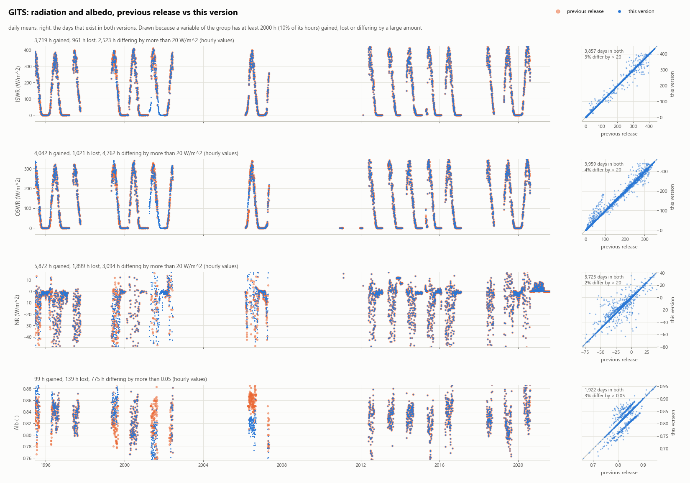

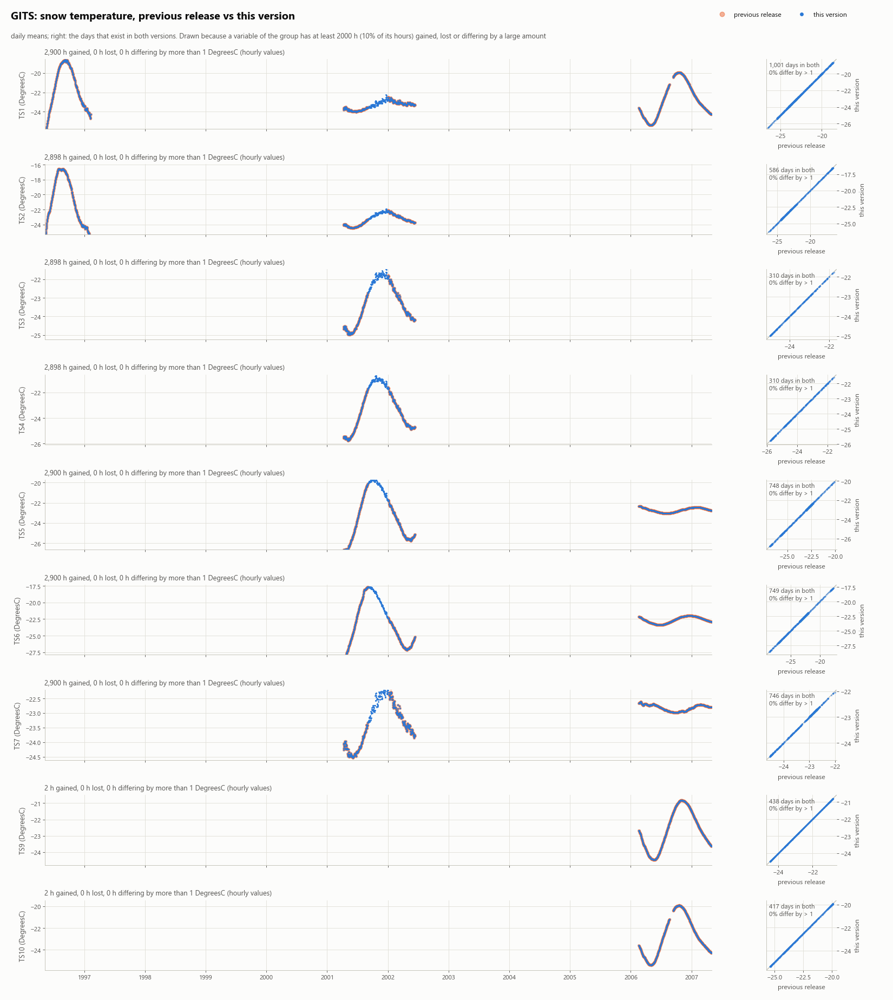

| variable | unit | valid h before | now | change | gained | lost | modified | % of shared | shift of modified: median [5 %, 95 %] |
|---|---|---:|---:|---:|---:|---:|---:|---:|---|
| VW1 | m/s | 97,414 | 103,747 | +6.5 % | 6,580 | 247 | 18,788 | 19.3 | -0.16 [-1.95, +2.23] |
| OSWR | W/m^2 | 98,589 | 101,610 | +3.1 % | 4,042 | 1,021 | 15,266 | 15.6 | -1.39 [-34.2, +82.6] |
| NR | W/m^2 | 96,866 | 100,839 | +4.1 % | 5,872 | 1,899 | 10,805 | 11.4 | +2.29 [-51.8, +72.3] |
| DW1 | Degrees | 75,707 | 93,476 | +23.5 % | 17,921 | 152 | 0 | 0.0 | - |
| VW2 | m/s | 56,656 | 61,436 | +8.4 % | 5,921 | 1,141 | 5,339 | 9.6 | -0.16 [-4.48, +5.64] |
| RH1 | % | 72,362 | 76,733 | +6.0 % | 4,460 | 89 | 5,848 | 8.1 | +2.65 [-0.657, +8.65] |
| ISWR | W/m^2 | 95,514 | 98,272 | +2.9 % | 3,719 | 961 | 4,329 | 4.6 | -3.26 [-123, +114] |
| TA3 | DegreesC | 83,761 | 88,873 | +6.1 % | 5,122 | 10 | 3,530 | 4.2 | -0.62 [-11.4, +8.21] |
| TA4 | DegreesC | 92,777 | 97,838 | +5.5 % | 5,068 | 7 | 3,575 | 3.9 | -0.57 [-11.5, +8.19] |
| DW2 | Degrees | 60,571 | 63,239 | +4.4 % | 3,753 | 1,085 | 2,051 | 3.4 | -1.9 [-10.8, +8.7] |
| TA1 | DegreesC | 70,180 | 74,986 | +6.8 % | 4,812 | 6 | 586 | 0.8 | -0.155 [-0.97, +0.725] |
| TA2 | DegreesC | 76,105 | 80,871 | +6.3 % | 4,772 | 6 | 603 | 0.8 | +0.1 [-0.817, +0.894] |

32 other variables differ (derived, thermistors, humidity wrt ice or water...), most affected: NR_cor, VW10m, RH1_wrt_ice_or_water, RH2_wrt_ice_or_water, TS6, TS7; see `variable_summary.csv`.

## Humboldt

Record 1995-06-22 to 2023-06-30 before, 1995-06-22 to 2023-06-30 now. Core variables: 2,634,872 -> 2,739,018 valid hours (+4.0 %); 14.5 % of the hours that exist in either version are gained, lost or modified.
Columns added: TA5; removed: OSWR_adj_flag.

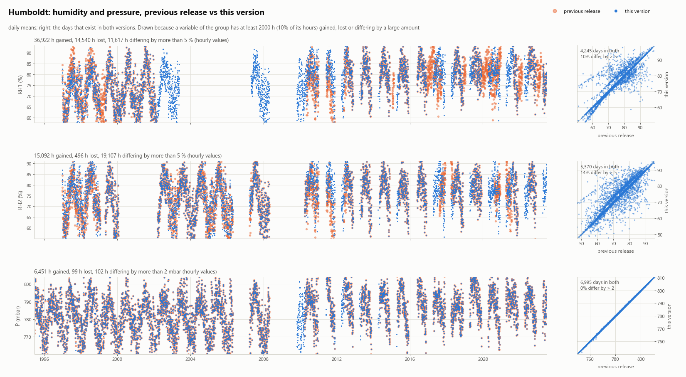

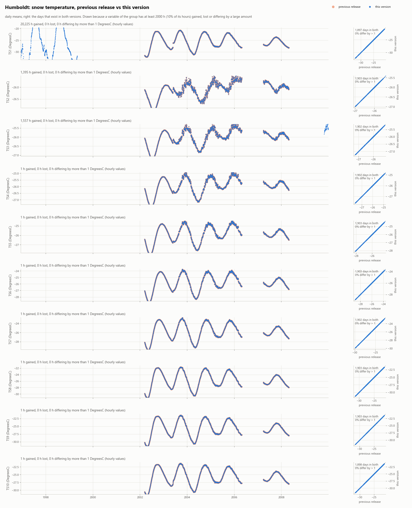

| variable | unit | valid h before | now | change | gained | lost | modified | % of shared | shift of modified: median [5 %, 95 %] |
|---|---|---:|---:|---:|---:|---:|---:|---:|---|
| RH1 | % | 117,094 | 139,476 | +19.1 % | 36,922 | 14,540 | 35,424 | 34.5 | -0.53 [-8.94, +18] |
| RH2 | % | 129,818 | 144,414 | +11.2 % | 15,092 | 496 | 57,197 | 44.2 | +2.12 [-12, +14.7] |
| HS_combined | m | 245,652 | 245,652 | +0.0 % | 0 | 0 | 34,454 | 14.0 | +0.04 [-0.14, +0.21] |
| DW1 | Degrees | 135,512 | 149,778 | +10.5 % | 14,428 | 162 | 19,733 | 14.6 | +32.8 [+23.5, +59.4] |
| OSWR | W/m^2 | 169,457 | 167,066 | -1.4 % | 277 | 2,668 | 19,437 | 11.7 | -1.38 [-35.2, +76.1] |
| VW2 | m/s | 163,690 | 173,537 | +6.0 % | 9,932 | 85 | 9,074 | 5.5 | +0.11 [-1.09, +1.08] |
| TA2 | DegreesC | 161,754 | 167,073 | +3.3 % | 5,387 | 68 | 9,439 | 5.8 | -0.1 [-1.47, +1.5] |
| P | mbar | 167,110 | 173,462 | +3.8 % | 6,451 | 99 | 8,344 | 5.0 | -0.1 [-0.8, +0.8] |
| TA1 | DegreesC | 160,524 | 165,878 | +3.3 % | 5,451 | 97 | 8,898 | 5.5 | +0.11 [-1.36, +1.37] |
| TA3 | DegreesC | 110,931 | 115,174 | +3.8 % | 4,631 | 388 | 8,172 | 7.4 | -0.12 [-1.58, +1.56] |
| ISWR | W/m^2 | 169,950 | 169,494 | -0.3 % | 2,041 | 2,497 | 7,983 | 4.8 | +7.2 [-80, +60.2] |
| NR | W/m^2 | 146,514 | 150,553 | +2.8 % | 4,454 | 415 | 6,423 | 4.4 | -1.04 [-21.3, +21.4] |

34 other variables differ (derived, thermistors, humidity wrt ice or water...), most affected: RH1_wrt_ice_or_water, RH2_wrt_ice_or_water, Q1, Q2, LHF, TS1; see `variable_summary.csv`.

## Summit

Record 1996-05-13 to 2022-10-07 before, 1996-05-13 to 2022-11-05 now. Core variables: 3,325,686 -> 3,471,466 valid hours (+4.4 %); 18.1 % of the hours that exist in either version are gained, lost or modified. Hourly rows: 231,425 before, 232,130 now, 231,425 in both.
Columns added: none; removed: OSWR_adj_flag.

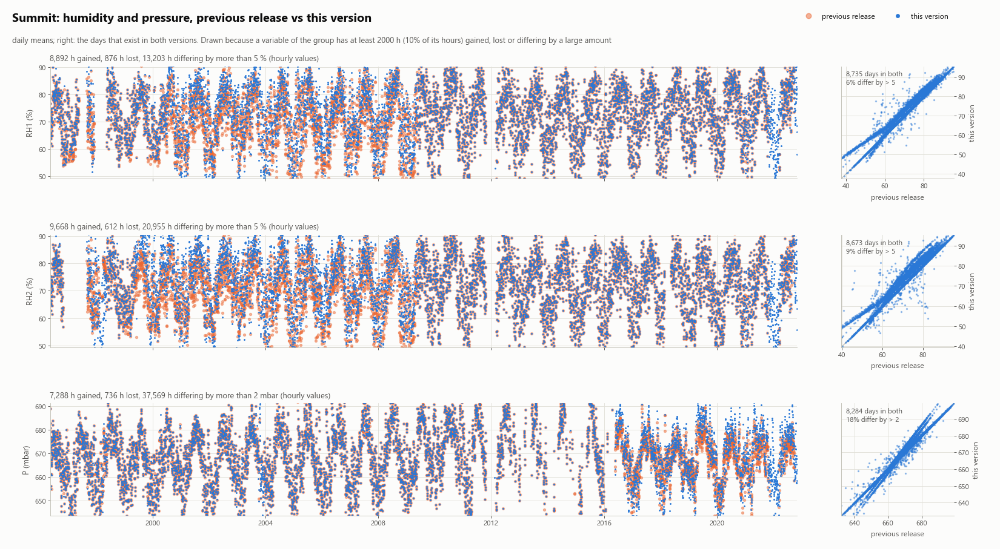

| variable | unit | valid h before | now | change | gained | lost | modified | % of shared | shift of modified: median [5 %, 95 %] |
|---|---|---:|---:|---:|---:|---:|---:|---:|---|
| RH2 | % | 209,754 | 218,810 | +4.3 % | 9,668 | 612 | 86,474 | 41.3 | +3.47 [-1.28, +8.64] |
| RH1 | % | 211,928 | 219,944 | +3.8 % | 8,892 | 876 | 74,835 | 35.5 | +3.07 [-1.5, +9.86] |
| P | mbar | 198,730 | 205,282 | +3.3 % | 7,288 | 736 | 62,460 | 31.5 | +1.38 [-4.67, +6.27] |
| TA1 | DegreesC | 211,880 | 219,488 | +3.6 % | 7,644 | 36 | 37,869 | 17.9 | +0.29 [+0.26, +0.31] |
| DW2 | Degrees | 199,405 | 170,572 | -14.5 % | 4,438 | 33,271 | 6,297 | 3.8 | +1.9 [-127, +122] |
| VW1 | m/s | 175,502 | 186,248 | +6.1 % | 14,385 | 3,639 | 20,403 | 11.9 | +0.25 [-4.54, +4.34] |
| VW2 | m/s | 191,936 | 203,693 | +6.1 % | 14,850 | 3,093 | 17,170 | 9.1 | +0.37 [-4.96, +4.66] |
| TA3 | DegreesC | 151,834 | 158,433 | +4.3 % | 7,060 | 461 | 27,185 | 18.0 | -0.36 [-2.25, +1.44] |
| HS_combined | m | 201,272 | 232,117 | +15.3 % | 30,845 | 0 | 3,197 | 1.6 | -0.02 [-0.13, +0.09] |
| DW1 | Degrees | 178,604 | 183,272 | +2.6 % | 13,884 | 9,216 | 6,404 | 3.8 | +1.8 [-126, +116] |
| OSWR | W/m^2 | 213,865 | 219,013 | +2.4 % | 6,788 | 1,640 | 18,281 | 8.6 | +6.98 [-57.2, +118] |
| HW1 | m | 171,603 | 197,758 | +15.2 % | 26,306 | 151 | 161 | 0.1 | -0.09 [-0.13, -0.05] |

35 other variables differ (derived, thermistors, humidity wrt ice or water...), most affected: RH2_wrt_ice_or_water, RH1_wrt_ice_or_water, LHF, SHF, HS2, VW10m; see `variable_summary.csv`.

## Tunu-N

Record 1996-05-16 to 2023-06-20 before, 1996-05-16 to 2023-06-20 now. Core variables: 3,114,998 -> 3,147,571 valid hours (+1.0 %); 16.4 % of the hours that exist in either version are gained, lost or modified.

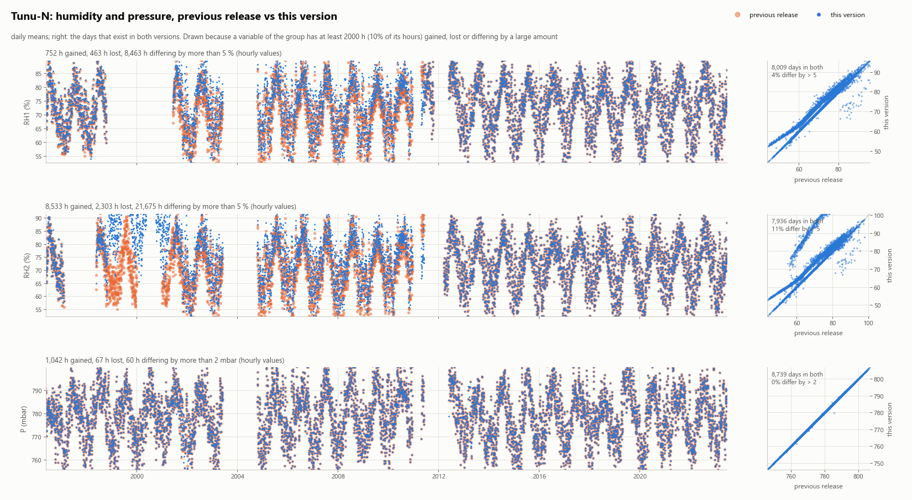

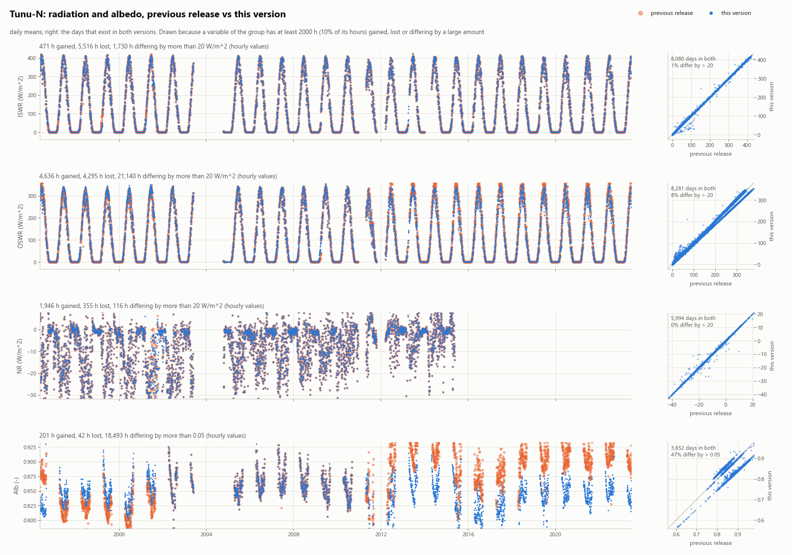

| variable | unit | valid h before | now | change | gained | lost | modified | % of shared | shift of modified: median [5 %, 95 %] |
|---|---|---:|---:|---:|---:|---:|---:|---:|---|
| RH2 | % | 193,960 | 200,190 | +3.2 % | 8,533 | 2,303 | 84,814 | 44.3 | +3.73 [-0.68, +24.4] |
| OSWR | W/m^2 | 208,884 | 209,225 | +0.2 % | 4,636 | 4,295 | 80,438 | 39.3 | -7.63 [-32.8, +14.1] |
| RH1 | % | 192,919 | 193,208 | +0.1 % | 752 | 463 | 70,800 | 36.8 | +3.15 [-0.87, +6.56] |
| VW2 | m/s | 209,013 | 217,548 | +4.1 % | 8,986 | 451 | 57,561 | 27.6 | +0.71 [+0.11, +2.16] |
| VW1 | m/s | 194,199 | 200,600 | +3.3 % | 6,705 | 304 | 49,242 | 25.4 | +0.13 [-0.42, +0.22] |
| Alb | - | 38,234 | 38,393 | +0.4 % | 201 | 42 | 26,971 | 70.6 | -0.06 [-0.06, +0.03] |
| DW1 | Degrees | 204,112 | 209,841 | +2.8 % | 6,164 | 435 | 19,316 | 9.5 | +4.9 [-7.7, +8.6] |
| DW2 | Degrees | 119,182 | 120,442 | +1.1 % | 2,153 | 893 | 19,692 | 16.6 | -4.8 [-8.6, +9.2] |
| TA1 | DegreesC | 202,971 | 205,537 | +1.3 % | 2,566 | 0 | 17,985 | 8.9 | +0.25 [+0.22, +0.27] |
| TA4 | DegreesC | 152,784 | 151,922 | -0.6 % | 2,578 | 3,440 | 6,105 | 4.1 | -0.35 [-3.76, +0.918] |
| TA3 | DegreesC | 140,184 | 142,288 | +1.5 % | 2,190 | 86 | 8,343 | 6.0 | +0.3 [-0.26, +0.72] |
| ISWR | W/m^2 | 207,096 | 202,051 | -2.4 % | 471 | 5,516 | 3,292 | 1.6 | +1.8 [-118, +107] |

35 other variables differ (derived, thermistors, humidity wrt ice or water...), most affected: RH2_wrt_ice_or_water, VW10m, SHF, RH1_wrt_ice_or_water, LHF, Q2; see `variable_summary.csv`.

## DYE-2

Record 1996-05-24 to 2023-06-14 before, 1996-05-24 to 2023-06-14 now. Core variables: 3,224,227 -> 3,257,374 valid hours (+1.0 %); 11.6 % of the hours that exist in either version are gained, lost or modified.
Columns added: none; removed: OSWR_adj_flag.

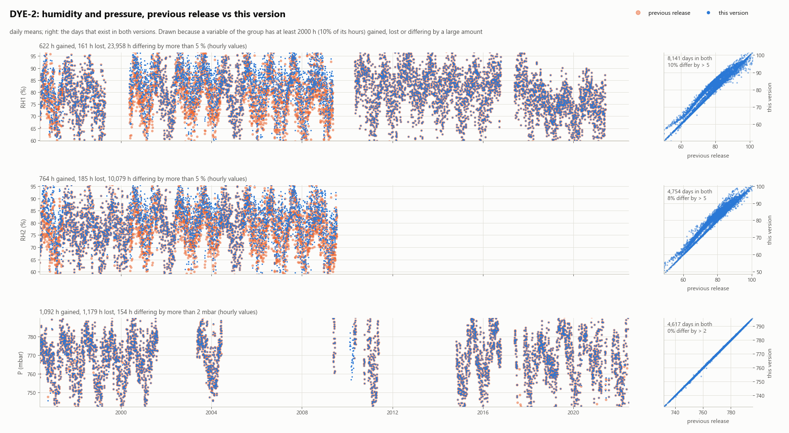

| variable | unit | valid h before | now | change | gained | lost | modified | % of shared | shift of modified: median [5 %, 95 %] |
|---|---|---:|---:|---:|---:|---:|---:|---:|---|
| VW1 | m/s | 206,471 | 218,850 | +6.0 % | 13,490 | 1,111 | 72,391 | 35.3 | -0.24 [-0.64, +0.69] |
| RH2 | % | 114,178 | 114,757 | +0.5 % | 764 | 185 | 67,337 | 59.1 | +3.89 [-0.612, +6.39] |
| RH1 | % | 195,339 | 195,800 | +0.2 % | 622 | 161 | 66,244 | 33.9 | +4.34 [-2.31, +6.65] |
| VW2 | m/s | 148,309 | 161,190 | +8.7 % | 13,625 | 744 | 48,481 | 32.9 | -0.3 [-0.8, -0.13] |
| TA1 | DegreesC | 223,571 | 223,641 | +0.0 % | 77 | 7 | 27,224 | 12.2 | -0.18 [-0.19, -0.16] |
| OSWR | W/m^2 | 209,764 | 207,917 | -0.9 % | 269 | 2,116 | 20,723 | 10.0 | +8.92 [+1.43, +51.5] |
| DW1 | Degrees | 204,982 | 207,301 | +1.1 % | 2,879 | 560 | 6,558 | 3.2 | +2.2 [-138, +144] |
| DW2 | Degrees | 200,459 | 207,856 | +3.7 % | 7,747 | 350 | 1,528 | 0.8 | -1.1 [-12.2, +12] |
| Alb | - | 46,656 | 46,460 | -0.4 % | 39 | 235 | 8,489 | 18.3 | +0.02 [+0.02, +0.08] |
| NR | W/m^2 | 185,082 | 184,726 | -0.2 % | 97 | 453 | 4,614 | 2.5 | +3.04 [+1.04, +20.9] |
| TA3 | DegreesC | 193,601 | 193,763 | +0.1 % | 178 | 16 | 4,623 | 2.4 | -0.1 [-0.1, -0.1] |
| P | mbar | 112,527 | 112,440 | -0.1 % | 1,092 | 1,179 | 681 | 0.6 | -0.5 [-3.4, +2.5] |

22 other variables differ (derived, thermistors, humidity wrt ice or water...), most affected: VW10m, RH2_wrt_ice_or_water, RH1_wrt_ice_or_water, SHF, LHF, Q2; see `variable_summary.csv`.

## JAR1

Record 1996-06-19 to 2019-09-08 before, 1996-06-19 to 2019-09-08 now. Core variables: 2,549,064 -> 2,613,300 valid hours (+2.5 %); 22.2 % of the hours that exist in either version are gained, lost or modified.
Columns added: P_adj_flag; removed: OSWR_adj_flag.

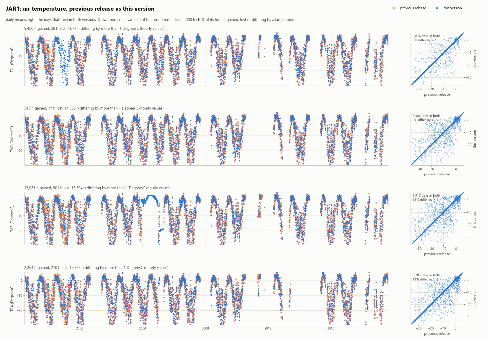

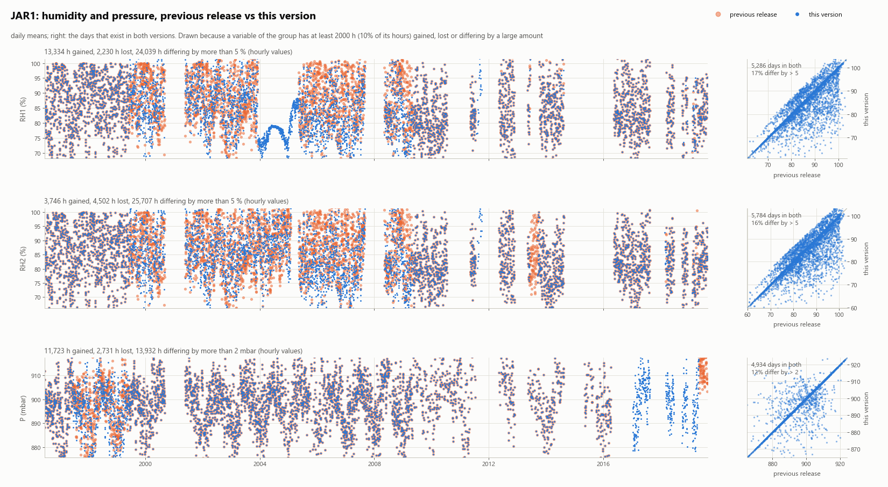

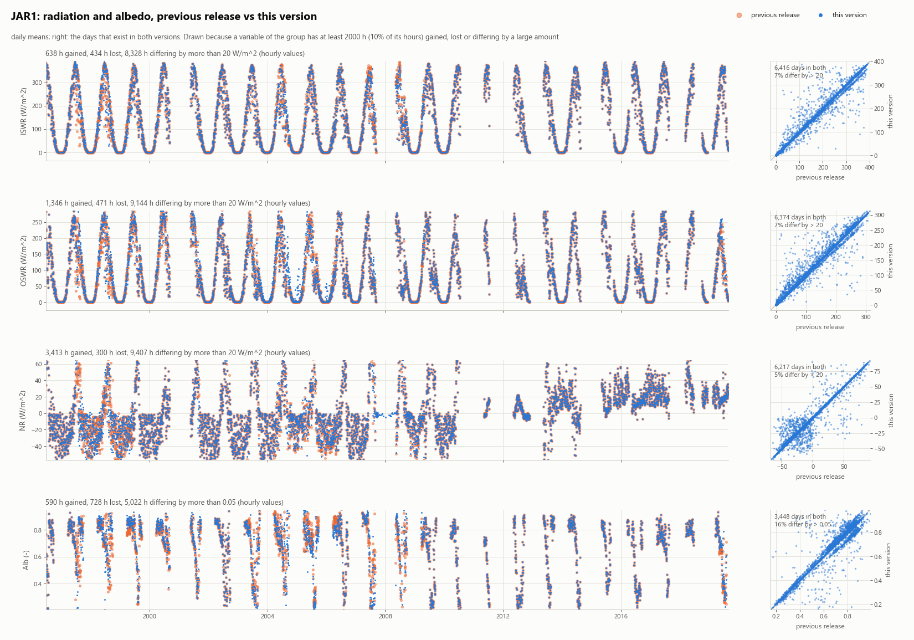

| variable | unit | valid h before | now | change | gained | lost | modified | % of shared | shift of modified: median [5 %, 95 %] |
|---|---|---:|---:|---:|---:|---:|---:|---:|---|
| RH2 | % | 145,684 | 144,928 | -0.5 % | 3,746 | 4,502 | 65,283 | 46.2 | -1.28 [-16.7, +6.17] |
| RH1 | % | 131,422 | 142,526 | +8.4 % | 13,334 | 2,230 | 54,301 | 42.0 | -1.77 [-17.4, +6.85] |
| HS_combined | m | 200,519 | 200,519 | +0.0 % | 0 | 0 | 68,776 | 34.3 | +0.09 [+0.04, +0.25] |
| VW1 | m/s | 154,811 | 159,802 | +3.2 % | 5,300 | 309 | 53,024 | 34.3 | -0.14 [-4.26, +4.26] |
| VW2 | m/s | 155,608 | 161,249 | +3.6 % | 5,646 | 5 | 52,271 | 33.6 | -0.15 [-4.43, +4.52] |
| TA3 | DegreesC | 144,084 | 156,264 | +8.5 % | 13,081 | 901 | 18,818 | 13.1 | -0.2 [-14.6, +14.7] |
| P | mbar | 131,267 | 140,259 | +6.9 % | 11,723 | 2,731 | 16,273 | 12.7 | -1.6 [-24.1, +21.2] |
| NR | W/m^2 | 153,003 | 156,116 | +2.0 % | 3,413 | 300 | 26,598 | 17.4 | +1.99 [-52.4, +53.4] |
| OSWR | W/m^2 | 153,082 | 153,957 | +0.6 % | 1,346 | 471 | 28,345 | 18.6 | +2.95 [-47.6, +104] |
| TA4 | DegreesC | 140,244 | 142,298 | +1.5 % | 2,264 | 210 | 18,153 | 13.0 | -0.56 [-14.9, +14.8] |
| DW2 | Degrees | 158,469 | 161,879 | +2.2 % | 3,419 | 9 | 16,846 | 10.6 | -3.7 [-81.3, +77.7] |
| DW1 | Degrees | 155,117 | 157,703 | +1.7 % | 2,893 | 307 | 16,876 | 10.9 | -4.6 [-80.2, +76.7] |

33 other variables differ (derived, thermistors, humidity wrt ice or water...), most affected: RH2_wrt_ice_or_water, RH1_wrt_ice_or_water, Q1, Q2, VW10m, LHF; see `variable_summary.csv`.

## Saddle

Record 1997-04-20 to 2021-10-16 before, 1997-04-20 to 2021-10-16 now. Core variables: 2,612,207 -> 2,642,468 valid hours (+1.2 %); 11.5 % of the hours that exist in either version are gained, lost or modified.
Columns added: none; removed: OSWR_adj_flag.

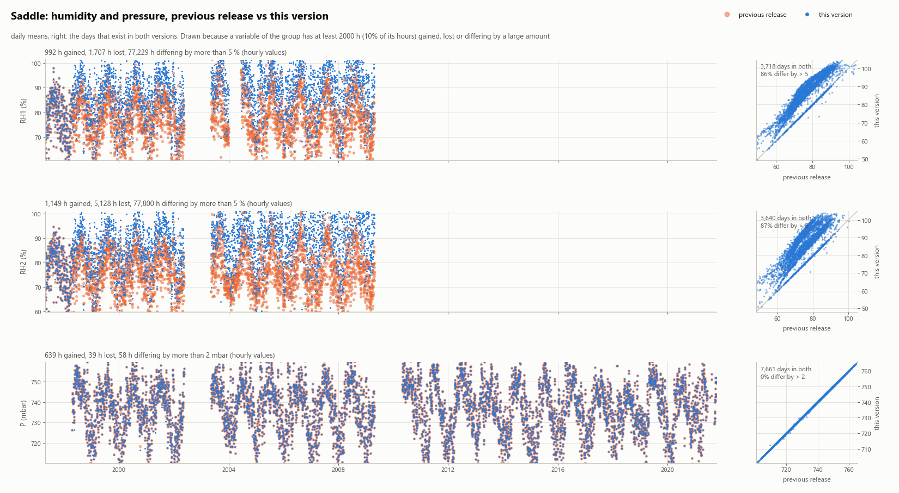

| variable | unit | valid h before | now | change | gained | lost | modified | % of shared | shift of modified: median [5 %, 95 %] |
|---|---|---:|---:|---:|---:|---:|---:|---:|---|
| RH2 | % | 95,463 | 91,484 | -4.2 % | 1,149 | 5,128 | 81,536 | 90.3 | +11.6 [+5.01, +19.7] |
| RH1 | % | 91,857 | 91,142 | -0.8 % | 992 | 1,707 | 81,388 | 90.3 | +10.1 [+4.58, +15.4] |
| OSWR | W/m^2 | 191,104 | 191,179 | +0.0 % | 314 | 239 | 22,684 | 11.9 | +9.02 [+1.35, +67.7] |
| TA3 | DegreesC | 179,606 | 180,420 | +0.5 % | 875 | 61 | 21,802 | 12.1 | -0.21 [-0.21, -0.2] |
| TA2 | DegreesC | 152,885 | 167,605 | +9.6 % | 14,726 | 6 | 6,066 | 4.0 | -0.24 [-1.53, +0.5] |
| VW1 | m/s | 142,026 | 147,495 | +3.9 % | 7,739 | 2,270 | 9,366 | 6.7 | +0.44 [-2.88, +2.39] |
| VW2 | m/s | 169,010 | 174,320 | +3.1 % | 7,550 | 2,240 | 1,967 | 1.2 | -0.19 [-2.48, +1.89] |
| Alb | - | 40,409 | 39,918 | -1.2 % | 236 | 727 | 8,927 | 22.5 | +0.02 [+0.02, +0.03] |
| DW1 | Degrees | 72,637 | 79,717 | +9.7 % | 7,602 | 522 | 243 | 0.3 | -1.5 [-20.7, +8.28] |
| TA1 | DegreesC | 139,873 | 140,470 | +0.4 % | 769 | 172 | 6,124 | 4.4 | +0.24 [-0.52, +1.56] |
| NR | W/m^2 | 191,465 | 192,108 | +0.3 % | 837 | 194 | 2,887 | 1.5 | +1.96 [-16.8, +15.8] |
| ISWR | W/m^2 | 191,108 | 191,213 | +0.1 % | 303 | 198 | 2,468 | 1.3 | +6.2 [-188, +80.9] |

29 other variables differ (derived, thermistors, humidity wrt ice or water...), most affected: RH2_wrt_ice_or_water, RH1_wrt_ice_or_water, Q2, Q1, LHF, SHF; see `variable_summary.csv`.

## SouthDome

Record 1997-04-23 to 2021-06-21 before, 1997-04-23 to 2021-06-21 now. Core variables: 2,649,141 -> 2,644,897 valid hours (-0.2 %); 8.5 % of the hours that exist in either version are gained, lost or modified.
Columns added: none; removed: OSWR_adj_flag.

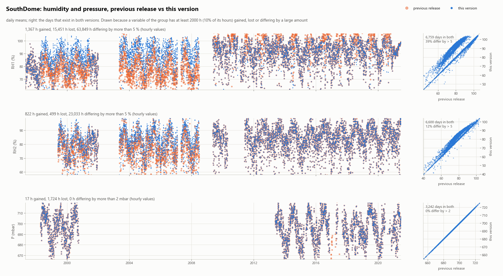

| variable | unit | valid h before | now | change | gained | lost | modified | % of shared | shift of modified: median [5 %, 95 %] |
|---|---|---:|---:|---:|---:|---:|---:|---:|---|
| RH1 | % | 186,401 | 172,317 | -7.6 % | 1,367 | 15,451 | 65,327 | 38.2 | +11.6 [+7.02, +16.8] |
| RH2 | % | 159,437 | 159,760 | +0.2 % | 822 | 499 | 56,649 | 35.6 | +4.47 [+0.83, +8.34] |
| OSWR | W/m^2 | 181,107 | 180,875 | -0.1 % | 630 | 862 | 18,069 | 10.0 | +9.88 [+1.52, +64.6] |
| VW1 | m/s | 130,871 | 133,118 | +1.7 % | 5,354 | 3,107 | 8,527 | 6.7 | -1.24 [-7.1, +2.25] |
| Alb | - | 39,384 | 37,094 | -5.8 % | 51 | 2,341 | 9,054 | 24.4 | +0.02 [-0.03, +0.03] |
| TA1 | DegreesC | 172,484 | 181,889 | +5.5 % | 9,407 | 2 | 6 | 0.0 | +0.225 [-3.59, +3.91] |
| DW1 | Degrees | 129,422 | 129,613 | +0.1 % | 4,090 | 3,899 | 1,051 | 0.8 | +1.3 [-21.2, +20.2] |
| ISWR | W/m^2 | 174,825 | 174,168 | -0.4 % | 114 | 771 | 5,890 | 3.4 | +5.14 [-153, +23.5] |
| DW2 | Degrees | 112,019 | 111,511 | -0.5 % | 2,178 | 2,686 | 1,249 | 1.1 | +1.2 [-18.7, +21.2] |
| VW2 | m/s | 155,632 | 157,866 | +1.4 % | 3,223 | 989 | 682 | 0.4 | -0.24 [-2.12, +0.84] |
| P | mbar | 79,340 | 77,633 | -2.2 % | 17 | 1,724 | 0 | 0.0 | - |
| HS_combined | m | 205,458 | 205,458 | +0.0 % | 0 | 0 | 591 | 0.3 | -0.02 [-0.03, -0.02] |

35 other variables differ (derived, thermistors, humidity wrt ice or water...), most affected: RH1_wrt_ice_or_water, RH2_wrt_ice_or_water, V, Q1, VW10m, LHF; see `variable_summary.csv`.

## NASA-E

Record 1997-05-03 to 2022-10-07 before, 1997-05-03 to 2022-10-07 now. Core variables: 2,899,266 -> 2,958,783 valid hours (+2.1 %); 19.9 % of the hours that exist in either version are gained, lost or modified.
Columns added: none; removed: OSWR_adj_flag.

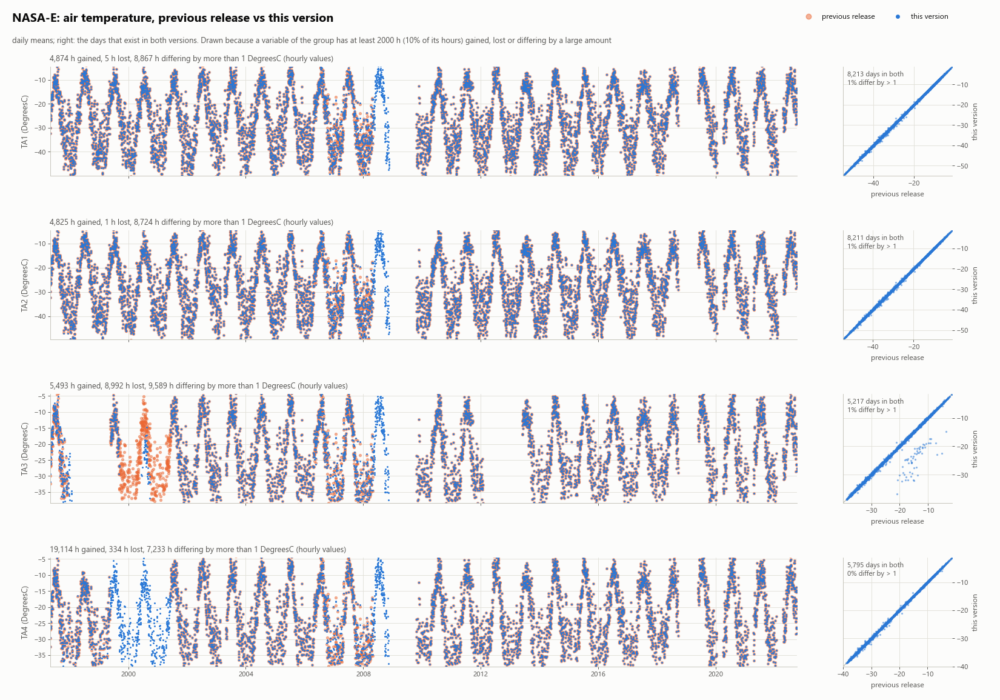

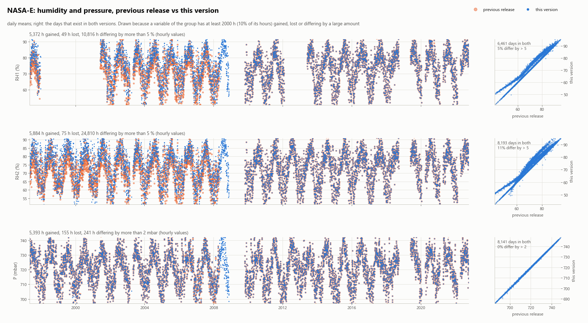

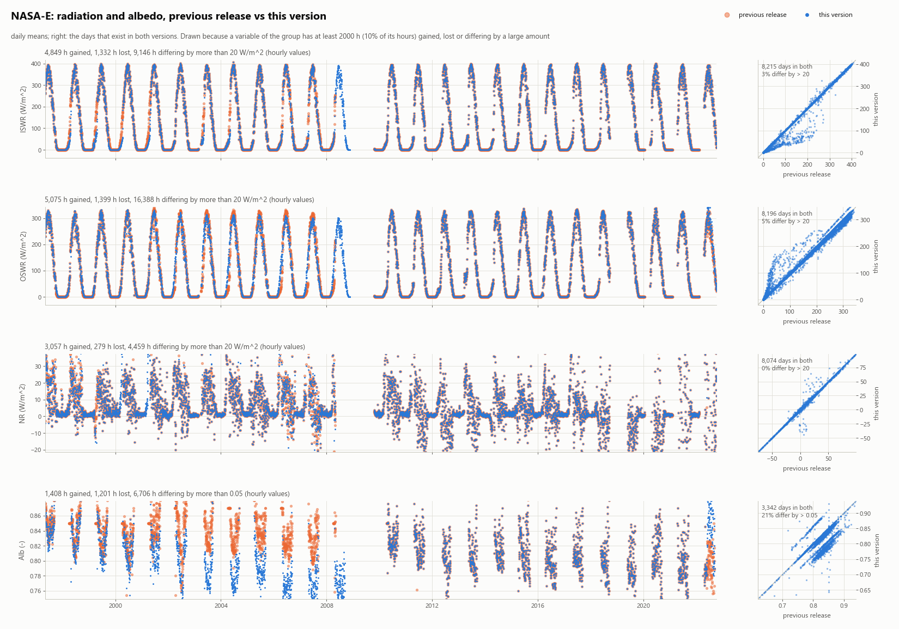

| variable | unit | valid h before | now | change | gained | lost | modified | % of shared | shift of modified: median [5 %, 95 %] |
|---|---|---:|---:|---:|---:|---:|---:|---:|---|
| RH2 | % | 197,074 | 202,883 | +2.9 % | 5,884 | 75 | 89,793 | 45.6 | +3.07 [+0.69, +6.85] |
| VW1 | m/s | 112,091 | 118,229 | +5.5 % | 9,869 | 3,731 | 71,406 | 65.9 | -0.39 [-1.78, +0.72] |
| RH1 | % | 155,560 | 160,883 | +3.4 % | 5,372 | 49 | 62,307 | 40.1 | +3.82 [+1, +7.49] |
| VW2 | m/s | 175,820 | 184,034 | +4.7 % | 9,709 | 1,495 | 54,732 | 31.4 | -0.32 [-1.71, +1.67] |
| OSWR | W/m^2 | 196,985 | 200,661 | +1.9 % | 5,075 | 1,399 | 47,587 | 24.3 | -3.53 [-65.4, +87.7] |
| TA3 | DegreesC | 142,226 | 138,727 | -2.5 % | 5,493 | 8,992 | 20,284 | 15.2 | +0.5 [-12.1, +2.45] |
| TA4 | DegreesC | 147,610 | 166,390 | +12.7 % | 19,114 | 334 | 13,317 | 9.0 | +0.15 [-2.87, +2.72] |
| DW1 | Degrees | 115,713 | 111,208 | -3.9 % | 1,351 | 5,856 | 15,291 | 13.9 | -2.8 [-9.4, +21.9] |
| TA2 | DegreesC | 198,025 | 202,849 | +2.4 % | 4,825 | 1 | 16,730 | 8.4 | +0.17 [-2.91, +2.66] |
| TA1 | DegreesC | 197,926 | 202,795 | +2.5 % | 4,874 | 5 | 16,582 | 8.4 | +0.17 [-3.04, +2.76] |
| DW2 | Degrees | 126,769 | 124,858 | -1.5 % | 1,412 | 3,323 | 15,705 | 12.7 | +2.8 [-22.2, +10.1] |
| P | mbar | 193,593 | 198,831 | +2.7 % | 5,393 | 155 | 14,781 | 7.6 | -0.1 [-1.1, +1.1] |

34 other variables differ (derived, thermistors, humidity wrt ice or water...), most affected: RH2_wrt_ice_or_water, VW10m, RH1_wrt_ice_or_water, SHF, LHF, Q2; see `variable_summary.csv`.

## NASA-SE

Record 1998-04-24 to 2019-09-26 before, 1998-04-24 to 2019-09-26 now. Core variables: 2,433,481 -> 2,467,662 valid hours (+1.4 %); 11.3 % of the hours that exist in either version are gained, lost or modified.
Columns added: none; removed: OSWR_adj_flag.

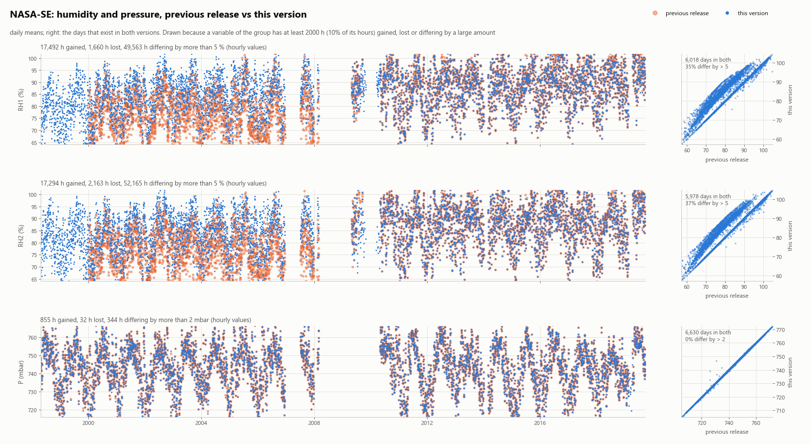

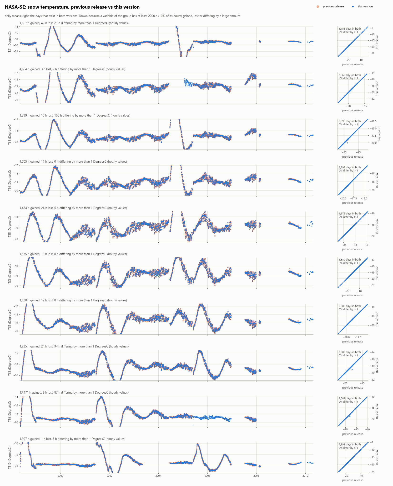

| variable | unit | valid h before | now | change | gained | lost | modified | % of shared | shift of modified: median [5 %, 95 %] |
|---|---|---:|---:|---:|---:|---:|---:|---:|---|
| RH2 | % | 148,009 | 163,140 | +10.2 % | 17,294 | 2,163 | 63,069 | 43.2 | +6.59 [+3.05, +10.2] |
| RH1 | % | 148,095 | 163,927 | +10.7 % | 17,492 | 1,660 | 63,162 | 43.1 | +6.53 [+2.08, +11.1] |
| HS_combined | m | 187,787 | 187,787 | +0.0 % | 0 | 0 | 40,448 | 21.5 | -0.02 [-0.02, +0.03] |
| OSWR | W/m^2 | 161,705 | 161,374 | -0.2 % | 189 | 520 | 16,301 | 10.1 | -3.75 [-16.2, +62.2] |
| NR | W/m^2 | 164,480 | 164,488 | +0.0 % | 146 | 138 | 12,850 | 7.8 | +2.49 [+1.07, +8.69] |
| DW1 | Degrees | 129,910 | 128,552 | -1.0 % | 3,207 | 4,565 | 2,135 | 1.7 | -1.6 [-129, +30.7] |
| DW2 | Degrees | 148,509 | 147,019 | -1.0 % | 2,230 | 3,720 | 2,299 | 1.6 | +1.1 [-101, +70.4] |
| VW2 | m/s | 144,021 | 146,797 | +1.9 % | 4,656 | 1,880 | 1,458 | 1.0 | -0.49 [-6.43, +0.732] |
| VW1 | m/s | 83,934 | 85,492 | +1.9 % | 3,383 | 1,825 | 1,350 | 1.6 | -0.26 [-6.25, +1.2] |
| Alb | - | 36,114 | 35,777 | -0.9 % | 45 | 382 | 6,042 | 16.9 | -0.02 [-0.03, -0.02] |
| P | mbar | 157,811 | 158,634 | +0.5 % | 855 | 32 | 1,396 | 0.9 | -0.4 [-3.3, +8.6] |
| ISWR | W/m^2 | 159,913 | 159,649 | -0.2 % | 163 | 427 | 1,366 | 0.9 | +9 [-181, +59.2] |

33 other variables differ (derived, thermistors, humidity wrt ice or water...), most affected: RH2_wrt_ice_or_water, RH1_wrt_ice_or_water, Q2, Q1, LHF, HS2; see `variable_summary.csv`.

## PetermannELA

Record 2003-05-23 to 2022-04-12 before, 2003-05-23 to 2022-04-12 now. Core variables: 1,100,982 -> 1,105,322 valid hours (+0.4 %); 5.5 % of the hours that exist in either version are gained, lost or modified.
Columns added: TA5; removed: none.

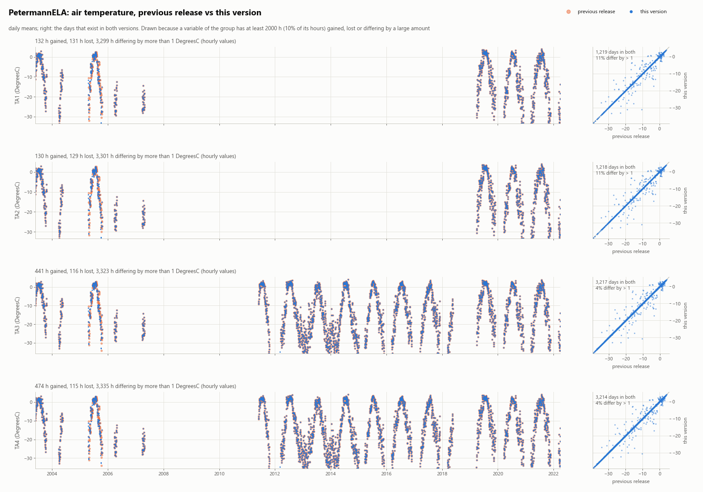

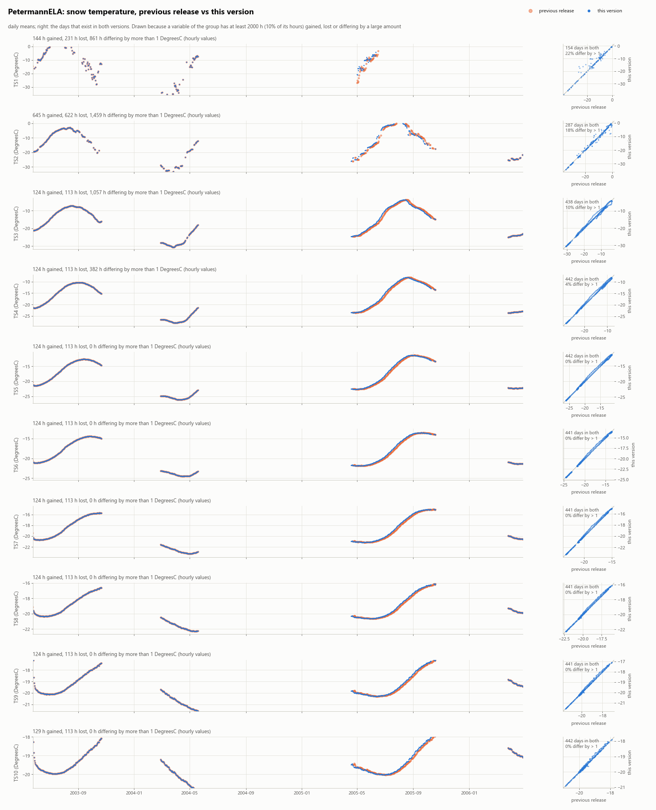

| variable | unit | valid h before | now | change | gained | lost | modified | % of shared | shift of modified: median [5 %, 95 %] |
|---|---|---:|---:|---:|---:|---:|---:|---:|---|
| VW1 | m/s | 11,060 | 11,109 | +0.4 % | 188 | 139 | 4,853 | 44.4 | +0.71 [-5.09, +4.91] |
| DW2 | Degrees | 73,596 | 74,047 | +0.6 % | 628 | 177 | 3,850 | 5.2 | -1.4 [-75.7, +76.3] |
| TA4 | DegreesC | 76,566 | 76,925 | +0.5 % | 474 | 115 | 4,062 | 5.3 | -0.36 [-8.99, +9.37] |
| OSWR | W/m^2 | 74,507 | 75,455 | +1.3 % | 1,101 | 153 | 3,361 | 4.5 | +42.2 [-167, +273] |
| TA3 | DegreesC | 76,587 | 76,912 | +0.4 % | 441 | 116 | 4,055 | 5.3 | -0.36 [-9.04, +9.51] |
| DW1 | Degrees | 74,443 | 74,803 | +0.5 % | 521 | 161 | 3,912 | 5.3 | -1.3 [-76.6, +78.7] |
| VW2 | m/s | 74,015 | 74,119 | +0.1 % | 243 | 139 | 4,058 | 5.5 | +0.12 [-5.48, +5.47] |
| P | mbar | 68,114 | 68,137 | +0.0 % | 187 | 164 | 3,983 | 5.9 | -0.6 [-13.9, +14.4] |
| TA2 | DegreesC | 28,189 | 28,190 | +0.0 % | 130 | 129 | 4,040 | 14.4 | -0.37 [-8.88, +9.32] |
| TA1 | DegreesC | 28,204 | 28,205 | +0.0 % | 132 | 131 | 4,034 | 14.4 | -0.37 [-9, +9.49] |
| ISWR | W/m^2 | 74,657 | 75,646 | +1.3 % | 1,102 | 113 | 2,958 | 4.0 | +74 [-222, +344] |
| NR | W/m^2 | 77,340 | 77,421 | +0.1 % | 194 | 113 | 3,643 | 4.7 | -1.14 [-15.9, +15.3] |

32 other variables differ (derived, thermistors, humidity wrt ice or water...), most affected: TS3, TS4, V, NR_cor, TS2, TS5; see `variable_summary.csv`.

## Aurora

Record 2000-06-24 to 2001-05-06 before, 2000-06-24 to 2001-05-06 now. Core variables: 90,771 -> 92,095 valid hours (+1.5 %); 11.3 % of the hours that exist in either version are gained, lost or modified.

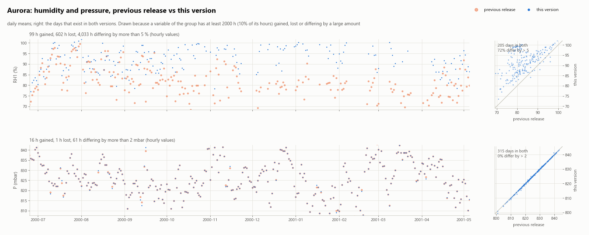

| variable | unit | valid h before | now | change | gained | lost | modified | % of shared | shift of modified: median [5 %, 95 %] |
|---|---|---:|---:|---:|---:|---:|---:|---:|---|
| RH1 | % | 6,026 | 5,523 | -8.3 % | 99 | 602 | 5,403 | 99.6 | +6.6 [+1.96, +21.3] |
| VW1 | m/s | 6,604 | 7,546 | +14.3 % | 946 | 4 | 666 | 10.1 | +0.26 [-2.57, +0.907] |
| VW2 | m/s | 6,711 | 7,548 | +12.5 % | 839 | 2 | 217 | 3.2 | -0.25 [-1.7, +0.488] |
| DW2 | Degrees | 7,444 | 7,543 | +1.3 % | 108 | 9 | 364 | 4.9 | +1.4 [-8.58, +24.4] |
| DW1 | Degrees | 7,417 | 7,545 | +1.7 % | 129 | 1 | 328 | 4.4 | +0 [-12.5, +12] |
| ISWR | W/m^2 | 7,356 | 7,125 | -3.1 % | 0 | 231 | 204 | 2.9 | +11.6 [+6.6, +19.8] |
| P | mbar | 7,532 | 7,547 | +0.2 % | 16 | 1 | 205 | 2.7 | -0.8 [-6.34, +3.08] |
| TA3 | DegreesC | 3,846 | 3,884 | +1.0 % | 61 | 23 | 6 | 0.2 | +6.74 [-1.95, +19.6] |
| NR | W/m^2 | 7,571 | 7,570 | -0.0 % | 0 | 1 | 15 | 0.2 | -56.7 [-102, +2.12] |
| TA1 | DegreesC | 7,551 | 7,551 | +0.0 % | 0 | 0 | 1 | 0.0 | -1.93 [-1.93, -1.93] |

5 other variables differ (derived, thermistors, humidity wrt ice or water...), most affected: RH1_wrt_ice_or_water, Q1, VW10m, V, NR_cor; see `variable_summary.csv`.

## CP2

Record 1997-05-13 to 2001-05-29 before, 1997-05-12 to 2001-05-29 now. Core variables: 570,804 -> 593,076 valid hours (+3.9 %); 16.0 % of the hours that exist in either version are gained, lost or modified. Hourly rows: 35,450 before, 35,486 now, 35,450 in both.

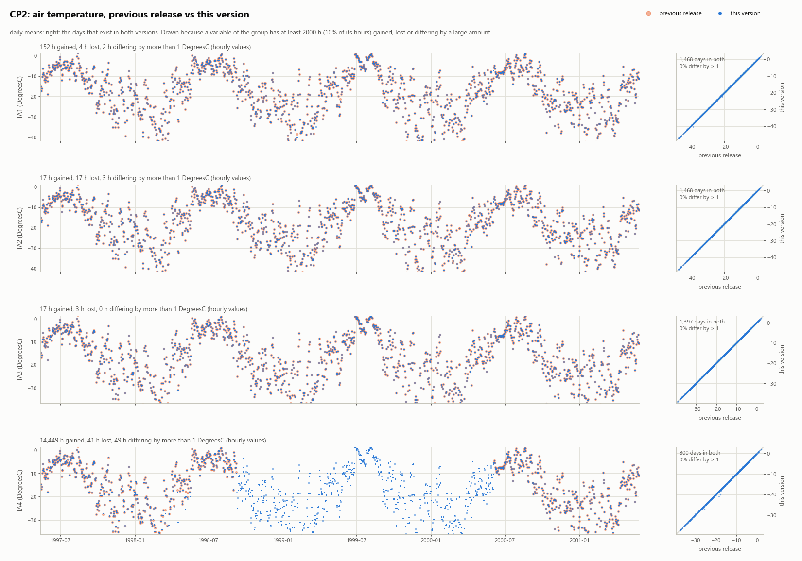

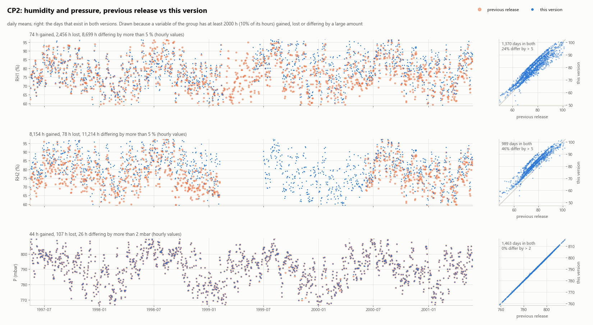

| variable | unit | valid h before | now | change | gained | lost | modified | % of shared | shift of modified: median [5 %, 95 %] |
|---|---|---:|---:|---:|---:|---:|---:|---:|---|
| RH1 | % | 35,377 | 32,995 | -6.7 % | 74 | 2,456 | 29,448 | 89.5 | +3.48 [-4.73, +7.19] |
| RH2 | % | 23,845 | 31,921 | +33.9 % | 8,154 | 78 | 23,282 | 98.0 | +4.66 [+0.7, +11.2] |
| TA4 | DegreesC | 19,519 | 33,927 | +73.8 % | 14,449 | 41 | 4,296 | 22.1 | +0.15 [-0.17, +0.42] |
| VW1 | m/s | 34,308 | 34,534 | +0.7 % | 250 | 24 | 8,833 | 25.8 | +2.2 [+0.95, +4.21] |
| OSWR | W/m^2 | 34,361 | 34,807 | +1.3 % | 454 | 8 | 504 | 1.5 | +11.3 [+1.47, +102] |
| VW2 | m/s | 35,023 | 35,245 | +0.6 % | 239 | 17 | 255 | 0.7 | +0.56 [-0.83, +2.29] |
| DW2 | Degrees | 34,728 | 35,165 | +1.3 % | 457 | 20 | 1 | 0.0 | -1.2 [-1.2, -1.2] |
| HS_combined | m | 35,447 | 35,447 | +0.0 % | 0 | 0 | 345 | 1.0 | -0.06 [-0.1, +0.068] |
| DW1 | Degrees | 33,469 | 33,790 | +1.0 % | 326 | 5 | 1 | 0.0 | -2.1 [-2.1, -2.1] |
| HW2 | m | 34,972 | 35,298 | +0.9 % | 326 | 0 | 0 | 0.0 | - |
| P | mbar | 35,000 | 34,937 | -0.2 % | 44 | 107 | 131 | 0.4 | +0.4 [-1.5, +3.55] |
| ISWR | W/m^2 | 34,513 | 34,560 | +0.1 % | 50 | 3 | 179 | 0.5 | -4.35 [-136, +168] |

24 other variables differ (derived, thermistors, humidity wrt ice or water...), most affected: RH1_wrt_ice_or_water, RH2_wrt_ice_or_water, Q2, SHF, LHF, Q1; see `variable_summary.csv`.

## JAR2

Record 1999-06-02 to 2013-06-16 before, 1999-06-02 to 2013-05-16 now. Core variables: 1,347,691 -> 1,375,693 valid hours (+2.1 %); 18.4 % of the hours that exist in either version are gained, lost or modified.
Columns added: none; removed: ISWR_adj_flag, OSWR_adj_flag.

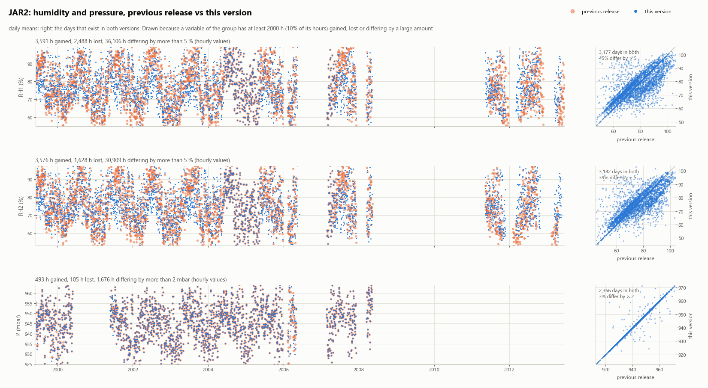

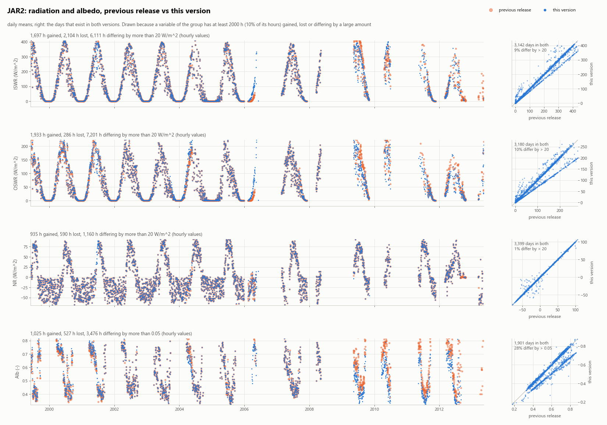

| variable | unit | valid h before | now | change | gained | lost | modified | % of shared | shift of modified: median [5 %, 95 %] |
|---|---|---:|---:|---:|---:|---:|---:|---:|---|
| RH1 | % | 79,005 | 80,108 | +1.4 % | 3,591 | 2,488 | 64,603 | 84.4 | +1.98 [-16.2, +14.7] |
| RH2 | % | 78,148 | 80,096 | +2.5 % | 3,576 | 1,628 | 63,426 | 82.9 | +1.38 [-15.7, +14.9] |
| VW1 | m/s | 62,217 | 74,043 | +19.0 % | 11,931 | 105 | 23,543 | 37.9 | +2.08 [-3.47, +4.41] |
| OSWR | W/m^2 | 79,982 | 81,629 | +2.1 % | 1,933 | 286 | 18,451 | 23.2 | -1.59 [-123, +35.9] |
| ISWR | W/m^2 | 80,116 | 79,709 | -0.5 % | 1,697 | 2,104 | 9,914 | 12.7 | -28 [-139, +52.9] |
| Alb | - | 15,102 | 15,600 | +3.3 % | 1,025 | 527 | 5,814 | 39.9 | -0.06 [-0.12, +0.02] |
| VW2 | m/s | 79,118 | 83,226 | +5.2 % | 4,281 | 173 | 2,640 | 3.3 | +0.11 [-6.21, +5.88] |
| DW1 | Degrees | 71,821 | 73,863 | +2.8 % | 2,172 | 130 | 2,805 | 3.9 | -1.2 [-88.3, +98.7] |
| DW2 | Degrees | 81,472 | 82,866 | +1.7 % | 1,543 | 149 | 2,811 | 3.5 | +1.3 [-87.7, +99.4] |
| NR | W/m^2 | 83,850 | 84,195 | +0.4 % | 935 | 590 | 1,943 | 2.3 | +1.44 [-62, +63.8] |
| TA2 | DegreesC | 85,651 | 86,500 | +1.0 % | 961 | 112 | 1,911 | 2.2 | +0.54 [-13.8, +11.2] |
| P | mbar | 56,863 | 57,251 | +0.7 % | 493 | 105 | 2,347 | 4.1 | -0.4 [-17.2, +22.7] |

34 other variables differ (derived, thermistors, humidity wrt ice or water...), most affected: RH1_wrt_ice_or_water, RH2_wrt_ice_or_water, Q1, Q2, LHF, VW10m; see `variable_summary.csv`.

## JAR3

Record 2000-05-28 to 2004-05-25 before, 2000-05-29 to 2004-05-25 now. Core variables: 548,722 -> 546,304 valid hours (-0.4 %); 32.7 % of the hours that exist in either version are gained, lost or modified. Hourly rows: 34,991 before, 34,982 now, 34,982 in both.

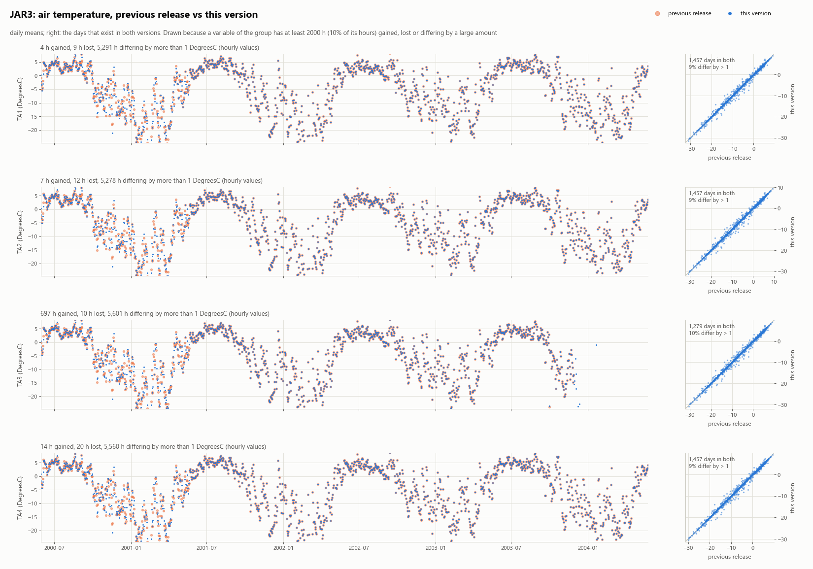

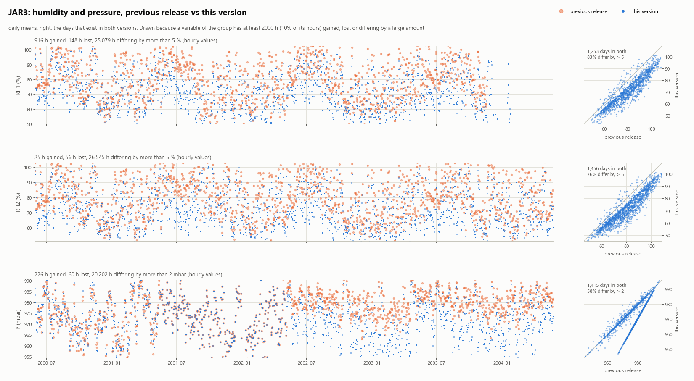

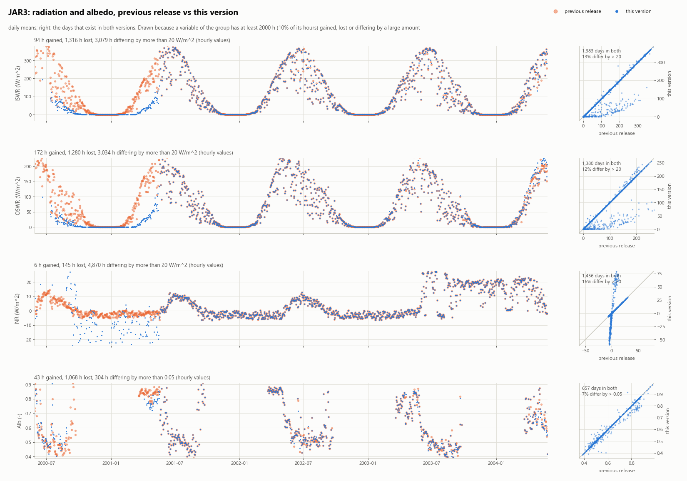

| variable | unit | valid h before | now | change | gained | lost | modified | % of shared | shift of modified: median [5 %, 95 %] |
|---|---|---:|---:|---:|---:|---:|---:|---:|---|
| RH2 | % | 34,961 | 34,930 | -0.1 % | 25 | 56 | 34,608 | 99.1 | -7.52 [-19.6, +2.99] |
| RH1 | % | 30,312 | 31,080 | +2.5 % | 916 | 148 | 29,884 | 99.1 | -8.72 [-20.8, +4.06] |
| P | mbar | 33,639 | 33,805 | +0.5 % | 226 | 60 | 24,957 | 74.3 | -6.64 [-15.6, +2.9] |
| DW1 | Degrees | 30,277 | 31,980 | +5.6 % | 1,884 | 181 | 7,892 | 26.2 | +2 [-101, +102] |
| TA3 | DegreesC | 30,697 | 31,384 | +2.2 % | 697 | 10 | 8,234 | 26.8 | +0.175 [-4.58, +4.53] |
| TA4 | DegreesC | 34,953 | 34,947 | -0.0 % | 14 | 20 | 8,215 | 23.5 | +0.17 [-4.49, +4.4] |
| TA2 | DegreesC | 34,972 | 34,967 | -0.0 % | 7 | 12 | 8,221 | 23.5 | +0.16 [-4.2, +4.21] |
| TA1 | DegreesC | 34,970 | 34,965 | -0.0 % | 4 | 9 | 8,190 | 23.4 | +0.15 [-4.24, +4.28] |
| VW2 | m/s | 34,936 | 33,935 | -2.9 % | 8 | 1,009 | 7,172 | 21.1 | +0.12 [-4.05, +4.35] |
| VW1 | m/s | 34,904 | 33,807 | -3.1 % | 7 | 1,104 | 7,038 | 20.8 | -0.1 [-3.94, +4.16] |
| NR | W/m^2 | 34,950 | 34,811 | -0.4 % | 6 | 145 | 7,929 | 22.8 | -14.8 [-63.4, +140] |
| DW2 | Degrees | 34,033 | 33,966 | -0.2 % | 441 | 508 | 6,848 | 20.4 | +1.2 [-124, +125] |

7 other variables differ (derived, thermistors, humidity wrt ice or water...), most affected: RH2_wrt_ice_or_water, RH1_wrt_ice_or_water, Q2, Q1, NR_cor, V; see `variable_summary.csv`.

## KAR

Record 1999-05-17 to 2001-06-07 before, 1999-05-19 to 2001-06-07 now. Core variables: 264,648 -> 268,642 valid hours (+1.5 %); 11.1 % of the hours that exist in either version are gained, lost or modified. Hourly rows: 18,045 before, 18,015 now, 18,014 in both.

| variable | unit | valid h before | now | change | gained | lost | modified | % of shared | shift of modified: median [5 %, 95 %] |
|---|---|---:|---:|---:|---:|---:|---:|---:|---|
| RH1 | % | 17,810 | 17,973 | +0.9 % | 230 | 67 | 13,760 | 77.6 | +0.9 [-1.91, +1.41] |
| NR | W/m^2 | 18,033 | 17,982 | -0.3 % | 6 | 57 | 6,414 | 35.7 | +2.56 [+1.11, +6.09] |
| DW2 | Degrees | 15,553 | 16,864 | +8.4 % | 1,509 | 198 | 719 | 4.7 | +1.1 [-23.9, +30.7] |
| VW2 | m/s | 15,929 | 17,957 | +12.7 % | 2,080 | 52 | 290 | 1.8 | -0.36 [-1.65, +0.486] |
| OSWR | W/m^2 | 17,971 | 17,902 | -0.4 % | 1 | 70 | 1,599 | 8.9 | +14.5 [+1.92, +58.3] |
| DW1 | Degrees | 16,887 | 17,552 | +3.9 % | 740 | 75 | 677 | 4.0 | +1.39 [-85.1, +113] |
| P | mbar | 17,719 | 17,830 | +0.6 % | 152 | 41 | 300 | 1.7 | -0.5 [-2.2, +0.7] |
| ISWR | W/m^2 | 17,971 | 17,902 | -0.4 % | 1 | 70 | 306 | 1.7 | +9.8 [-97.6, +65] |
| TA3 | DegreesC | 16,957 | 17,061 | +0.6 % | 131 | 27 | 19 | 0.1 | +0.16 [-3.29, +0.434] |
| Alb | - | 3,816 | 3,775 | -1.1 % | 1 | 42 | 36 | 1.0 | +0 [-0.163, +0.212] |
| TA1 | DegreesC | 18,035 | 18,009 | -0.1 % | 1 | 27 | 9 | 0.0 | -0.14 [-2.12, +0.152] |
| TA2 | DegreesC | 18,037 | 18,012 | -0.1 % | 1 | 26 | 2 | 0.0 | -4.36 [-5.45, -3.26] |

31 other variables differ (derived, thermistors, humidity wrt ice or water...), most affected: RH1_wrt_ice_or_water, NR_cor, Q1, SHF, VW10m, V; see `variable_summary.csv`.

## KULU

Record 1999-06-20 to 2000-09-14 before, 1999-06-20 to 2000-09-14 now. Core variables: 105,930 -> 105,930 valid hours (+0.0 %); 4.0 % of the hours that exist in either version are gained, lost or modified.

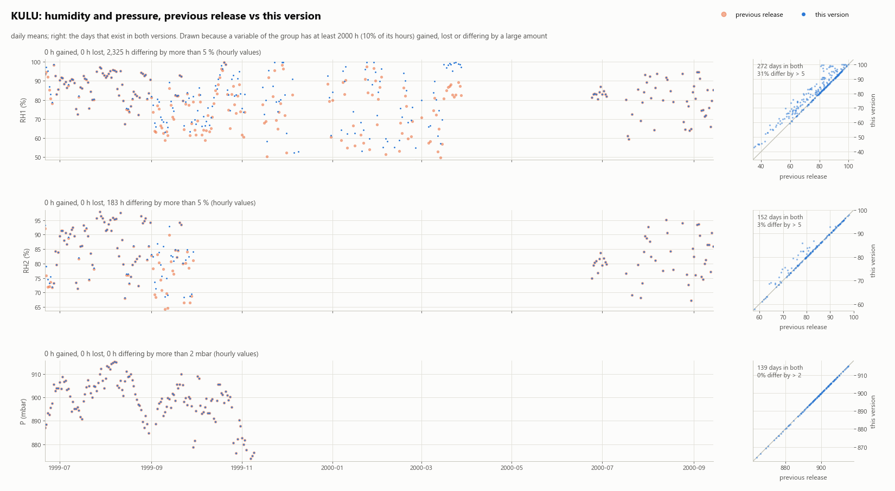

| variable | unit | valid h before | now | change | gained | lost | modified | % of shared | shift of modified: median [5 %, 95 %] |
|---|---|---:|---:|---:|---:|---:|---:|---:|---|
| RH1 | % | 7,063 | 7,063 | +0.0 % | 0 | 0 | 3,653 | 51.7 | +6.51 [+1.19, +13.1] |
| RH2 | % | 3,932 | 3,932 | +0.0 % | 0 | 0 | 605 | 15.4 | +2.97 [+0.792, +8.44] |

4 other variables differ (derived, thermistors, humidity wrt ice or water...), most affected: RH1_wrt_ice_or_water, Q1, RH2_wrt_ice_or_water, Q2; see `variable_summary.csv`.

## LAR1

Record 2008-12-23 to 2012-12-25 before, 2008-12-23 to 2012-12-25 now. Core variables: 395,710 -> 400,328 valid hours (+1.2 %); 27.8 % of the hours that exist in either version are gained, lost or modified.
Columns added: TS1, TS2, TS3, TS4, TS5, TS6, TS7, TS8, TS9, TS10; removed: ISWR_adj_flag, OSWR_adj_flag.

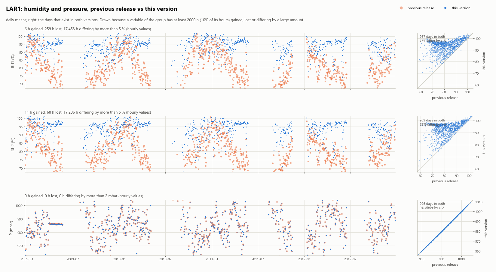

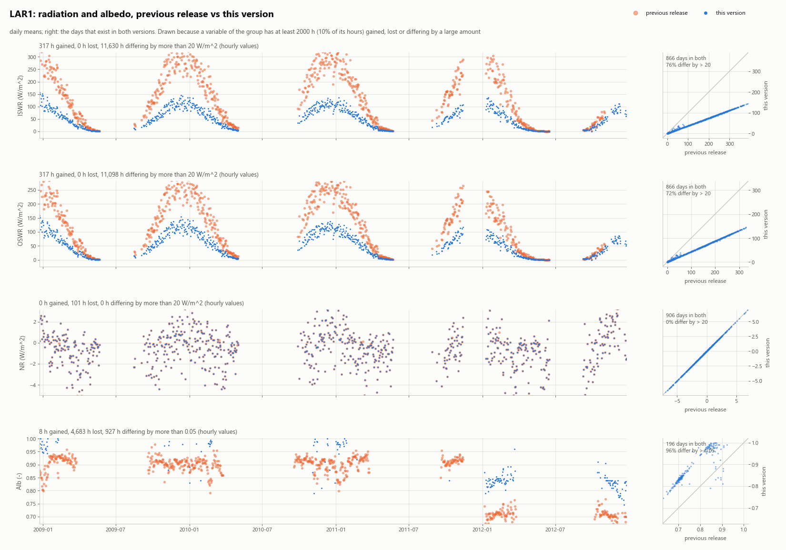

| variable | unit | valid h before | now | change | gained | lost | modified | % of shared | shift of modified: median [5 %, 95 %] |
|---|---|---:|---:|---:|---:|---:|---:|---:|---|
| HS_combined | m | 24,209 | 27,094 | +11.9 % | 2,885 | 0 | 21,182 | 87.5 | -0.33 [-0.48, -0.16] |
| RH1 | % | 24,226 | 23,973 | -1.0 % | 6 | 259 | 22,987 | 95.9 | +11.7 [+1.77, +29] |
| RH2 | % | 24,080 | 24,023 | -0.2 % | 11 | 68 | 23,035 | 95.9 | +11.6 [+1.75, +28.2] |
| ISWR | W/m^2 | 22,571 | 22,888 | +1.4 % | 317 | 0 | 14,945 | 66.2 | -96.8 [-389, -2.77] |
| OSWR | W/m^2 | 22,571 | 22,888 | +1.4 % | 317 | 0 | 14,791 | 65.5 | -74.7 [-304, -2.46] |
| Alb | - | 5,610 | 935 | -83.3 % | 8 | 4,683 | 927 | 100.0 | +0.13 [+0.12, +0.15] |
| HW2 | m | 21,557 | 24,761 | +14.9 % | 3,204 | 0 | 0 | 0.0 | - |
| HW1 | m | 24,043 | 27,024 | +12.4 % | 2,981 | 0 | 0 | 0.0 | - |
| NR | W/m^2 | 23,247 | 23,146 | -0.4 % | 0 | 101 | 0 | 0.0 | - |

12 other variables differ (derived, thermistors, humidity wrt ice or water...), most affected: HS1, RH1_wrt_ice_or_water, RH2_wrt_ice_or_water, Q2, Q1, HS2; see `variable_summary.csv`.

## LAR2

Record 2008-12-22 to 2011-11-15 before, 2008-12-22 to 2011-11-15 now. Core variables: 322,528 -> 326,714 valid hours (+1.3 %); 28.0 % of the hours that exist in either version are gained, lost or modified.
Columns added: TS1, TS2, TS3, TS4, TS5, TS6, TS7, TS8, TS9, TS10; removed: ISWR_adj_flag, OSWR_adj_flag.

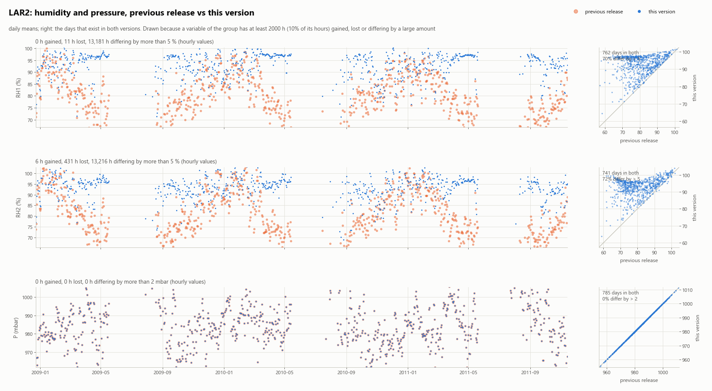

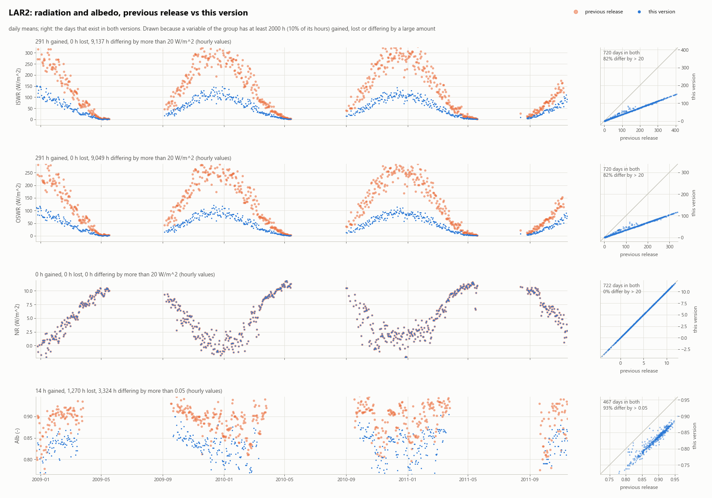

| variable | unit | valid h before | now | change | gained | lost | modified | % of shared | shift of modified: median [5 %, 95 %] |
|---|---|---:|---:|---:|---:|---:|---:|---:|---|
| HS_combined | m | 22,387 | 22,387 | +0.0 % | 0 | 0 | 22,387 | 100.0 | +0.3 [+0.29, +1.55] |
| RH2 | % | 18,967 | 18,542 | -2.2 % | 6 | 431 | 17,491 | 94.4 | +12.6 [+1.53, +29.4] |
| RH1 | % | 18,846 | 18,835 | -0.1 % | 0 | 11 | 17,880 | 94.9 | +12.5 [+1.46, +29.7] |
| ISWR | W/m^2 | 17,904 | 18,195 | +1.6 % | 291 | 0 | 11,651 | 65.1 | -104 [-408, -2.89] |
| OSWR | W/m^2 | 17,904 | 18,195 | +1.6 % | 291 | 0 | 11,613 | 64.9 | -96.9 [-371, -2.88] |
| HW1 | m | 17,099 | 22,387 | +30.9 % | 5,288 | 0 | 0 | 0.0 | - |
| Alb | - | 4,645 | 3,389 | -27.0 % | 14 | 1,270 | 3,375 | 100.0 | -0.06 [-0.07, -0.05] |
| HW2 | m | 22,379 | 22,387 | +0.0 % | 8 | 0 | 0 | 0.0 | - |

11 other variables differ (derived, thermistors, humidity wrt ice or water...), most affected: RH2_wrt_ice_or_water, RH1_wrt_ice_or_water, Q2, Q1, LHF, HS1; see `variable_summary.csv`.

## LAR3

Record 2009-08-10 to 2011-11-08 before, 2009-08-10 to 2011-11-08 now. Core variables: 197,610 -> 197,341 valid hours (-0.1 %); 6.2 % of the hours that exist in either version are gained, lost or modified.
Columns added: TS1, TS2, TS3, TS4, TS5, TS6, TS7, TS8, TS9, TS10; removed: none.

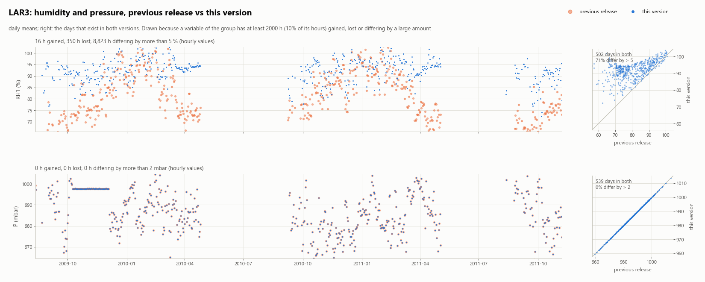

| variable | unit | valid h before | now | change | gained | lost | modified | % of shared | shift of modified: median [5 %, 95 %] |
|---|---|---:|---:|---:|---:|---:|---:|---:|---|
| RH1 | % | 13,033 | 12,699 | -2.6 % | 16 | 350 | 11,819 | 93.2 | +11.7 [+1.53, +27.6] |
| HS_combined | m | 14,058 | 14,070 | +0.1 % | 12 | 0 | 29 | 0.2 | +0.77 [+0.322, +0.824] |
| HW2 | m | 14,030 | 14,070 | +0.3 % | 40 | 0 | 0 | 0.0 | - |
| HW1 | m | 14,054 | 14,067 | +0.1 % | 13 | 0 | 0 | 0.0 | - |

6 other variables differ (derived, thermistors, humidity wrt ice or water...), most affected: RH1_wrt_ice_or_water, Q1, HS2, VW10m, HS1, SHF; see `variable_summary.csv`.

## NGRIP

Record 2002-06-09 to 2010-05-08 before, 1997-07-09 to 2010-05-08 now. Core variables: 743,895 -> 1,269,175 valid hours (+70.6 %); 54.7 % of the hours that exist in either version are gained, lost or modified. Hourly rows: 69,356 before, 112,463 now, 69,356 in both.

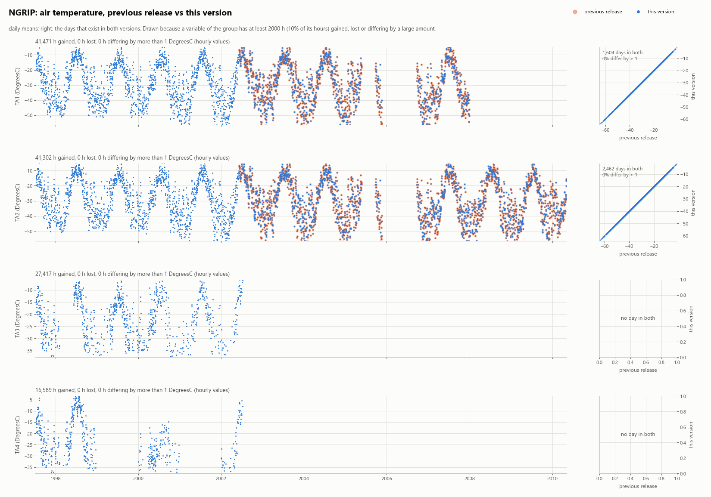

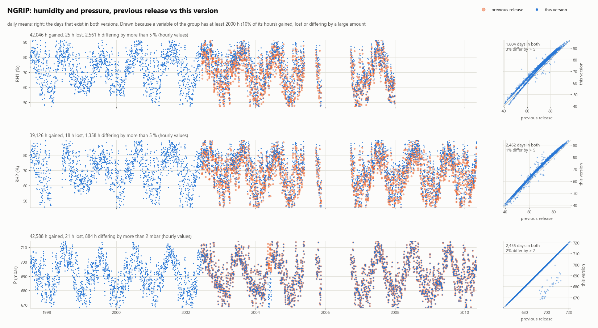

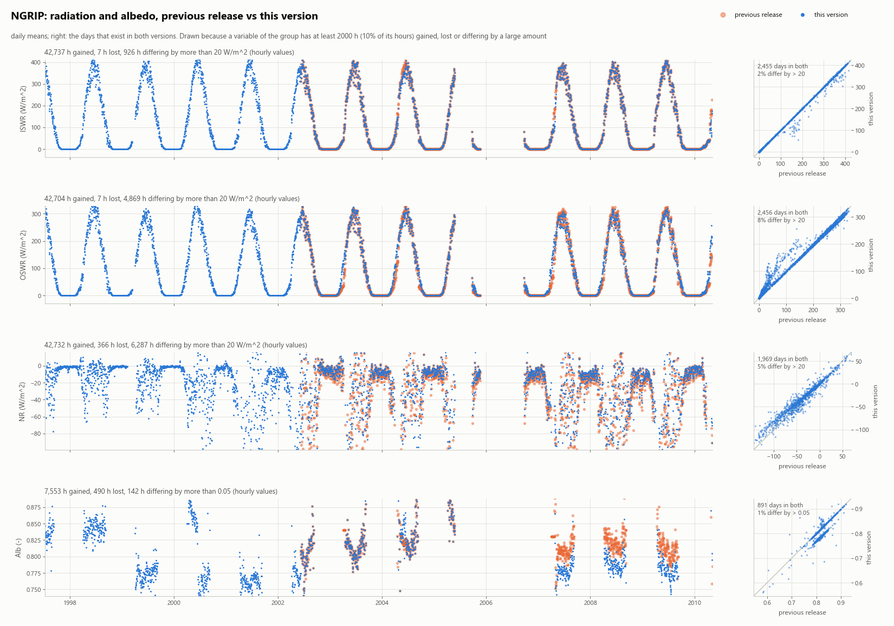

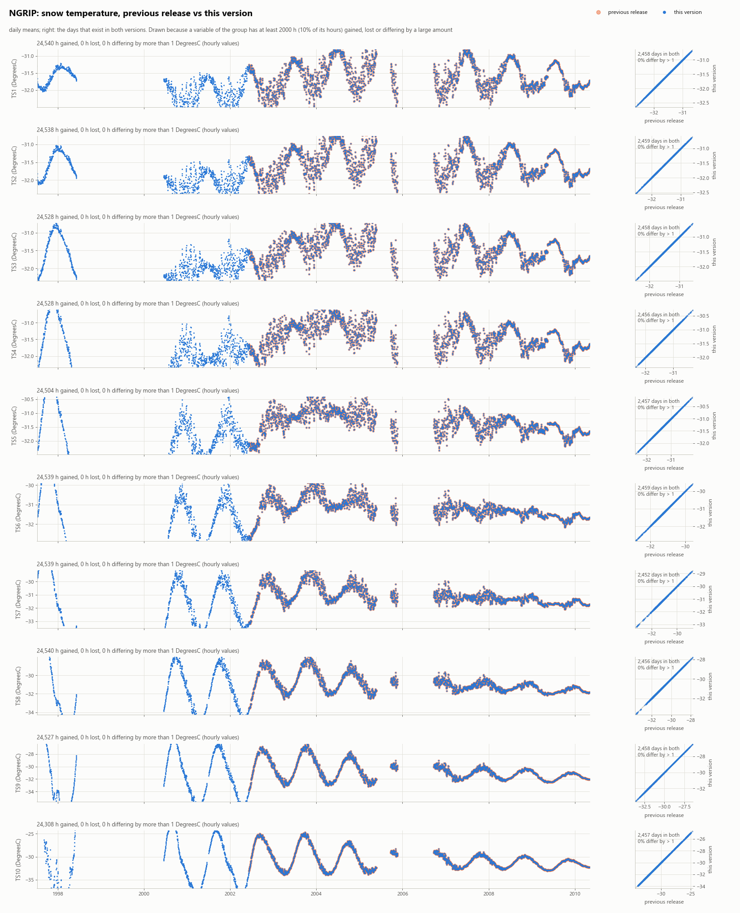

| variable | unit | valid h before | now | change | gained | lost | modified | % of shared | shift of modified: median [5 %, 95 %] |
|---|---|---:|---:|---:|---:|---:|---:|---:|---|
| RH2 | % | 59,120 | 98,228 | +66.2 % | 39,126 | 18 | 58,229 | 98.5 | +3.13 [+1.3, +3.83] |
| NR | W/m^2 | 51,815 | 94,181 | +81.8 % | 42,732 | 366 | 38,510 | 74.9 | +3.25 [-3.29, +35.6] |
| RH1 | % | 38,531 | 80,552 | +109.1 % | 42,046 | 25 | 36,997 | 96.1 | +3.42 [+0.57, +5.12] |
| OSWR | W/m^2 | 58,573 | 101,270 | +72.9 % | 42,704 | 7 | 17,303 | 29.5 | -3.08 [-20.3, +106] |
| ISWR | W/m^2 | 58,551 | 101,281 | +73.0 % | 42,737 | 7 | 1,118 | 1.9 | -38.8 [-291, +76.8] |
| P | mbar | 58,545 | 101,112 | +72.7 % | 42,588 | 21 | 890 | 1.5 | -23.9 [-28.1, -15.3] |
| TA1 | DegreesC | 38,530 | 80,001 | +107.6 % | 41,471 | 0 | 3 | 0.0 | -0.11 [-0.785, +0.475] |
| TA2 | DegreesC | 59,143 | 100,445 | +69.8 % | 41,302 | 0 | 6 | 0.0 | -0.005 [-0.628, +0.38] |
| DW2 | Degrees | 45,917 | 83,295 | +81.4 % | 38,483 | 1,105 | 0 | 0.0 | - |
| DW1 | Degrees | 28,871 | 67,559 | +134.0 % | 39,052 | 364 | 0 | 0.0 | - |
| VW1 | m/s | 32,437 | 63,311 | +95.2 % | 33,763 | 2,889 | 575 | 1.9 | -0.82 [-3.62, -0.12] |
| VW2 | m/s | 47,347 | 80,355 | +69.7 % | 34,501 | 1,493 | 763 | 1.7 | -0.21 [-2.89, +0.449] |

32 other variables differ (derived, thermistors, humidity wrt ice or water...), most affected: RH2_wrt_ice_or_water, NR_cor, RH1_wrt_ice_or_water, Q1, Q2, V; see `variable_summary.csv`.

## PetermannGlacier

Record 2002-06-04 to 2006-05-01 before, 2002-06-04 to 2006-05-05 now. Core variables: 520,565 -> 521,197 valid hours (+0.1 %); 11.0 % of the hours that exist in either version are gained, lost or modified. Hourly rows: 34,243 before, 34,363 now, 34,243 in both.

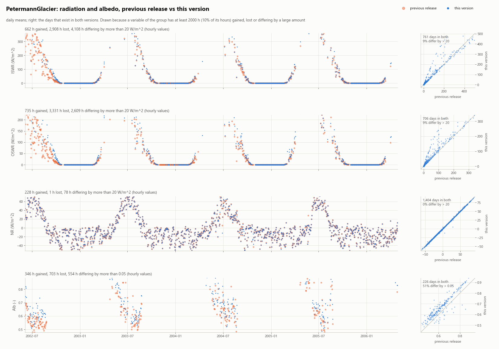

| variable | unit | valid h before | now | change | gained | lost | modified | % of shared | shift of modified: median [5 %, 95 %] |
|---|---|---:|---:|---:|---:|---:|---:|---:|---|
| VW1 | m/s | 30,933 | 33,927 | +9.7 % | 3,036 | 42 | 18,812 | 60.9 | -0.32 [-2.04, -0.12] |
| ISWR | W/m^2 | 25,572 | 23,326 | -8.8 % | 662 | 2,908 | 7,633 | 33.7 | -3.29 [-39.1, +210] |
| OSWR | W/m^2 | 25,333 | 22,737 | -10.2 % | 735 | 3,331 | 4,799 | 21.8 | +24.8 [+1.24, +195] |
| VW2 | m/s | 32,317 | 33,783 | +4.5 % | 1,654 | 188 | 6,773 | 21.1 | -0.31 [-1.88, -0.12] |
| Alb | - | 1,816 | 1,459 | -19.7 % | 346 | 703 | 1,107 | 99.5 | +0.05 [+0.03, +0.08] |
| NR | W/m^2 | 33,851 | 34,078 | +0.7 % | 228 | 1 | 1,687 | 5.0 | +1.29 [-10.6, +9.08] |
| TA1 | DegreesC | 33,694 | 34,036 | +1.0 % | 343 | 1 | 794 | 2.4 | +0.1 [-1.05, +2.26] |
| TA2 | DegreesC | 33,704 | 34,035 | +1.0 % | 332 | 1 | 796 | 2.4 | -0.1 [-1.15, +2.13] |
| RH2 | % | 33,406 | 33,789 | +1.1 % | 383 | 0 | 257 | 0.8 | +0.55 [-1.76, +4.33] |
| RH1 | % | 33,587 | 33,912 | +1.0 % | 326 | 1 | 241 | 0.7 | +0.52 [-1.99, +3.54] |
| DW2 | Degrees | 33,474 | 33,282 | -0.6 % | 3 | 195 | 0 | 0.0 | - |
| DW1 | Degrees | 33,431 | 33,386 | -0.1 % | 3 | 48 | 0 | 0.0 | - |

5 other variables differ (derived, thermistors, humidity wrt ice or water...), most affected: NR_cor, RH2_wrt_ice_or_water, RH1_wrt_ice_or_water, Q2, Q1; see `variable_summary.csv`.

## EastGRIP

Record 2014-05-17 to 2023-06-22 before, 2014-05-17 to 2023-06-22 now. Core variables: 917,774 -> 917,661 valid hours (-0.0 %); 0.0 % of the hours that exist in either version are gained, lost or modified.
Columns added: ISWR, OSWR, NR, TS1, TS2, TS3, TS4, TS5, TS6, TS7, TS8, TS9, TS10, NR_cor, Alb; removed: none.

| variable | unit | valid h before | now | change | gained | lost | modified | % of shared | shift of modified: median [5 %, 95 %] |
|---|---|---:|---:|---:|---:|---:|---:|---:|---|
| P | mbar | 74,324 | 74,211 | -0.2 % | 0 | 113 | 0 | 0.0 | - |

4 other variables differ (derived, thermistors, humidity wrt ice or water...), most affected: Q1, Q2, LHF, SHF; see `variable_summary.csv`.

## NEEM

Record 2006-03-29 to 2022-10-07 before, 2006-03-29 to 2022-10-07 now. Core variables: 1,596,955 -> 1,590,333 valid hours (-0.4 %); 5.1 % of the hours that exist in either version are gained, lost or modified.
Columns added: none; removed: OSWR_adj_flag.

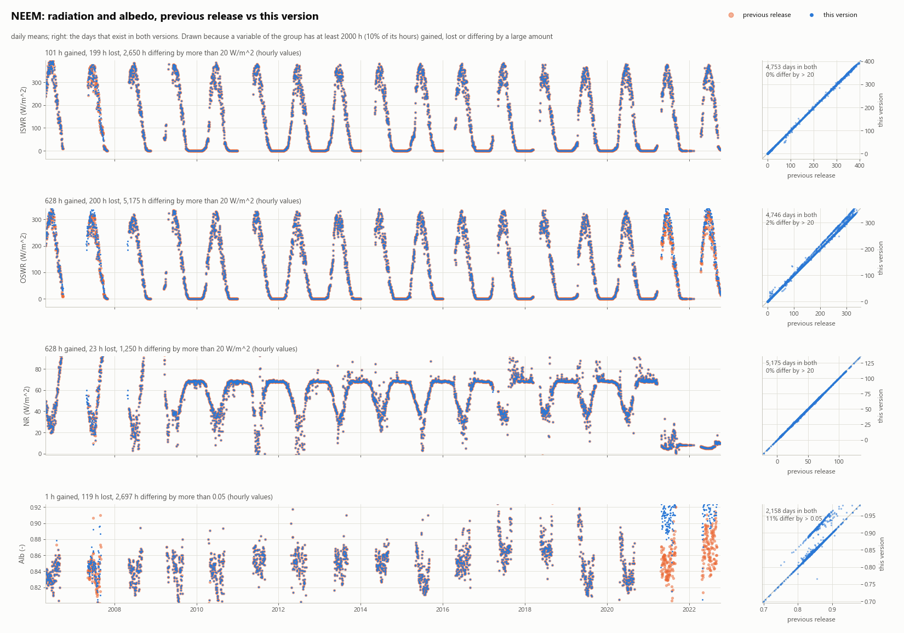

| variable | unit | valid h before | now | change | gained | lost | modified | % of shared | shift of modified: median [5 %, 95 %] |
|---|---|---:|---:|---:|---:|---:|---:|---:|---|
| OSWR | W/m^2 | 114,282 | 114,710 | +0.4 % | 628 | 200 | 10,556 | 9.3 | +12.8 [-79.1, +86.7] |
| RH2 | % | 110,815 | 111,544 | +0.7 % | 732 | 3 | 9,056 | 8.2 | +3.04 [-0.972, +11.8] |
| RH1 | % | 102,412 | 103,097 | +0.7 % | 690 | 5 | 8,551 | 8.4 | +2.08 [-2.29, +13.1] |
| HS_combined | m | 84,617 | 78,356 | -7.4 % | 11 | 6,272 | 10 | 0.0 | +0.04 [+0.03, +0.134] |
| HW1 | m | 62,980 | 56,706 | -10.0 % | 0 | 6,274 | 8 | 0.0 | -0.02 [-0.02, -0.02] |
| TA2 | DegreesC | 124,237 | 124,785 | +0.4 % | 550 | 2 | 5,414 | 4.4 | +0.44 [-3.29, +17.8] |
| TA1 | DegreesC | 111,292 | 111,819 | +0.5 % | 529 | 2 | 5,404 | 4.9 | +0.46 [-3.3, +18.4] |
| P | mbar | 12,435 | 12,722 | +2.3 % | 299 | 12 | 4,076 | 32.8 | +0.1 [-3.9, +4.1] |
| VW1 | m/s | 114,803 | 115,219 | +0.4 % | 498 | 82 | 3,758 | 3.3 | -0.11 [-1.5, +1.57] |
| NR | W/m^2 | 124,576 | 125,181 | +0.5 % | 628 | 23 | 3,305 | 2.7 | -1.04 [-31, +29.4] |
| VW2 | m/s | 87,086 | 87,277 | +0.2 % | 195 | 4 | 3,716 | 4.3 | -0.13 [-1.47, +1.43] |
| ISWR | W/m^2 | 114,434 | 114,336 | -0.1 % | 101 | 199 | 3,286 | 2.9 | -10.3 [-130, +148] |

11 other variables differ (derived, thermistors, humidity wrt ice or water...), most affected: RH2_wrt_ice_or_water, RH1_wrt_ice_or_water, LHF, HS1, Q2, SHF; see `variable_summary.csv`.

## SMS-PET

Record 2002-06-02 to 2004-05-14 before, 2002-06-02 to 2004-05-14 now. Core variables: 151,486 -> 151,486 valid hours (+0.0 %); 0.0 % of the hours that exist in either version are gained, lost or modified.

No core variable differs.

## SMS1

Record 2002-01-01 to 2006-01-15 before, 2002-01-01 to 2006-01-15 now. Core variables: 173,102 -> 173,104 valid hours (+0.0 %); 0.0 % of the hours that exist in either version are gained, lost or modified. Hourly rows: 35,403 before, 35,404 now, 35,403 in both.

| variable | unit | valid h before | now | change | gained | lost | modified | % of shared | shift of modified: median [5 %, 95 %] |
|---|---|---:|---:|---:|---:|---:|---:|---:|---|
| RH1 | % | 29,363 | 29,364 | +0.0 % | 1 | 0 | 0 | 0.0 | - |
| DW1 | Degrees | 29,302 | 29,303 | +0.0 % | 1 | 0 | 0 | 0.0 | - |

1 other variables differ (derived, thermistors, humidity wrt ice or water...), most affected: RH1_wrt_ice_or_water; see `variable_summary.csv`.

## SMS2

Record 2003-04-24 to 2006-05-10 before, 2003-04-24 to 2006-05-10 now. Core variables: 151,551 -> 151,551 valid hours (+0.0 %); 0.0 % of the hours that exist in either version are gained, lost or modified.

| variable | unit | valid h before | now | change | gained | lost | modified | % of shared | shift of modified: median [5 %, 95 %] |
|---|---|---:|---:|---:|---:|---:|---:|---:|---|
| RH1 | % | 26,535 | 26,535 | +0.0 % | 1 | 1 | 0 | 0.0 | - |

1 other variables differ (derived, thermistors, humidity wrt ice or water...), most affected: RH1_wrt_ice_or_water; see `variable_summary.csv`.

## SMS3

Record 2001-05-22 to 2006-05-10 before, 2001-05-22 to 2006-05-10 now. Core variables: 232,676 -> 232,676 valid hours (+0.0 %); 0.0 % of the hours that exist in either version are gained, lost or modified.

No core variable differs.

## SMS4

Record 2001-05-22 to 2003-04-27 before, 2001-05-22 to 2003-04-27 now. Core variables: 101,248 -> 101,219 valid hours (-0.0 %); 0.0 % of the hours that exist in either version are gained, lost or modified.

| variable | unit | valid h before | now | change | gained | lost | modified | % of shared | shift of modified: median [5 %, 95 %] |
|---|---|---:|---:|---:|---:|---:|---:|---:|---|
| RH1 | % | 16,725 | 16,696 | -0.2 % | 0 | 29 | 0 | 0.0 | - |

1 other variables differ (derived, thermistors, humidity wrt ice or water...), most affected: RH1_wrt_ice_or_water; see `variable_summary.csv`.

## SMS5

Record 2002-09-20 to 2003-04-24 before, 2002-09-20 to 2003-04-24 now. Core variables: 31,134 -> 31,134 valid hours (+0.0 %); 0.0 % of the hours that exist in either version are gained, lost or modified.

No core variable differs.
