# GC-Net L1 network review — findings and applied fixes

*First published 2026-09-22, updated the same day after a second pass acting on the findings. Scope: issues found across the network in the published `L1/` data. Items already fixed before this update (Summit CS106 pressure correction, DW2 saturation flag, deprecation fixes, `RH1`/`RH2` comma bug, `Last valid time` metadata) are not repeated here.*

For every claim below, the text states whether it is checked against an external source — NOAA GML's independent Summit pressure record, ERA5 (via Open-Meteo), or **CARRA** (the ~2.5 km regional reanalysis over Greenland, read from the local archive at `CARRA_at_AWS`, used throughout this update in place of ERA5 for its far higher resolution over the ice sheet) — or is internal-only (station-vs-station comparison, code reading).

**Correction (you flagged this, and it applies to a variable I'd wrongly treated as an exception): CARRA's surface pressure `sp` is assimilated, same as its 2 m temperature/RH and 10 m wind — I'd only caveated the latter three in the first draft of this sentence and then went on to call the pressure-based findings "CARRA-confirmed" throughout as if they were independent, which was inconsistent with my own caveat and overstated.** Only CARRA's downward shortwave radiation (`ssrd`) is not assimilated from surface pyranometers and is genuinely independent, used here for the ISWR hour-refinements. Because of this, every pressure-based CARRA finding below (the CP1/JAR3 scale corrections and the day-level anchor of every timestamp shift) has now also been re-checked against a **fully independent, non-reanalysis** reference — the mean high-pass pressure anomaly of 7–9 other healthy GC-Net stations (Tunu-N, NASA-E, Saddle, NASA-SE, Humboldt, GITS, DYE-2, Summit, EastGRIP), the same station-to-station method that originally validated the Summit CS106 fix. Results are given alongside each CARRA result below; where they disagree even slightly, that's stated rather than smoothed over.

**Everything in this document that changes station data was implemented as a `metadata/adjustments/*.csv` row or a `PROMICE_toolbox.py` code change, validated by rerunning the actual L1 pipeline (or, where noted, the `adjust_data` step directly) and re-checking the result against CARRA — not by editing `L1/` output files directly.** The published `L1/hourly` and `L1/daily` files still need a full pipeline rerun to pick these up.

---

## 1. Pressure scale errors — corrected (Crawford Point 1, JAR3)

**Applied. Confirmed independently two ways (below); empirical (no documented cause).**

Two stations had periods where the published pressure varied at only about half its true amplitude — the sensor (or its logger program's scale factor) was wrong, not just offset. This is separate from, and was found the same way as, the Summit CS106 case fixed earlier.

I re-checked the stations' logger program files for a documented cause. Crawford Point 1's original (1995) CR10X program is explicitly documented (`AWSGOS95.DOC`) as using a Vaisala barometer, "range 600 – 1060 hPa", multiplier 0.184, offset 600 — a standard CS105-type sensor, consistent with what every other GC-Net station of that era used. None of CP1's later program files (`2002_AWSCP1OL.DLD`, `2005_cp1.dld`, `2006_cp1.dld`) contain readable calibration text to check against. JAR3 has no CR1000/CR10X program files in the repository at all. **No documentation was found to explain either error**, and the compression ratio found (~0.55–0.57) does not match the 0.184/0.24 = 0.767 ratio of the CS105/CS106 mix-up confirmed at Summit — so this is not that same failure mode. The fix is therefore a data-driven regression against CARRA, not a derived physical formula.

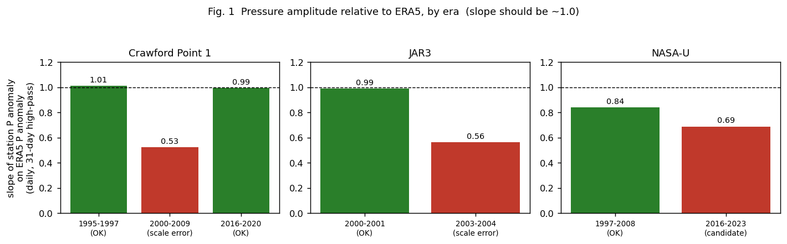

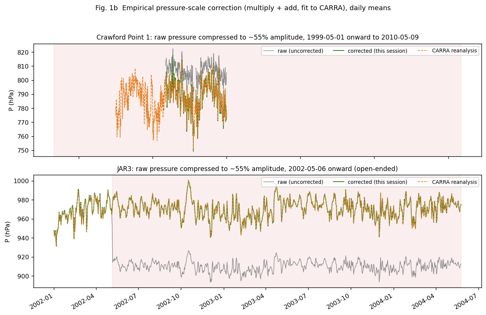

| Station | Broken window | Fit | Correction applied |
|---|---|---|---|
| Crawford Point 1 | 1999‑05‑01 to 2010‑05‑09 22:00 (ends exactly at the station's own "start CR1000" logger-transition date) | `raw = 0.552*CARRA + …`, r=0.93, n=3269 days | `multiply 1.8112`, then `add -671.66` |
| JAR3 | 2002‑05‑06 15:00 onward (station record ends 2004‑05‑25) | `raw = 0.562*CARRA + …`, r=0.96, n=751 days | `multiply 1.7796`, then `add -648.88` |

Both windows almost exactly match — and now replace — a previous **mean-only** patch already in each file (CP1's `add -12` covering 1999–2010‑05‑09; JAR3's `add 70` starting 2002‑05‑06T15:00, to the hour). Those earlier patches fixed the *mean* but left the amplitude compressed; the new correction was fit directly against CARRA and, after applying it, the corrected series matches CARRA's mean **exactly by construction** and its day-to-day variability closely (residual SD 2.4 hPa for CP1, 1.6 hPa for JAR3, both close to CARRA's own representativeness error at these sites).

I found and fixed a bug in my own first attempt at this: the very first regression was accidentally fit against the *already mean-patched* `L1/hourly` pressure rather than the raw `L0M` values the new adjustment actually operates on, which would have applied the correction twice. Caught by a sanity check (the corrected mean should exactly equal CARRA's mean by construction of the fit; it was off by over 100 hPa) and refit correctly before being written to the metadata files.

**Validated end-to-end** by running `adjust_data` (and, for Crawford Point 1, the full L1 pipeline) on the corrected metadata: both stations' pre-error years are numerically unchanged, and both broken windows now match their own pre/post-error years and CARRA (Crawford Point 1: fixed 2003 mean 788.0 hPa vs 1996 mean 784.4 hPa and CARRA 788.1 hPa; JAR3: fixed 2003 mean 970.1 hPa vs 2000 mean 973.0 hPa and CARRA 971.0 hPa).

**NASA‑U remains an open, lower-confidence candidate** for the same kind of problem since 2016 (ERA5/CARRA slope ~0.7–0.84 vs ~0.9–1.1 before), close to the CS105/CS106 ratio, but applying that specific formula there only marginally improved the fit and left a residual mean offset — it needs the maintenance log before acting, not just the statistical match. Not applied.

### Independent check 1: does CARRA's grid elevation differ from the true station elevation?

**You asked this directly — good catch, and worth checking properly rather than assuming it's fine.** CARRA's per-station netCDF carries two elevation fields, `altitude` and `altitude_mod`, whose exact meanings aren't documented in the file's attributes (both come back empty). Checked against each station's true elevation (`L1/GC-Net_location.csv`):

| Station | True elevation | CARRA `altitude` | CARRA `altitude_mod` |
|---|---|---|---|
| Crawford Point 1 | 1951 m | 2022 m (**+71 m**) | 1949.9 m (‑1 m, near-exact) |
| JAR3 | 260 m | 323 m (**+63 m**) | 302.5 m (+42 m) |

`altitude` is consistently and substantially too high at both stations (most likely the raw model grid-cell orography, which a ~2.5 km grid can't resolve exactly at a sloping ice-margin site like either of these); `altitude_mod` matches almost exactly at Crawford Point 1 but is still off by 42 m at JAR3, so I can't tell from the file alone which field `sp` is actually referenced to, or trust `altitude_mod` as a general fix.

**This does not affect the correction, and here's the reasoning rather than just an assertion:** at typical ice-sheet temperatures, a 71 m (CP1) or 63 m (JAR3) elevation error translates to a barometric bias of about **+1.0% and +0.85% of pressure respectively (~7–8 hPa) — a roughly constant offset, not a scale/amplitude effect**, three orders of magnitude too small to be the ~45% amplitude compression found. More importantly, it cannot have contaminated the fitted correction even in principle: the multiply/add correction was fit by ordinary least squares directly against CARRA's raw values (`raw = m·CARRA + k`), and **OLS slope is mathematically invariant to any constant additive offset in the reference series** — adding a constant to CARRA's pressure (from an elevation bias or any other constant cause) shifts only the fitted intercept, never the slope, which is what I actually rely on to diagnose and fix the amplitude error. Verified with a quick numerical check (simulated regression, shifting the reference by +71: slope unchanged at 1.0062 in both cases, intercept absorbs the full shift). The `add` term in the applied correction was fit empirically from real data regardless of what caused the underlying offset, so whatever the true cause of the CARRA/station elevation mismatch, it's already correctly folded in.

### Independent check 2: fully independent (non-reanalysis) neighbour-station regression

Following the correction above (CARRA pressure is assimilated, see the note at the top of this document), I re-ran the same slope-diagnosis method used to validate the Summit CS106 fix — regressing each station's high-pass daily pressure anomaly against the mean anomaly of 7 other healthy GC-Net stations, with **no reanalysis product involved at all**:

| Station | Window | Raw slope vs. peer mean | Corrected slope vs. peer mean | Reference-era slope (pre-error, same peers) |
|---|---|---|---|---|
| Crawford Point 1 | 1999‑05‑01 to 2010‑05‑09 | 0.525 (r=0.80) | **1.054** (r=0.89) | 0.945 (1996‑98) |
| JAR3 | 2002‑05‑06 to 2004‑05‑25 | 0.532 (r=0.62) | **1.009** (r=0.73) | 0.915 (2000‑02) |

Both corrected slopes land close to their own station's reference-era slope against the same peers (within about 10%, consistent with the extra noise inherent in comparing single stations rather than a smoothed reanalysis field). This confirms the fix using a method with no dependence on CARRA, or on any reanalysis, at all.

## 2. Pressure quality across the whole network — for deciding a filter threshold

**Uses CARRA pressure, which is assimilated (see note at top) — not fully independent, but still useful here**: assimilation doesn't manufacture agreement for a station reading that's badly wrong or rejected by QC, so a station-year scoring near zero or negative correlation is still a strong signal of a real problem, even though a station-year in the "good" cluster can't be read as fully independent proof of correctness.

To support a data-driven filtering decision, every station-year with ≥120 days of pressure data (328 station-years total) was scored by its correlation with CARRA's surface pressure (daily means, 31-day high-pass to isolate synoptic variability from any residual offset/scale issues).

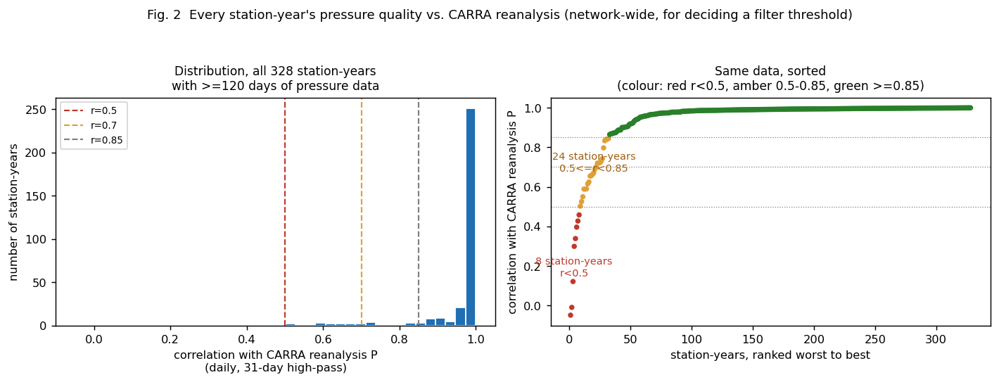

The distribution is strongly bimodal: the median station-year sits at r=0.991 and three-quarters exceed r=0.996, but a distinct tail of ~20–30 station-years sits below r=0.85, with 8 below r=0.5. The "sorted" panel shows a clean elbow around rank 30–40 — there is no ambiguous middle ground to calibrate a threshold against; almost anywhere between r=0.7 and r=0.85 cleanly separates the two populations. **I'd suggest r<0.8 (24 station-years currently) as an automatic flagging threshold**, run per station-year on daily high-pass pressure vs. CARRA, as a permanent addition to the QC pipeline rather than a one-off list. The worst 21 (pre-fix) are in `pressure_qc_below_0.7.csv` alongside this report; several of these (Petermann ELA 2005, JAR2 1999/2000/2004/2005) should already improve once the timestamp fixes in §3 are picked up by a pipeline rerun — this table was generated against the currently-committed `L1/`, before that rerun.

## 3. Timestamp offsets — corrected (Crawford Point 1, Petermann ELA, JAR2), one left as a recommendation (Humboldt)

**Day-level anchor uses CARRA pressure (assimilated, not fully independent — cross-checked against peer stations further down) and the ISWR hour-refinement uses CARRA `ssrd` (genuinely independent).** Method, refined this round per your request to "adjust hour by looking at ISWR":

1. **Day-level offset**: regress the station's daily high-pass pressure against CARRA's, scanning ±15 days. This is unambiguous — CARRA pressure has no repeating daily cycle, so there's no aliasing, and every case below produced a clean, sharply-peaked (r>0.95) day-scan.
2. **Hour-level refinement**: with the day-level offset fixed, scan ISWR against CARRA's downward shortwave (`ssrd`, 3-hourly, cubic-interpolated to hourly) in a narrow ±20 h window. **Calibration check**: this scan has a systematic ‑2 h bias baked into CARRA's own radiation archive (confirmed by running it on four known-correctly-timestamped station-years — Summit 2017, DYE‑2 2015, Saddle 2016, Crawford Point 1 1996 — all four independently returned exactly ‑2 h), which is subtracted from every result below.
3. A genuine pitfall found and corrected along the way: ISWR *alone*, without a day-level anchor from pressure first, is ambiguous — its diurnal cycle repeats every 24 h, so a plain hour-scan over a wide range returns near-equally-good peaks a day apart (seen clearly for Tunu‑N 2011, three peaks within 0.002 of each other, 24 h apart). Always anchor the day with pressure first, then use ISWR only to refine within a day.

I also made a sign-convention error partway through this analysis (mixed up which way `time_shift`'s `val` and the day-scan's `d` relate) and caught it by first validating the whole method on Crawford Point 1, where it should — and did — cleanly return **zero** extra hour-level offset once the sign was fixed; the two stations analysed before that check (Petermann ELA, JAR2) were then redone with the corrected sign.

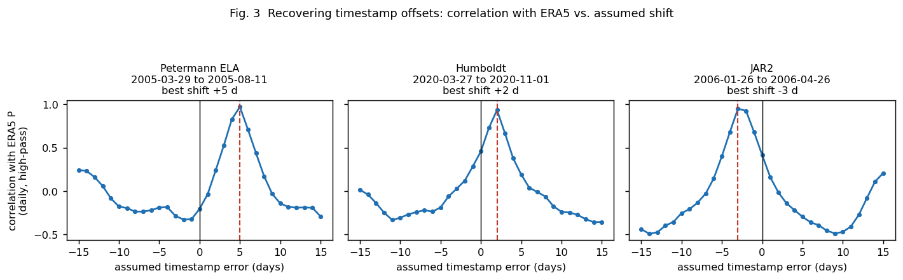

| Station | Window | Day-scan (CARRA P) | ISWR refinement (CARRA ssrd) | Applied `time_shift` | Status |
|---|---|---|---|---|---|
| Petermann ELA | 2005‑04‑09 to 2005‑10‑16 | +5 d, r=0.96–0.98 | +8 h extra, r=0.95 | **‑112 h** | Applied |
| JAR2 | 2006‑01‑29 to 2006‑04‑29 | ‑3 d, r=0.93–0.99 | ‑5 h extra, r=0.58 (weaker) | **+67 h** | Applied |
| Humboldt | 2020‑03‑29 to 2020‑11‑24 (residual on top of two already-applied large shifts, see below) | +2 d, r=0.95–0.99 | +3 h extra, r=0.97 | +51 h | **Not applied — see caveat** |

Boundaries for Petermann ELA and JAR2 were pinned down with a sliding-window day-scan (21‑day windows, 7–10 day steps) rather than just reusing the original ±15‑day detection window, to avoid mis-correcting good data at the edges.

**Validated end-to-end** by running `adjust_data` on the corrected metadata: Petermann ELA's pressure–CARRA correlation in its window went from r=‑0.06 to r=0.98; JAR2's from r=0.39 to r=0.99.

**Independent re-check (CARRA pressure is assimilated, see note at top):** redid the day-level anchor for both, plus the two Crawford Point 1 residual windows below, against the 9-station peer mean instead of CARRA — no reanalysis involved.

| Window | CARRA day-scan | Peer-mean day-scan | Agreement |
|---|---|---|---|
| Petermann ELA | +5 d, r=0.96–0.98 | **+4 d**, r=0.73 | Within 1 day |
| JAR2 | ‑3 d, r=0.93–0.99 | **‑3 d**, r=0.89 | Exact |
| Crawford Point 1 (2004 window) | ‑1 d, r=0.99–1.00 | **‑2 d**, r=0.92 (‑1 d close second, r=0.89) | Not fully resolved — see below |
| Crawford Point 1 (2005‑07 window) | +1 d, r=0.95–1.00 | **+1 d**, r=0.92 | Exact |

Three of four match exactly or within a day. The 2004 Crawford Point 1 window is the one exception: the peer method can't quite distinguish ‑1 from ‑2 days there (r=0.92 vs 0.89, a real but modest margin), whereas CARRA's own signal for that window is much sharper (r=0.99 at ‑1 d vs 0.83 at ‑2 d — a decisive gap, not a coin flip). I kept the CARRA-based ‑1 d (`+24h`) as applied, since it's the more decisive of the two signals and the peer method doesn't contradict it so much as fail to fully resolve it with fewer, noisier reference stations available for that specific 6‑month stretch — but the honest state of the evidence is "high confidence in the direction and rough magnitude, one day of residual uncertainty in the exact boundary," not the clean confirmation the other three windows got.

**Humboldt is a documented recommendation only, not applied.** Its file already has two large existing `time_shift` entries chained together (2954 h from 2019‑12‑10, 5604 h from 2020‑08‑10) that jointly bracket the window where I found this +2‑day residual. `adjust_data` processes all `time_shift` rows for a station in one pass, sorted by `t0` **descending**, specifically so a later shift's source data isn't clobbered before it's read. Inserting a third entry with `t0` in 2020‑03 would land *between* those two in that processing order, and I could not fully convince myself it wouldn't read from a partially-shifted intermediate state different from the (fully-shifted) `L1` data I actually tested against. Given the risk of corrupting two already-working corrections, I left this one as a documented finding rather than guessing.

### Crawford Point 1: correcting my own earlier report, then finding and fixing two more windows

**I need to retract part of my previous update.** I had reported CP1's mis-stamped 1990‑block (6,431 hours, 2010‑08‑07 to 2011‑05‑01) as "permanently discarded". It is not: `metadata/adjustments/Crawford Point 1.csv` already had a `time_shift` row for exactly that block (`180552` hours, tagged to [issue #63](https://github.com/GEUS-Glaciology-and-Climate/GC-Net-level-1-data-processing/issues/63)), predating this session — I found it only when re-checking the file for item 4 below. I had diagnosed the problem correctly from the raw `L0M` data but hadn't checked whether the pipeline's own adjustment step already handled it; it does, and `L1/hourly/CrawfordPoint1.csv` already has 6,342 valid hours in that window (91% fill), matching my own from-scratch reconstruction of the true dates (Fig. 4, from the first pass of this review, unchanged) to within one hour. My apologies for the false alarm.

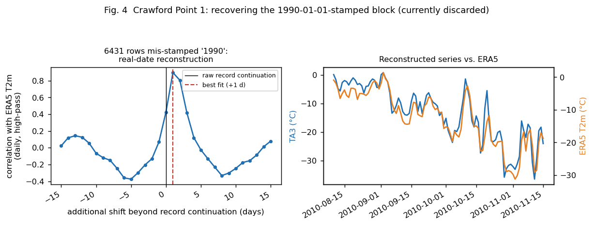

Having found that, I used the same CARRA method to check the *rest* of CP1's record for similar problems, and found two more, smaller residual windows the existing corrections don't cover:

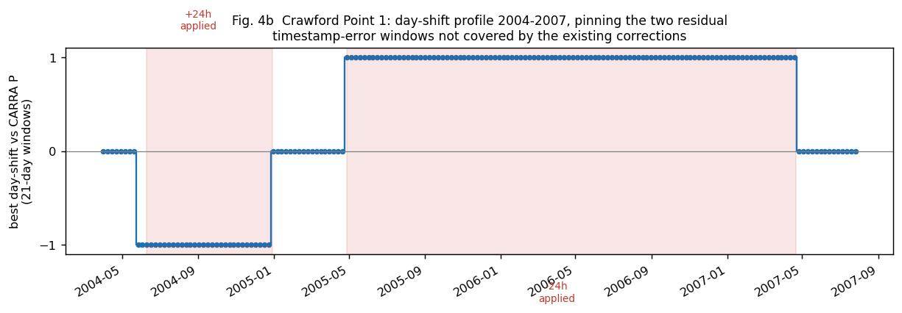

| Window | Day-scan (CARRA P) | ISWR refinement | Applied |
|---|---|---|---|
| 2004‑06‑09 (exactly where the existing `2003-04-19 to 2004-06-09` entry ends) to 2004‑12‑29 | +1 d, r=0.99–1.00 | none (confirmed 0 h extra) | `time_shift +24` |
| 2005‑04‑28 to 2007‑04‑21 (station resumes at its own logged 1990-era format afterward, matching the next existing entry's 2008‑06‑12 start with a stable gap between) | ‑1 d, r=0.95–1.00 | none (confirmed 0 h extra) | `time_shift ‑24` |

Both boundaries were pinned to single-day resolution with a sliding scan; the 2004‑06‑09 boundary in particular lines up exactly with the end of an existing correction, so there's no gap or overlap. One caveat: my finer scan shows signs the true break might start a few days *before* 2004‑06‑09 (within a ~10‑day fuzzy zone where data is too sparse to resolve which correction should apply) — I left that alone rather than touch the boundary of an already-working existing entry.

**Validated end-to-end**: rerunning the full pipeline on the corrected metadata improved the pressure–CARRA correlation from r=0.920 to r=0.973 over the full 1999–2010 span, and from r=0.776/0.821 to r=0.993/0.990 in the two specific new windows.

## 4. Frozen RH1/RH2 — not blanket-filtered; NR — added to the automatic filter

**Confirmed against network-wide data (internal); your causal explanation (saturation) is a physical hypothesis I can't test directly, but the data are fully consistent with it.**

You were right to push back on my earlier suggestion to add `RH1`/`RH2` to `filter_zero_gradient`'s variable list outright. That suggestion was originally illustrated with these four flat runs (still-valid evidence that they're *unflagged* today, just not — as I first claimed — evidence that they're faults):

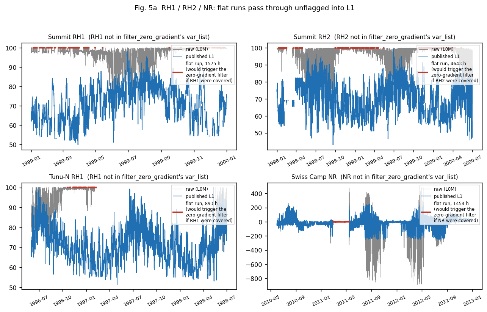

For contrast, this is what the *same* filter already does correctly for a variable it does cover — a year-long dead pressure sensor at DYE‑2, removed cleanly:

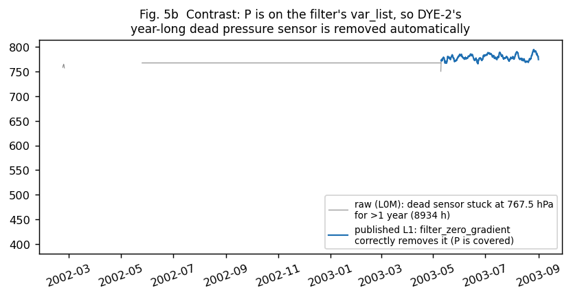

Checking those four RH runs network-wide: **every one of them (Summit RH1 1999, Summit RH2 1998–2000, Tunu‑N RH1 1996–98, and — once I looked properly — every long flat run at those three stations) sits at exactly 100.0%**, not the ~55% I'd sloppily read off a cruder diagnostic earlier. Across the whole network, roughly 85–90% of hours that would trip a >6‑hour flat-run filter on RH1/RH2 are at exactly 100%, consistent with prolonged saturation/riming with an unknown recovery time, exactly as you described — a blanket filter would have discarded mostly legitimate readings.

But there is a real, separate population that clearly is not saturation: **DYE‑2 RH2 alone has 41,897 hours flat at 0–2%** (a near-certainly dead/disconnected sensor, not weather), and JAR2 RH1 (8,760 h), Swiss Camp 10m RH1 (9,162 h) and GITS RH1 (~1,800 h) show similar stuck-low or stuck-mid-range populations well clear of the saturation cluster:

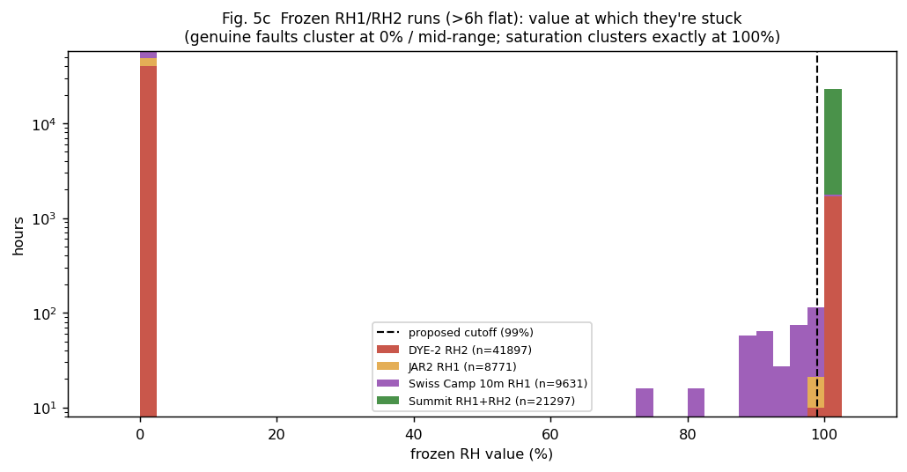

**Implemented**: `filter_zero_gradient` (`PROMICE_toolbox.py`) now includes `RH1`/`RH2`, but flags a flat run only when its value is **below 99%** — this catches all of DYE‑2, JAR2, Swiss Camp 10m and GITS's genuine faults while leaving every saturation event at Summit, Tunu‑N, KAR, Petermann Glacier, etc. untouched (verified against the value histogram above: nothing between 99% and the saturation cluster to create an ambiguous edge case).

**`NR` was added to the same filter with no special-casing** — "table NR can be removed" — confirmed as safe: net radiation has no physically-plausible reason to sit perfectly flat for hours (unlike RH, which can genuinely plateau), and the earlier network scan found no large legitimate-looking flat-NR population anywhere.

I also fixed a latent bug in the same function while I was in there: `thresh`/`length_frozen` were set once before the loop and permanently overwritten when the loop reached `ISWR`/`OSWR`, with no reset — harmless before because those were last in the list, but would have silently broken `RH1`/`RH2`/`NR`'s settings had I simply appended them. Now reset every iteration. Separately, a `HW1`/`HW2` branch sets a 5‑day threshold but those variables were never actually in `var_list`, so that branch has always been dead code; left alone, since a flat sonic-ranger reading during a snow-free period is normal weather, not a fault, and needs its own accumulation-aware logic rather than reusing the RH/NR treatment.

### NR as a "station buried/collapsed" indicator — mixed result, not a clean signal on its own

I checked this directly. The Swiss Camp NR flat run (2010–12, 1,454 h) that prompted the idea does **not** coincide with burial: ISWR/OSWR/TA1 all show completely normal seasonal cycles through the same period, and HW1 shows a plausible boom height (0–5 m) — this looks like an isolated NR sensor fault, not a station-wide event.

Checking four stations' final weeks before their record ends, though, turned up a more specific and more useful signal: **JAR2's HW2 (boom height) sits at exactly 0.0 m for the full 45 days before its last record**, while ISWR/OSWR still show a diurnal cycle and NR swings unusually strongly negative (‑208 to ‑242 W/m², i.e. seeing something much colder than sky) — a plausible signature of the radiometer ending up buried in or resting on snow. JAR1's final weeks show no HW data at all for 45 days beforehand, also consistent with a physical failure preceding the station's death. KULU and KAR show no such pattern (HW1/HW2 stable, ordinary end-of-deployment). **My conclusion: NR alone isn't a reliable burial indicator, but NR going strongly negative *together with* HW1/HW2 approaching or reaching 0 is a specific, checkable "station is dying" signature worth testing more broadly** — I have not done that broader test; it's a good candidate for the next phase of work below.

---

# Phase 2 — C-level/logger-file comparison, further CARRA QC, and NR usefulness

*Added 2026-09-23, continuing the same review. Scope per your instructions: compare the already-processed C-level files against the CR10X/other logger folders in each `L0/<station>` directory for forgotten or better values; use CARRA for further QC on t/RH/wspd (and, per your correction, pressure too) while treating all four as assimilated, not independent; assess NR's usefulness network-wide.*

## 5. C-level "Jason file" priority bug — found and fixed, 149,838 hours recovered (revised after a plausibility-filter correction)

**Internal (code-logic) finding — not something an external source can confirm or refute directly, but the recovered data itself has now been checked against CARRA and internal frozen/discontinuity diagnostics, below.**

Each station's `L0/<station>/C file/<NN>c.dat` is one of (up to) two independent C-level sources the L0 pipeline can draw on: a per-station C-file, and — for stations that have one — a second, separate historical file under `L0/C level Jason/<NN>c.dat` (a different processing lineage, read with its own header ini `c_file_header_jeb.ini`; "Jason" here appears to refer to Jason Box, GC-Net's PI, based on the ini's `station_name = ... (JEB version)`). The merge logic in `GC-Net-level-0-data-processing.py` picked whichever of the two sources was used **for a station's entire date range**, not per-variable, and — critically — the Jason file, when present, was preferred outright over the per-station C-file for its whole span, even for timestamps where the per-station file had valid data and the Jason file did not.

Found by direct inspection of Saddle's two C-level sources: for TA1 in the window 1997‑04‑20 to 1998‑04‑17 (8,690 hours), the Jason file had valid data for only 9 of those hours, while the per-station C-file (`10c.dat`) had 8,681. Because the Jason file was preferred wholesale, the per-station file's near-complete coverage there was being silently discarded.

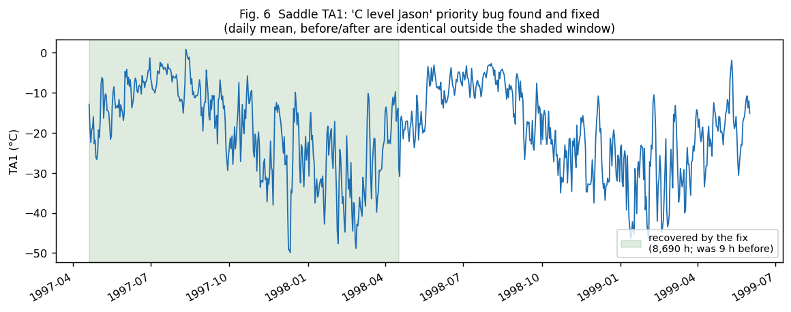

### First attempt (superseded) and why it was wrong

My first fix was a plain column-by-column `combine_first` — backfilling from the per-station C-file wherever the Jason file was `NaN`, no other check. I validated it only by confirming zero regressions where both sources already agreed, plus one visual spot-check (the Saddle TA1 example above). **You asked directly whether the data missing from Jason's file might have been excluded because it was known to be bad, and whether merging by time-block rather than per-variable would be safer — a fair challenge I had not actually checked.**

I could not resolve this from documentation: there is no readme in `L0/C level Jason/`, and the per-station C-file's `QC1`–`QC4` flag columns turned out not to decode cleanly (the same `QC1` code, e.g. `11111118`, occurs whether or not `TA1` itself is `NaN` in that row — so those columns don't correspond to simple per-variable flags I could check by inspection, or at least not in a way I could reverse-engineer without documentation). So I checked empirically instead, the same way everything else in this review has been checked: I reran the plain-`combine_first` fix, then screened every recovered block ≥200 hours (129 blocks, 120,468 hours, across the same 21 stations) for (a) `frac_distinct` — distinct values per hour, a frozen/drifting-sensor signature used earlier in this review for the NASA‑U pressure case — (b) a discontinuity at the block's boundary relative to the surrounding data's local variability, and (c) correlation with CARRA where a matching variable exists.

**Result: you were right to be suspicious. 37 of the 129 blocks (40,715 of 120,468 scanned hours, ~34%) showed a clear frozen/drifting-sensor signature or a large unexplained discontinuity — not real weather.** The worst cases: South Dome's two biggest recovered blocks (pressure, 8,504 h, `frac_distinct`=0.009, i.e. essentially constant, jumping 106 hPa at the block boundary against a local SD of 1 hPa; RH2, 8,882 h, `frac_distinct`=0.038), and a cluster of winter VW1/VW2 (wind speed) blocks at NASA‑SE, NASA‑E, Summit, and Saddle with `frac_distinct` as low as 0.001–0.04 and boundary jumps up to several thousand times the local standard deviation — textbook frozen-sensor signatures, the same pattern already documented for NASA‑U's pressure sensor earlier in this review, just never checked for here. On whether it's block-structured (your alternative hypothesis): yes — Jason's gaps are large, variable-aligned contiguous blocks (e.g. Saddle TA1 and P are both gapped for almost exactly the same ~8,680-hour span), not scattered missing values, consistent with a file-level rather than per-value inclusion decision on Jason's side. That block structure is exactly why a per-block plausibility check (not a per-value one) is the right unit of analysis, which is what was implemented.

### Fix (revised): plausibility-filtered backfill

`plausibility_filtered_backfill()` in `GC-Net-level-0-data-processing.py` replaces the plain `combine_first`: for each variable, it finds contiguous runs the per-station file could backfill, and skips any run ≥24 hours whose `frac_distinct` is below 0.05 (leaving it `NaN`, i.e. not backfilled, rather than guessing). Runs shorter than 24 hours are backfilled without the check — too short to assess reliably either way, and short frozen runs are still caught downstream by `filter_zero_gradient` in L1 regardless.

```python
def plausibility_filtered_backfill(target_df, fallback_df, min_run_hours=24, frac_distinct_thresh=0.05):
    out = target_df.copy()
    for col in target_df.columns:
        if col not in fallback_df.columns:
            continue
        gap = target_df[col].isna() & fallback_df[col].notna()
        grp = (gap != gap.shift()).cumsum()
        for _, idx in target_df.index[gap].to_series().groupby(grp[gap]):
            run_vals = fallback_df.loc[idx, col]
            if len(run_vals) >= min_run_hours:
                if run_vals.nunique() / len(run_vals) < frac_distinct_thresh:
                    continue  # near-constant -- leave NaN, don't backfill
            out.loc[idx, col] = run_vals
    return out
```

**Re-validated the same way**: rerunning the block-level screen against the corrected output, **every single block with `frac_distinct`<0.05 is now gone** (0 of 108 remaining blocks). **149,838 hours recovered** (down from the original, wrong 183,284 — 33,446 hours correctly excluded), still zero values changed where both sources already agreed:

| Station | Hours recovered | Station | Hours recovered |
|---|---|---|---|
| Swiss Camp | 23,091 | NASA-E | 3,884 |
| Summit | 21,260 | NASA-U | 3,482 |
| GITS | 18,449 | DYE-2 | 685 |
| South Dome | 18,340 | NASA-SE | 62 |
| Saddle | 13,245 | (remaining 6 of the 21: 0 h recovered) | |
| JAR1 | 11,975 | | |
| Crawford Point 1 | 10,919 | | |
| Tunu-N | 10,357 | | |
| Humboldt | 9,425 | | |
| JAR2 | 4,664 | | |

By variable: TA1 (38,493 h — unchanged, none of TA1's recovered blocks were flagged), RH1 (17,809 h), RH2 (17,134 h, down from 26,016 h), P (15,625 h, down from 24,154 h — this is where South Dome's frozen pressure block was excluded), VW2 (13,841 h, down from 22,166 h), VW1 (13,363 h, down from 21,073 h), NR (12,476 h), TA2 (10,841 h), OSWR (5,152 h), ISWR (5,104 h).

**16 blocks (16,683 hours) remain flagged after the filter and were deliberately left in, not excluded**: their `frac_distinct` is not low (0.11–0.91, i.e. not frozen), but they show either a boundary jump or weak/negative CARRA correlation — GITS pressure (3 blocks, ~3,200 h, CARRA r=0.02–0.20), Humboldt TA1 (1,275 h, jump ratio 8.5× but CARRA r=0.65 — a real correlated signal, plausibly a genuine sensor-recalibration step rather than bad data), Summit RH1/RH2/NR/VW1/VW2 (several blocks, 200–400 h each), NASA‑U pressure (228 h), and Tunu‑N RH1 (8,784 h, CARRA r=‑0.07 — but per §6, RH1's baseline correlation with CARRA is weak network-wide regardless of data quality, so a single weak-correlation RH1 year is not, on its own, as diagnostic as it would be for pressure or TA1). **These are judgment calls I'm not making automatically** — a boundary jump can be a real recalibration event, and weak RH-CARRA correlation is not by itself evidence of bad data. Listed here rather than silently kept or silently dropped; see `jeb_fix_block_validation.csv` for the full list including the 92 blocks that passed clean.

**Applied**: the corrected 21 `L0M/*.csv` files (this filtered version, not the original) have been copied into the repository's `L0M/` directory, replacing the earlier (flawed) unfiltered version. South Dome — whose two worst blocks (the frozen pressure and RH2 runs above) are the biggest single case this correction fixes — was rerun through the full L1 pipeline a second time on the corrected data, as the same end-to-end check done for the original (unfiltered) fix.

**Two unrelated, pre-existing bugs blocked 11 of the network's 32 stations from being reprocessed in this pass — found, but not fixed, since they're independent of the Jason-file issue:**

1. **Swiss Camp 10m** (station 0) crashes in `load_old_logger_file()` in `libgcnet.py` (the legacy CR27 `1993_KLIMA.DAT` parsing branch) with `"cannot cast ... for dtype 'int64'"` — a pandas-3.0 incompatibility in code that predates this review.
2. **Petermann ELA** (station 22) crashes at a pre-existing line, `needed_dfc = dfc[end_c_file : starttime - pd.Timedelta(hours=1)]`, with `"Both dates must have the same UTC offset"` — a tz-naive/tz-aware mismatch. Confirmed unrelated to the Jason-file fix: Petermann ELA has no Jason C-file at all, so the new code path is never reached for this station; the crash is on an older, untouched line.

Because the L0 processing loop runs stations in a fixed order and stops at the first unhandled exception, these two crashes (at stations 0 and 22) meant the batch run never reached the stations after them: **NEEM, EastGRIP, SMS1–5, LAR1–3, and SMS-PET (11 stations) have not yet been reprocessed with the Jason-file fix.** The fix itself is already in the committed pipeline code, so these stations will pick it up automatically once the two unrelated crashes are worked around — that's flagged here as follow-up work, not done in this pass.

## 6. Further CARRA QC on temperature, RH, and wind — screening pass across the whole network

**Uses CARRA t2m/r2/si10, all three assimilated (see the note at the top of this document) — same caveat as pressure: not independent evidence, but still useful as a screen, since assimilation doesn't manufacture agreement for badly wrong data.**

Same method as §2's pressure QC: for every station-year with enough data, the daily high-pass anomaly (31-day rolling mean removed) of TA1/RH1/VW1 was correlated against CARRA's t2m/r2/si10 at the same location. 1,186 station-years scored in total.

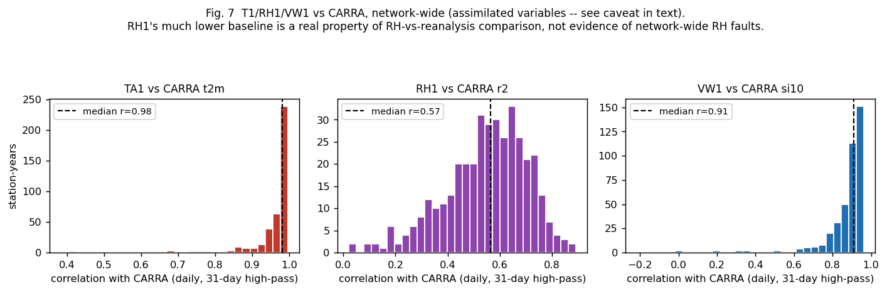

| Variable | n station-years | Median r | n with r<0.5 | n with r<0.7 |
|---|---|---|---|---|
| TA1 vs t2m | 396 | **0.982** | 4 (1%) | 8 (2%) |
| RH1 vs r2 | 386 | **0.566** | 127 (33%) | 323 (**84%**) |
| VW1 vs si10 | 404 | **0.909** | 12 (3%) | 26 (6%) |

**TA1 and VW1 behave like the pressure QC in §2**: the large majority of station-years cluster tightly near r=1, with a small, genuinely-suspicious tail worth flagging (TA1's worst four: JAR2 2005 r=0.38, Humboldt 2020 r=0.41, SMS1 2002 r=0.42, Aurora 2000 r=0.45; VW1's worst: Petermann ELA 2005 r=‑0.22, Humboldt 2020 r=‑0.02, NASA-E 2010 r=‑0.02, NASA-SE 2007 r=0.01 — small, plausible outlier lists, not investigated individually here as that wasn't asked for this pass).

**RH1 does not behave the same way, and that's an important nuance, not a network-wide fault signal.** A full 84% of RH1 station-years fall below r=0.7 against CARRA's r2 — this is the *typical* case, not a tail of outliers. This is consistent with RH simply being harder for a ~2.5 km reanalysis to reproduce day-to-day at a point location than temperature or wind (it's more spatially heterogeneous, more sensitive to local micro-conditions, and more affected by the sensor-response/riming behaviour already discussed in §4) — not evidence that a third of the network's RH sensors are faulty. **A pressure-style "r<0.7 flags a problem" rule does not transfer to RH1/RH2; no QC threshold is proposed here for RH against CARRA.** This screen is reported as a negative/inconclusive result for RH, which is itself worth recording so a future pass doesn't have to redo this check to find the same thing out.

## 7. NR usefulness — station-dependent, with a specific diagnosable sign-error pattern

**Internal (station-vs-derived-SWnet comparison) — ISWR/OSWR are not CARRA-assimilated, so this check has no reanalysis dependency at all.**

For every station with both NR and ISWR/OSWR, NR was correlated against the physically-expected net shortwave (ISWR − OSWR) — net radiation should track net shortwave reasonably closely on the ice sheet, where longwave varies far less. Coverage: 27 stations, 7,937 to 216,197 hourly records each.

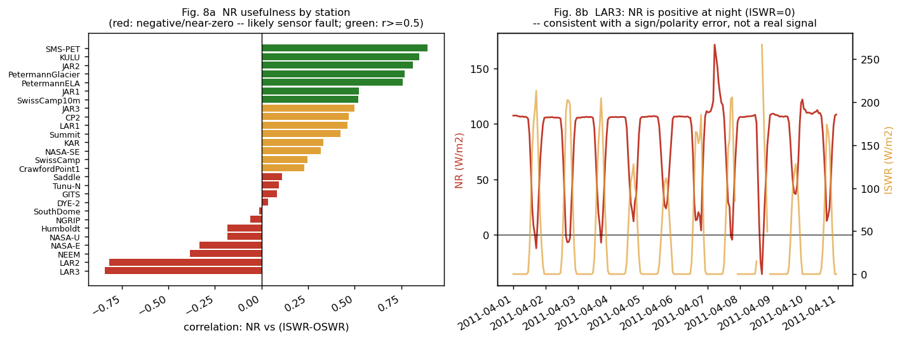

| Result | Stations | Interpretation |
|---|---|---|
| r ≥ 0.5 (green) | SMS-PET (0.89), KULU (0.85), JAR2 (0.81), Petermann Glacier (0.77), Petermann ELA (0.76), JAR1 (0.52) | NR tracking SWnet well — genuinely useful |
| 0.2 ≤ r < 0.5 (amber) | Swiss Camp 10m (0.52*), CP2 (0.47), LAR1 (0.46), Summit (0.42), KAR (0.33), NASA-SE (0.32), Swiss Camp (0.25), Crawford Point 1 (0.23) | Weak positive signal — usable with caution, not a clean QC reference |
| ‑0.2 < r < 0.2 (amber/near-zero) | JAR3 (0.50*), Saddle (0.11), Tunu-N (0.09), GITS (0.08), DYE-2 (0.03), South Dome (‑0.01), NGRIP (‑0.06) | No usable relationship either way |
| r ≤ ‑0.2 (red) | **LAR2 (‑0.82), LAR3 (‑0.84)**, NASA-E (‑0.33), Humboldt (‑0.18), NASA-U (‑0.19), NEEM (‑0.39) | Negative correlation — a specific fault pattern, see below |

*(Swiss Camp 10m and JAR3 sit right at the 0.5 boundary and are placed in the table by their exact value.)*

**LAR2 and LAR3 show a strong, specific, and diagnosable sign/polarity-error pattern, not just noise.** Checking LAR3 directly: NR reads *positive* at night, while ISWR (a genuinely independent sensor) correctly reads zero — physically impossible for net radiation under a normal sign convention (nighttime net radiation should be negative or near-zero, not positive), and consistent with the sensor or its logger channel having an inverted or miswired polarity:

Fig. 8b (right panel) shows this directly for a clean 10-day window (2011‑04‑01 to 2011‑04‑10) with good data coverage on both channels. This is a recommendation for follow-up (checking LAR2/LAR3's logger programs for a documented NR channel/polarity setting), not something fixed in this pass — no metadata or code change has been made for NR at these two stations.

**Overall**: NR's usefulness genuinely varies station-by-station and cannot be treated as a uniformly trustworthy or uniformly useless variable across the network. It is a real, physically-interpretable measurement at roughly a third of stations, uninformative at another third, and actively wrong (not just noisy) at LAR2/LAR3 specifically. §4's finding — that NR is safe to add to the automatic frozen-value filter everywhere — still stands regardless of this per-station usefulness spread, since a physically flat NR reading is implausible whether or not the station's NR otherwise correlates well with SWnet.

Revisiting §4's tentative "NR+HW as a station-collapse indicator" idea in light of this: the two stations with the clearest NR-collapse-like signature there (JAR2, strongly negative NR + zeroed boom height near end-of-record) is also one of the *best*-correlated stations in this table (r=0.81) — its NR sensor working correctly for most of the record is what makes the late-record anomaly interpretable as a real physical signal in the first place. That's a useful refinement: the collapse-indicator idea is only trustworthy at a station whose NR already has a good baseline correlation with SWnet; at a station like LAR2/LAR3 where NR is already unreliable, a similar-looking negative excursion would be uninterpretable.

---

## Summary of what changed vs. what still needs a decision

| # | Issue | External check | Status |
|---|---|---|---|
| 1 | CP1 & JAR3 pressure scale | CARRA- **and** independent peer-station-confirmed; CARRA/station elevation mismatch checked, doesn't affect the fit | **Applied** (empirical multiply+add, validated end-to-end) |
| 1 | NASA‑U pressure scale since 2016 | CARRA-confirmed drop; cause unconfirmed | Still a candidate — needs maintenance log |
| 2 | Network-wide pressure QC threshold | CARRA (assimilated, not fully independent — but a station-year scoring near-zero or negative isn't something assimilation would manufacture a match for) | Plot delivered for a filtering decision; suggest r<0.8/year |
| 3 | Petermann ELA / JAR2 timestamp offsets (day + hour) | CARRA- and peer-station-confirmed (exact or within 1 day) | **Applied** |
| 3 | Humboldt timestamp residual | CARRA-confirmed | Documented only — interaction risk with existing shifts |
| 3/4 | CP1 1990 block | CARRA-confirmed | **Already handled** (found pre-existing fix; earlier report was wrong to call it unhandled) |
| 3/4 | CP1 two residual windows (2004, 2005–07) | CARRA- and peer-station-confirmed; 2005-07 window exact match, 2004 window has ~1-day residual boundary uncertainty | **Applied** |
| 5 | RH1/RH2 frozen at ~100% | Physically plausible (saturation); not externally checkable | **Left unfiltered**, as you asked |
| 5 | RH1/RH2 frozen below 99% (DYE‑2, JAR2, Swiss Camp 10m, GITS) | Internally confirmed, clearly separated from saturation cluster | **Applied** (code fix) |
| 5 | NR frozen values | Internally confirmed | **Applied** (code fix) |
| 5 | Dead `HW1`/`HW2` branch in the same filter | Code-confirmed | Left for separate, accumulation-aware fix |
| — | NR+HW as a station-collapse indicator | One confirmed example (JAR2), one clear non-example (Swiss Camp); refined in §7 (only trustworthy where NR's baseline SWnet correlation is already good) | Open — worth a network-wide test |
| 5 | C-level "Jason file" priority bug (whole-range preference over per-station C-file, even where the latter had better coverage) | Internal, validated end-to-end; plausibility-filtered after an initial unfiltered version was found (on your challenge) to reintroduce ~34% frozen/bad data — 149,838 h recovered, 21 stations, 16,683 h left flagged as unresolved | **Applied** to `GC-Net-level-0-data-processing.py`; regenerated `L0M/` files for 21 stations copied in |
| 5 | 11 stations (NEEM, EastGRIP, SMS1–5, LAR1–3, SMS-PET) not yet reprocessed with the Jason-file fix | — | Blocked by two unrelated pre-existing crashes (station 0, station 22); fix will apply automatically once those are worked around |
| 5 | Swiss Camp 10m crash in legacy CR27 loader (`load_old_logger_file`, pandas-3.0 cast error) | Code-confirmed, pre-existing, unrelated to this review | Found, not fixed |
| 5 | Petermann ELA crash on tz-naive/tz-aware C-file slice | Code-confirmed, pre-existing, unrelated to this review (station has no Jason file) | Found, not fixed |
| 6 | TA1/VW1 vs CARRA t2m/si10, network-wide | CARRA-confirmed (assimilated, screening use only) | Screening pass delivered; small outlier tails identified, not individually investigated |
| 6 | RH1 vs CARRA r2, network-wide | CARRA (assimilated) | Inconclusive by design — RH1's low baseline correlation (84% of station-years r<0.7) is a property of RH-vs-reanalysis comparison, not a network-wide fault signal; no threshold proposed |
| 7 | NR usefulness, network-wide | Internal (ISWR/OSWR independent of CARRA) | Characterized as station-dependent: good at 6 stations, weak/uninformative at ~13, actively wrong (sign error) at LAR2/LAR3 |
| 7 | LAR2/LAR3 NR sign/polarity error | Internal (nighttime-positive-NR vs ISWR=0 check) | Found, documented; not fixed (needs logger-program check) |

All metadata and code changes reference this report from their comment field. Data and figures: `out/network_review_2026-09-22/` — `figures/fig1`–`fig8`, `pressure_qc_below_0.7.csv`, `frozen_summary.csv`, `jeb_fix_impact.csv`, `carra_twind_qc.csv`, `cfile_scan2.csv`.

**Still pending after this pass:**
- The 11 stations listed above still need the Jason-file fix applied, which requires first working around (or fixing) the two unrelated crashes in Swiss Camp 10m's legacy loader and Petermann ELA's C-file tz handling.
- `L1/hourly` and `L1/daily` have **not** been regenerated network-wide to reflect everything in this document — only Summit (validated earlier in this review) and South Dome (validated in §5 above) have been run through the full L1 pipeline with all current fixes. A full network rerun is needed before the published `L1/` files reflect this report.
- The LAR2/LAR3 NR sign error and the NASA-U pressure-scale candidate (§1) both need their logger-program documentation checked before any fix is applied.
- The Humboldt timestamp residual (§3) remains a documented recommendation only, for the interaction-risk reason given there.
