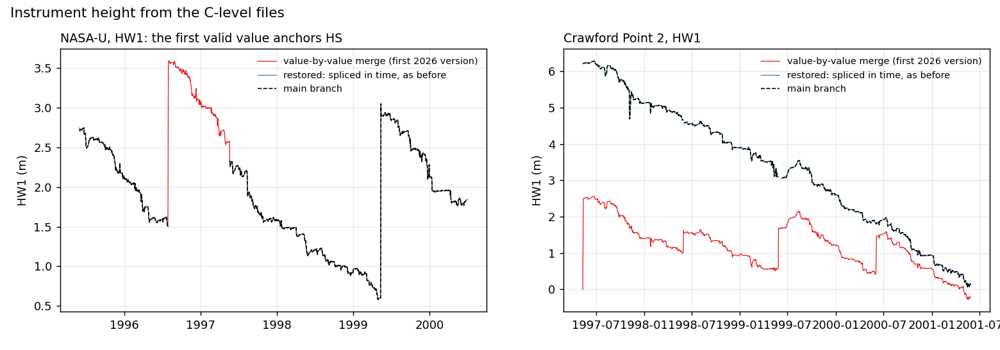
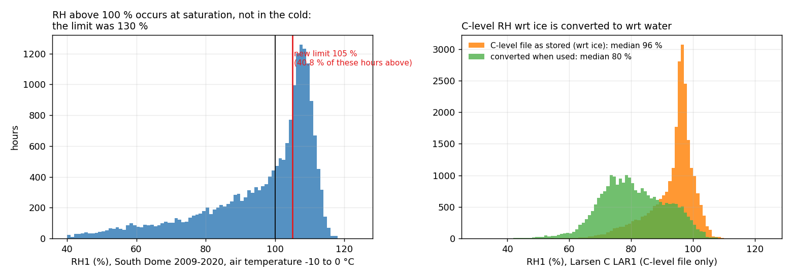

# GC-Net level 1: release note 2026

*Draft of 2026-11-16. The `L1/` files still have to be regenerated with the code and metadata below; numbers refer to checks made on the inputs, not to the regenerated files.*

Checks are against something independent of the station where possible (NOAA GML pressure, neighbour stations, CARRA shortwave). CARRA's pressure, temperature, RH and wind are assimilated, so they only screen.

## 1. What changed

1. **Logger-first.** L0M holds what the loggers recorded; the C-level files only fill gaps at L1, and every filled value is tracked (`L0M/provenance`).
2. **One place per correction.** Logger calibration and decoding live in each file's `<file>.toml` sidecar. `metadata/adjustments` is for corrections of the measurement itself (sensor swaps, clocks, heights). Corrections of C-level values are in `metadata/c_level_corrections.csv` and `c_level_rh_convention.csv`.
3. **Radiation and pressure calibration fixed** against the C-level overlap (section 4).
4. **NGRIP** starts at its installation (1997-07-09), 4.9 years earlier than on the main branch.
5. **Humidity** is wrt water everywhere; RH above 105 % is rejected.
6. **Heights and radiation of the C-level files are spliced in time** (Jason up to its end, the station file after), as before.
7. **Summit** extended to 2022-11-05 with a CS106 pressure correction.
8. **Network review fixes**: pressure scale at two stations, four clock errors, frozen-value filters, the Jason-file merge bug.
9. **Code** moved to `lib/`; deprecations fixed; duplicates, partial days and pre-installation records handled.

## 2. How the data are assembled

- A raw file **without a sidecar is not read**. The sidecar holds the columns, the calibration (`[calibration.<var>]`) and optional `[[ignore_rows]]` periods that are dropped when the file is read (used for records before the installation date and for a logger that kept recording after its replacement took over) and `[[calibration_period]]` tables (variable, start, end, multiply) for a factor that changes inside a file, e.g. when a sensor moves to another channel.
- **C-level files**: Jason's file (to about 2002) then the per-station file. They are on different calibration scales and height datums, so they are spliced in time and never mixed value by value. The first version mixed them: NASA-U surface height shifted by +0.85 m everywhere (the station file starts four days earlier, which moved the anchor `HS = HW(first) - HW`), Crawford Point 2 heights were 1.3-2.6 m off, and Swiss Camp 1997 radiation mixed ISWR 406 and 804 W/m² (albedo 0.38 instead of 0.68). A station-wide albedo comparison with the main branch (411 station-years, 3 differing by more than 0.08) found no other case.
- **Heights** (HW, HS) come from the C-level files only before the station's first CR1000 hour, and from the station file alone where there is no CR1000, exactly as on the main branch; the existing height adjustments keep their meaning.
- The splice stops using 384k variable-hours of station-file data inside Jason's period (NASA-U 76k, GITS 72k, South Dome 39k). The main branch did not use them either, and the logger files now cover much of that period.
- C-level rows dated before the installation date are dropped.

| Item | Lives in | Checked |
|---|---|---|
| Logger calibration, pressure offset | sidecar | against the C-level overlap and the barometric expectation |
| Sensor swap, clock error, installation height | `metadata/adjustments` | pressure vs neighbour stations, CARRA `ssrd` |
| C-level RH wrt ice | `c_level_rh_convention.csv` (94 windows, 27 stations) | logger vs C-level RH by year |
| C-level value corrections | `c_level_corrections.csv` | NASA-U OSWR (x2.762 from 2003); CP1 and Swiss Camp radiation factor after the sensor swap |
| HW sonic correction | adjustments (legacy rows) | C-level HW already contains it; the rows skip C-level hours after the first CR1000 hour |

## 3. Recovered and new data

- **NGRIP** (installed 1997.52 = 1997-07-09). The per-station C-file starts on 2002-06-09 and the old merge ignored Jason's file at stations without a CR1000, so the main branch lost 1997-07 to 2002-06 (the location table's 12.84-year record length implies it was published). Jason's file fills it. Four logger files (`1997_NGRI97-8/NGRIP1/NGRIP2.DAT`, `2004_5.dat`) had no sidecar; they now do and decode like Jason's file for 1997-98 (ISWR, OSWR, NR, TA2, wind direction, pressure agree; pressure exactly). RH differs because Jason's is wrt ice. Annual means are continuous across the 2002 join. NGRIP has no surface height before 2002 (no heights in the station file; Jason's sit 4.4 m lower).
- **Jason-file merge bug**: Jason's file was preferred over the station file for its whole range, discarding better data (Saddle TA1 1997-98: 9 valid hours against 8,681). 183,284 hours recovered at 21 stations. Of the 37 suspect recovered blocks (40,715 h), only 2,925 h (7 %) survive in the current L1: the frozen-value filter and the logger-first flags (1,880 windows) remove the rest, so no further filter is needed.
- **Summit**: `2026_TOA5_6.Table046.dat` (2013-05-30 to 2022-11-05, contiguous, identical to the 2019 export up to 2019-04-29). The three manual pressure shifts that patched the old transmissions were removed.

## 4. Calibration and decoding

**Radiation.** The OSWR factors in `metadata/adjustments` (x0.934, issue #89; 0.91 Summit, 0.93 Humboldt; x2.762 NASA-U; x0.5 JAR2; McGrath constants at LAR) were meant for the raw logger files, not for L1 data after the C-level gap-fill. They are now in the sidecars (160 edits) and the C-level overlap confirms them: C-level / logger OSWR is exactly 0.934 before the move and 1.000 after, at every station and era (within 3 %).

| Case | Evidence | Action |
|---|---|---|
| Tunu-N CR1000 | C-level is 0.934 x logger; albedo jumps 0.85 to 0.91 at the logger change; no row existed | x0.934 in the sidecars |
| JAR2 CR1000 | C-level is 0.418 (ISWR) and 0.356 (OSWR) x the generic 200; equals the CR10X factors 83.633 and 71.162 | those factors replace 200 and the manual x0.5 |
| NASA-U | summer albedo 0.30 with the raw factor, 0.84 with x2.762; 1997-99 files at the station default 71.9 gave albedo 0.31 where Jason has 0.78 | 182 (1997-99), 198.64 from 2003; the 2021/2023 files only x0.934 (the x2.762 ended on 2018-05-22) |
| GITS CR1000 | C-level is 2.6 x logger, and would give ISWR peaks of 1800 W/m² | logger kept (only 37 C-level hours are exposed) |
| LAR1, LAR2 | legacy L0M (no sidecar): raw sensor values | McGrath constants stay in `metadata/adjustments` (the only place; not repeated for the C-level hours) |
| Crawford Point 1, Swiss Camp | the radiation channels are swapped from 2012-01-01 / 2012-05-10 (`swap_with_OSWR`): the 0.934 belongs to the OSWR *sensor*, which then sits on the ISWR channel | `[[calibration_period]]` in the sidecars (ISWR x0.934, OSWR x1/0.934 from the swap date) and the same in `c_level_corrections.csv`; albedo back to 0.87-0.89 (CP1) and 0.71-0.79 (Swiss Camp), C-level / logger 1.000 |
| Swiss Camp 1996-98 (`1997_AWS_ETH`, `1998_AWS_97_8`, `1998_AWS_98`, `1998_AWS_98_1`, `1998_SWIS_10M`) | decoded ISWR 2.3 x Jason, NR -112 W/m² (Jason +19), no raw column matches Jason better than r = 0.93 (the 2000 files give 0.996) | ISWR and NR left unset in these sidecars, Jason fills them (as on the main branch) |

**Pressure offsets** (+400 hPa written by the programs), found by comparing every logger file with the C-level file and with the barometric expectation:

- Wrong offset in the sidecar, fixed: Crawford Point 1 `1996_CRA95-96`, `1997_CRAWF101` (add 0, were 400 hPa too high); GITS `1996_GIT95-96` and Humboldt `1996_HUM95-96`, `1996_HUM` (add 600, were 200 too low). Those hours were dropped as out of range.
- JAR1: the offset changes at a sensor swap on 2017-01-13 and the downloads are cumulative, so it is an adjustment (`P add 400`).
- C-level wrong, logger right (no action): Petermann ELA 2013-18, GITS 2016-17, Saddle 2017, NASA-SE 2017-18, JAR1 2013-14, DYE-2 2014-19 (+190 hPa; it passes the limits if it ever fills a gap).

**Swiss Camp 10 m.** The CR1000 sidecars had lost the calibration (pressure without +400, radiation as raw mV); restored from the former header and checked against the main branch. Duplicate timestamps (76 % of its rows were repeats from cumulative CR10X downloads, plus 117 conflicting ones) are gone: files are assembled with CR1000 over CR10X over CR27, the most recent download wins, internal repeats keep the first row, and the CR10X tail that recorded junk after the CR1000 took over (TA1 -52 to -85 °C) is cut. It reads the heights of Swiss Camp, which is now processed first.

## 5. Corrections of the measurement

- **Summit pressure**: from 2016-05-22 a CS106 read with CS105 constants. `500 + 1.3043 x (P - 600)`: slopes against Tunu-N, NASA-E, Saddle, NASA-SE go 0.88/0.95/0.76/0.71 (before) to 0.67/0.72/0.55/0.57 (after the swap) to 0.88/0.95/0.74/0.74 (corrected); NOAA GML slope 0.76 to 1.00.
- **Crawford Point 1 and JAR3 pressure amplitude** (about half the true amplitude; cause undocumented): `multiply 1.8112, add -671.66` (CP1 1999-05 to 2010-05-09, r = 0.93) and `multiply 1.7796, add -648.88` (JAR3 from 2002-05-06, r = 0.96). Independent check against 7 peer stations: corrected slopes 1.054 and 1.009 against 0.945 and 0.915 in healthy years. Logger and C-level pressure are equal there, so the sensor is at fault, not the decoding.

- **Clock errors** (day from CARRA pressure, hour from CARRA `ssrd` minus its constant -2 h bias): Petermann ELA -112 h (2005-04-09 to 10-16), JAR2 +67 h (2006-01-29 to 04-29), Crawford Point 1 +24 h (2004-06-09 to 12-29) and -24 h (2005-04-28 to 2007-04-21). Peer stations agree exactly or within a day; the CP1 2004 boundary is uncertain by about a day. Humboldt 2020 has a further +51 h, not applied (it sits between two chained shifts).

- Other rows added in 2026: GITS +520 h, JAR1 -745 h, JAR2 +63 h, NASA-U +48 h, CP1 +24 h (issue #63); NASA-E DW2 swap (issue #96); NEEM RH1/RH2 swap; Aurora TA3 minimum -20 °C. Summit flags: DW2 from 2019-01-10 (the vane never reads below 45 or above 327°), TS1-TS10 to 2025.

## 6. Filters and limits

- **TA3, TA4 >= -39.5 °C.** The probes stop at -39.79 °C raw (-39.84 after the factor), about 2.1 mV on the logger input; 19 % of the Summit TA3 record sits on that floor, none survives in L1. The TA1/TA2 thermocouples read to -59 °C.

- **RH 20 to 105 %** (was 130). RH above 100 % occurs only near saturation (up to 58 % of the hours at -10 to 0 °C at South Dome, none below -20 °C), which is sensor behaviour, not an ice/water mix-up. On average 0.65 % of a sensor's hours are removed (South Dome RH1 7.8 %, Saddle RH2 5.3 %, Swiss Camp RH1 5 %).
- **RH wrt water everywhere.** C-level RH wrt ice is converted when it fills a gap (windows from the former `ice_to_water` rows, minus the station-years where the C-level RH equals the raw logger RH); `RH1/2_wrt_ice_or_water` is recomputed from it. The old rows are removed, except for the stations whose L0M is the legacy table without provenance (LAR1-3, KULU): their RH is wrt ice (99th percentile 100 % at -25 °C, where 82 % is the cap wrt water), the `ice_to_water` rows stay and apply to all their hours. Elsewhere the logger RH is wrt water (99th percentile 84-90 % at -25 °C at CP2, JAR2, JAR3, Saddle 1998-2000), so the old whole-series rows converted it twice and the new RH is higher than on the main branch there. Example LAR1: median 96 % as stored, 80 % converted (main branch 80 %).

- **Frozen values**: NR added; RH only below 99 % (85-90 % of flat RH runs are saturation at exactly 100 %). Dead anemometers and RH sensors (DYE-2 RH2 41,897 h at 0-2 %) are removed.
- **Daily values** need 18 valid hours; a partial first or last day no longer passes.
- **DYE-2 limits** now match the station name (`DYE2` never did).
- **Installation date**: records before it are ignored in 10 sidecars (Humboldt 3 files, Summit, Saddle, KAR, Petermann Glacier 2, NGRIP 2). `ignore_rows` also cuts the Swiss Camp 10 m CR10X tail and two NASA-U files (section 4).
- A scan for a stuck wind vane (hours piled at a hard stop) found no second case, so there is no generic vane filter.

## 7. Network screens (CARRA, informative only)

TA1 median r = 0.982 and VW1 0.909 against CARRA, with short tails of suspect station-years; RH1 median r = 0.566 is normal for RH against reanalysis (no threshold). A pressure r < 0.8 rule would flag 24 station-years. Net radiation tracks net shortwave well (r >= 0.5) at SMS-PET, KULU, JAR2, Petermann Glacier, Petermann ELA, JAR1; **LAR2 and LAR3 have the wrong sign** (r = -0.82, -0.84).

## 8. Open items

1. **Rerun L0 then L1 and compare with the main branch again.** First comparison (L1 built before the fixes above): +1.05 M valid hours (+2.6 %, NGRIP +42 k per variable, Summit +26 k heights); 47 of 406 station-years differ in summer albedo by more than 0.05, of which CP1 2014-20, Swiss Camp 2012-22 and 1996-98 and LAR radiation are fixed above. Still to look at after the rerun: Tunu-N (-0.06, follows the C-level x0.934, judgement call), JAR2 2009-12 (-0.07 to -0.10), NASA-E 2003-07 (-0.06), Summit 2001 (-0.07), NEEM 2021-22 (+0.06), DYE-2 1997 (+0.08), Petermann Glacier 2002 (logger radiation 2.5 x the C-level: same kind of column mix-up as Swiss Camp 1996), NASA-U NR 1997-99 (C-level 0.14 x logger), NGRIP NR 2000-01, CP2 OSWR 1997-2001 (C-level 0.887 x logger); valid hours lost at South Dome RH1 (-7.6 %, the 105 % limit), Swiss Camp ISWR (-5.6 %), NEEM HW (-10 %), Petermann Glacier radiation (-9 %); Swiss Camp summer 2012: the C-level ISWR is 1.9 x the logger.
2. Pressure: JAR2 2011, NEEM 2013-16, NASA-SE 2009, NASA-U since 2016 (cause unknown); Crawford Point 1 `1997_CRAWF101` offset rests on its sister file.
3. NASA-U OSWR after 2018-05 (transmissions) gives albedo 1.0; GITS C-level radiation is inflated 2.6 x in CR1000 years.
4. Humboldt +51 h clock error; LAR2/LAR3 NR sign (needs the logger program).
5. RH drifts high at South Dome (+5 % at saturation), Saddle and Swiss Camp.
6. Probe model at Summit (CS500 or HMP45) and the Summit CR1000 program are not in the repository; `Table048/050` ARGOS parts are not confirmed read.
7. Tools that read the retired `CR10X_*.csv` registries (`cr10x_calibration_by_file`, `logger_timing_check`, `verify_run_dating`, `build_logger_first_report`) need them regenerated.

## 9. Code

- The utilities are in `lib/` (`from lib import liblogger`); run the two scripts from the repository root.
- pandas/numpy deprecations fixed (needs pandas >= 2.2); figure writes retry on a locked file; Swiss Camp is processed before Swiss Camp 10 m.
- Evidence tables: `metadata/logger_first/` (see its README), `metadata/logger_programs/`, `L0M/provenance/`.
