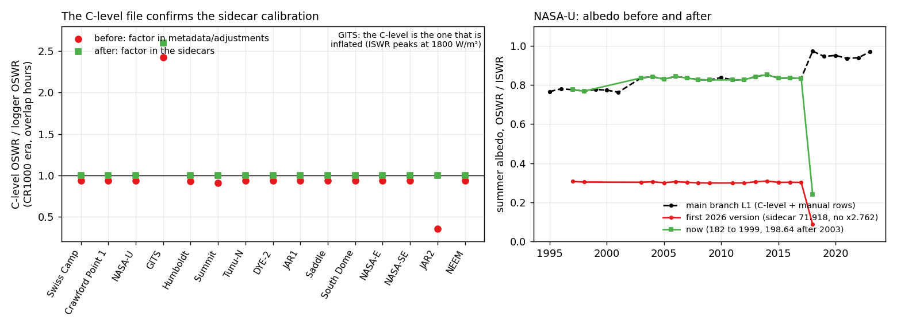
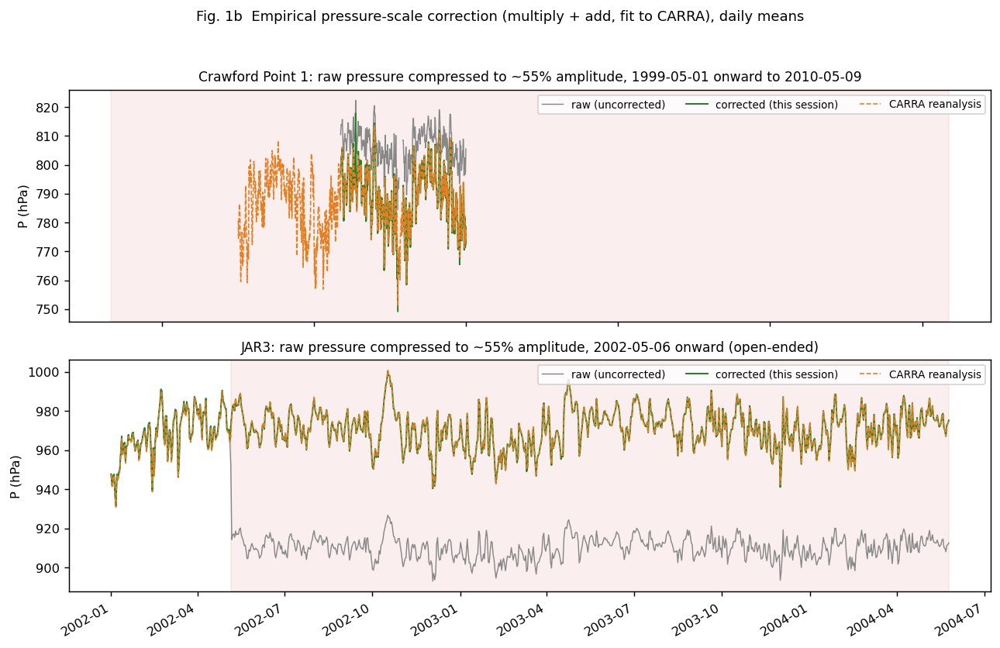
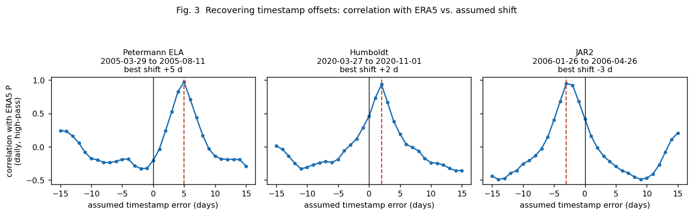

# GC-Net level 1: release note 2026

*Status 2026-11-26: L0M and L1 were rebuilt for all stations (files written 2026-11-24 to 2026-11-25) and delivered as `old releases/V12`. Edits made after that build (section 5): the Swiss Camp HW1 rows and the Saddle HW2 row of 2026-11-26 (rerun and checked: Swiss Camp 2002 spacing 1.20 m, HW1 above HW2 10,404 to 1,427 h, the rest being 2021-22; Saddle 2002 spacing 1.04 m; HS1 and HS2 unchanged to 0.000 m), and the start of the Swiss Camp HW1 `min_filter` moved to the first CR1000 hour (the shifted C-level HW1 of 2009-02 to 05 fell under it, 2,006 h of HW1 and HS1 lost): one more rerun of **Swiss Camp and Swiss Camp 10 m**. `python tools/hs_steps.py` finds no step of the surface height left except melt-season gaps at ablation sites. Comparison with the previous release (V11) in section 7, known defects and open items in section 8.*

Checks are against something independent of the station where possible (NOAA GML pressure, neighbour stations, CARRA shortwave, field reports and field books). CARRA's pressure, temperature, RH and wind are assimilated, so they only screen.

## 1. What changed

1. **Logger-first.** L0M holds what the loggers recorded; the C-level files (the L1 data of the previous releases) only fill gaps at L1, and every filled value is tracked (`L0M/provenance`).
2. **One place per correction.** Logger calibration and decoding live in the configuration file (`<file>.toml`) of each raw file. `metadata/adjustments` is for corrections of the measurement itself (sensor swaps, clocks, heights). Corrections of C-level values are in `metadata/c_level_corrections.csv`, `c_level_rh_convention.csv` and `c_level_swaps.csv`.
3. **Radiation and pressure calibration** fixed against the C-level overlap (section 4).
4. **NGRIP** starts at its installation (1997-07-09), 4.9 years earlier than in V11. **Summit** extended to 2022-11-05.
5. **Humidity** is wrt water everywhere; RH above 105 % is rejected.
6. **Heights**: HW1/HW2 keep the steps of the boom lifts; HS1, HS2 and HS_combined are continuous (steps removed); HW1 and HW2 carry the sensor of their name (South Dome, Saddle exchanged).
7. **Network review fixes**: pressure scale (Crawford Point 1, JAR3, Summit), 30 clock corrections, frozen-value filters, the Jason-file merge bug, misdated logger runs.
8. **Code** moved to `lib/`; duplicates, partial days and pre-installation records handled.

## 2. How the data are assembled

- A raw file **without a configuration file is not read**. The configuration file holds the columns, the calibration (`[calibration.<var>]`), the periods to drop (`[[ignore_rows]]`: records before the installation, a logger that kept recording after its replacement), a factor that changes inside a file (`[[calibration_period]]`: variable, start, end, multiply) and the exchange of two columns (`[[swap_columns]]`).
- **C-level files**: Jason's file (to about 2002) then the per-station file, spliced in time and never mixed value by value (different calibration scales and height datums; the first version mixed them and shifted the NASA-U surface height by 0.85 m, the Crawford Point 2 heights by 1.3-2.6 m and gave Swiss Camp 1997 an albedo of 0.38 instead of 0.68). C-level rows dated before the installation are dropped.
- **Heights** (HW, HS) come from the C-level files only before the first CR1000 hour of the station (the station file alone where there is no CR1000); CR10X-sourced heights are replaced by the C-level heights.

| Item | Lives in | Checked |
|---|---|---|
| Logger calibration, pressure offset | configuration file | C-level overlap, barometric expectation |
| Sensor swap, clock error, installation height | `metadata/adjustments` | neighbour pressure, CARRA `ssrd` |
| Exchange of two channels of a logger | `[[swap_columns]]`, `c_level_swaps.csv` | section 5 |
| C-level RH wrt ice | `c_level_rh_convention.csv` (94 windows, 27 stations) | logger vs C-level RH by year |
| C-level value corrections | `c_level_corrections.csv` | NASA-U OSWR (x2.762 from 2003); CP1 and Swiss Camp radiation factor after the sensor swap |
| HW sonic correction | adjustments (legacy rows) | C-level HW already contains it: skipped for C-level hours after the first CR1000 hour |

## 3. Recovered and new data

- **NGRIP** (installed 1997-07-09): the per-station C-file starts 2002-06-09 and the old merge ignored Jason's file at stations without a CR1000. Jason's file fills 1997-2002; four logger files (`1997_NGRI97-8/NGRIP1/NGRIP2.DAT`, `2004_5.dat`) now have configuration files and agree with Jason (pressure exactly). No surface height before 2002.
- **Jason-file merge bug**: Jason's file was preferred over the station file for its whole range (Saddle TA1 1997-98: 9 valid hours against 8,681). 183,284 hours recovered at 21 stations; the frozen-value filter and logger-first flags remove the suspect blocks (7 % survive).
- **Summit**: `2026_TOA5_6.Table046.dat` (2013-05-30 to 2022-11-05); the three manual pressure shifts that patched the old transmissions were removed.

## 4. Calibration and decoding

**Radiation.** The OSWR factors in `metadata/adjustments` (x0.934, issue #89; 0.91 Summit, 0.93 Humboldt; x2.762 NASA-U; x0.5 JAR2; McGrath constants at LAR) were meant for raw logger files, not for L1 data after the C-level gap-fill. They are now in the configuration files (160 edits); the C-level overlap confirms them (C-level / logger OSWR is 0.934 before the move and 1.000 after, at every station and era, within 3 %).

| Case | Evidence | Action |
|---|---|---|
| Tunu-N CR1000 | C-level is 0.934 x logger; albedo jumps 0.85 to 0.91 at the logger change | x0.934 |
| JAR2 CR1000 | C-level is 0.418 (ISWR), 0.356 (OSWR) x the generic 200; equals the CR10X factors 83.633 / 71.162 | those factors replace 200 and the manual x0.5 |
| NASA-U | summer albedo 0.30 with the raw factor, 0.84 with x2.762; 1997-99 files at 71.9 gave 0.31 where Jason has 0.78 | 182 (1997-99), 198.64 from 2003; 2021/2023 files only x0.934 (x2.762 ended 2018-05-22) |
| GITS CR1000 | C-level is 2.6 x logger (ISWR peaks of 1800 W/m²) | logger kept |
| LAR1, LAR2 | legacy L0M without configuration file | McGrath constants stay in `metadata/adjustments` |
| Crawford Point 1, Swiss Camp | radiation channels swapped from 2012-01-01 / 2012-05-10 (`swap_with_OSWR`): the 0.934 belongs to the OSWR *sensor* | `[[calibration_period]]` (ISWR x0.934, OSWR x1/0.934 from the swap) and the same in `c_level_corrections.csv`; C-level / logger 1.000 |
| Swiss Camp 1996-98 | decoded ISWR 2.3 x Jason, NR -112 W/m² (Jason +19); the column labelled ISWR is net radiation | ISWR and NR left unset, Jason fills them |
| NASA-E, GITS, NGRIP OSWR fitted to the C-level (5-7 % noise) | documented scale x0.934 gives the value of the CR1000 files and V11 | 66.0789 (NASA-E 2003-2011), 186.8 (GITS 2002, 2007), 66.714 (NGRIP 2003-2010) |

`metadata/calibration_overview.md` (written by `tools/calibration_overview.py`) lists every radiation and pressure factor per station against the instrument tables (`metadata/calibration factors`). **Documented** (equal to the tables): ISWR (SWin 200, South Dome 62, NASA-E 71.43), OSWR (SWref x 0.934), net radiometer, +400 hPa pressure offset (600 DYE-2, 300 NEEM). **Fitted to the C-level overlap, undocumented**: net-radiometer scales of single files (33 station-variables), a few single-year ISWR/OSWR scales. **No instrument table**: Aurora, CP2, JAR2, JAR3, NGRIP, Petermann Glacier, EastGRIP (pressure), KAR, Swiss Camp 10 m. **Estimates, not calibrations** (each about 5-10 % in radiation; evidence in section E of the overview): NASA-U ISWR x1.15 from 2018-05-22 (new radiometers installed 2018-05-23 per the field book; ISWR/CARRA falls 1.07 to 0.88) and OSWR x2.762; Petermann Glacier 73.5 for both sensors (logger and C-level scales gave 2.3 x CARRA); Crawford Point 1 ISWR x1.139 (2005 to 2010-05-09) and x1.105, Swiss Camp OSWR x1.055 (1995-97) and x0.926 (from 2012-05-10), chosen to keep the April-May dry-snow albedo at its value of the best documented years (CP1 0.83 in 1995-2004, Swiss Camp 0.81 in 1998-2012: **the albedo of these two stations is the result of that choice and cannot show a trend**); LAR1 OSWR x1.285 from 2011-11-15 (albedo 0.90 to 0.70 at the service of 2011-11-14 with unchanged ISWR). CARRA `ssrd` is the independent check for the shortwave; V11 can only show that a change is intended.

**Pressure offsets** (+400 hPa written by the programs), found by comparing every logger file with the C-level file and the barometric expectation:

- Wrong offset in the configuration file, fixed: Crawford Point 1 `1996_CRA95-96`, `1997_CRAWF101` (add 0, were 400 hPa too high); GITS `1996_GIT95-96`, Humboldt `1996_HUM95-96`, `1996_HUM` (add 600, were 200 too low). JAR1: the offset changes at a sensor swap on 2017-01-13, so it is an adjustment (`P add 400`).
- C-level wrong, logger right (no action): Petermann ELA 2013-18, GITS 2016-17, Saddle 2017, NASA-SE 2017-18, JAR1 2013-14, DYE-2 2014-19 (+190 hPa).

**Swiss Camp 10 m.** The CR1000 configuration files had lost the calibration (pressure without +400, radiation as raw mV); restored from the former header. Duplicate timestamps (76 % of rows were repeats of cumulative CR10X downloads) are gone (CR1000 over CR10X over CR27, most recent download wins); the CR10X tail that recorded junk after the CR1000 took over is cut. It reads the heights of Swiss Camp, which is processed first.

## 5. Corrections of the measurement

Each item below rests on an independent check or on a field record; estimates are listed in section 4.

**Pressure**
- **Summit** from 2016-05-22: a CS106 read with CS105 constants; `500 + 1.3043 x (P - 600)`. Slopes against Tunu-N, NASA-E, Saddle, NASA-SE 0.67/0.72/0.55/0.57 before, 0.88/0.95/0.74/0.74 after; NOAA GML slope 0.76 to 1.00.
- **Crawford Point 1** (1999-05 to 2010-05-09) and **JAR3** (from 2002-05-06): amplitude about half the true one; `multiply 1.8112, add -671.66` and `multiply 1.7796, add -648.88`. Corrected slopes against 7 peer stations 1.054 and 1.009 (0.945 and 0.915 in healthy years); logger and C-level agree, so the sensor is at fault.

**Clocks** (day from CARRA pressure, hour from CARRA `ssrd`; 30 `time_shift` rows at 10 stations)
- Petermann ELA -112 h (2005-04-09 to 10-16), JAR2 +67 h (2006-01-29 to 04-29) and +24 h (1999-06 to 2000-05), Crawford Point 1 +24 h (2004-06-09 to 12-29) and -24 h (2005-04-28 to 2007-04-21), Summit +24 h (1996-05 to 1997-12), Aurora +24 h (whole record), Humboldt -24 h (2004-01 to 08) and three chained shifts that left 2 and 7 days (r 0.97 at +2 d against 0.4), GITS +520 h, JAR1 -745 h, NASA-U +48 h, NASA-E -2 h (2006-05 to 2008-11). Humboldt 2015: the field book of 2015-05-20 records the logger 3 months 2 days behind, equal to the +2198 h row.
- Misdated runs found by matching daily pressure with CARRA over +-800 days: GITS `1999_GITS9902.DAT` is 1997 data (r 0.989 at 730 d, 0.03 at 0), JAR1 `1998_JAR_97-8.DAT` and `1998_JAR2.DAT` are one year earlier; `start_year` corrected.

**Flags**
- Summit DW2 from 2019-01-10 (the vane never reads below 45 or above 327°), TS1-TS10 to 2025; NGRIP ISWR 2010-02-10 to 05-02 (ISWR/CARRA 0.17-0.5 while OSWR/CARRA 0.75-0.95: covered sensor); GITS OSWR 2006-03-24 to 04-24 (albedo 1.9, V11 had 0.85); JAR1 RH1 and TA3 2003-12 to 2005-05 (RH1-RH2 -27 to +35 %, TA3 up to +25 °C); LAR1 2009-03-31 to 05-21 and LAR3 2009-10-09 to 12-03 pressure (constant, std 0.3 hPa); NASA-U/SE, EastGRIP and Humboldt HW2 episodes (restart transient, held value, drift); Aurora TA3 minimum -20 °C; NASA-E DW2 swap (issue #96); NEEM RH1/RH2 swap; 1,880 logger windows absent from the C-level file and stuck or out of range.

**Surface height and instrument heights**
- **Definition.** HW1 and HW2 are the heights of the anemometers (and of the T/RH sensors, about at the same height on each boom), derived from the sonic ranger readings, which are on a separate boom, plus the station geometry and the maintenance shifts; HW1 is the lower boom. Steps at boom lifts and reinstallations are real and kept; the sonic ranger spacing itself is not what matters (Humboldt and DYE-2 sonic rangers are 0.3-0.6 m apart, the anemometers 1.2 m). HS = HW[first valid] - HW + `add` rows, continuous by construction. A correction of the level of HW is paired with an HS row of the same size and hours (`tools/hw_corrections.py`).
- **Code** (`lib/PROMICE_toolbox.py`): runs of 14 days or more of the same HW value are removed (held values: KULU 9 months, GITS 2001 4 months, LAR1 2010 4 months, Summit 2001-02 2 months); isolated hours of HS1/HS2 more than 0.3 m from their 25 h median are removed; HS_combined brings HS2 onto HS1 with the offset of the surrounding week (it was the whole-record mean: hourly steps above 0.3 m fall from 826 to 43 at JAR1, 425 to 37 at NASA-SE); **HS_combined is interpolated over gaps of 30 days at most** (V11 interpolated over every gap, up to 8 years); the manual HS rows now also apply at the stations with the automatic shift (Summit, NASA-SE, Tunu-N, EastGRIP, LAR1, JAR1, JAR2, Petermann ELA, NGRIP, SMS).
- **Steps in HS** (`tools/hs_steps.py`, rows between `# hs_steps.py begin/end` in `metadata/adjustments`): a change between two valid hours that persists over 4 days, minus the change of the other sensor and the monthly climatology; November-March steps within a day are artefacts of the C-level processing (removed in HW), the others are boom moves (removed in HS). 69 rows at 18 stations; of the first 60 rows, 44 of the 47 that could be tested reduce the HS1-HS2 jump. Melt-season gaps at ablation sites are not corrected (26 candidates: JAR1 13, JAR2 4, SMS2 2, SMS3 2, Swiss Camp 5; `metadata/logger_first/hs_steps_proposal.csv`).
- **HW corrections with paired HS rows**: Humboldt HW1 +1.40 and HW2 +1.36 from 2011-05-15 (L1 was 1.46/1.34/1.40 m below the reports of 2011, 2018 and the field book of 2022 while the raw HW1 is within 0.12 m of all three; the row of 2023-01-01 that caused the -1.2 m HS1 step is switched off); Swiss Camp HW1 +1.04 and HW2 +1.35 from 2012-06-01 (reports 2013-2018 sit 1.02-1.09 m above the L1 whose HW1 fell below the range of the sonic ranger); Crawford Point 1 HW2 -1.06 over 2001-12-31 to 2002-12-31 (spacing jumped from 1.20 to 2.22 m at a source change in mid winter); Summit 2005-05-04 to 05-26 (the field-note shift rows ended 22 days before the boom was raised). Swiss Camp 2002-01-25 20 UTC (where Jason's file ends and the station file starts the C-level series change datum, HW1 +1.47 m and HW2 +0.32 m in one winter hour; HW2 corrected by an `hs_steps.py` row, HW1 not) and 2003-01-24 01 UTC (single-sensor step of HW1 of -0.85 m): HW1 -1.47 m and then -0.62 m up to the first CR1000 hour, with paired HS rows (HS unchanged to 0.000 m in a replay with `adjust_data`); the spacing HW2 - HW1 is 1.2 m again in 2002 (it was -0.27 m) and 0.85 m in 2003-2008 (0.23 m). The same datum step at the end of Jason's file at Saddle (2001-12-25 01 UTC: HW2 -0.79 m, HW1 -0.22 m, spacing 1.17 to 0.60 m): HW2 +0.79 m up to 2002-12-31 with a paired HS row (spacing 1.04 m, HS unchanged). A scan of the steps at the end of Jason's file in all stations shows no other single-sensor datum step (Tunu-N 2002-03 +0.84 / +0.56 on both sensors; the large steps of NASA-E 2001-06 and NASA-SE 2003-05 are the documented boom raises; JAR2 2001-08 is the copied series). Also: Crawford Point 1 HW swap covers 2010-05-09 to 2011-05-02 without a hole; LAR2 HW1 +2.54 m 2010-05-02 to 12-09 (sensor lowered).
- **A HW series flagged where it is a copy of the other** (identical in 100 % of the hours, or the spacing within 3 cm in every week for 4 weeks or more, which two real sonic rangers never do): HW2 at Petermann Glacier 2002-06 to 2006-05, KULU 1999-07 to 2000-09, Petermann ELA 2003-05 to 09, 2004-02 to 05, 2005-09 to 10, 2006-04 to 05 and 2007-03 to 04, JAR1 2010-02 to 04, JAR2 2001-08 to 2003-07 and 2004-05 to 2005-03, Swiss Camp 2003-04 to 09; HW1 at JAR1 2002-09 to 2003-04 (the report of 2003-04-26 agrees with HW2 and puts HW1 0.9 m lower).
- **HW1 and HW2 exchanged.** *South Dome from 2006-07-20 22 UTC*: HW2 - HW1 is +1.11 m the hour before and -1.00 m after, both booms rise by 1.0 to 1.1 m after the exchange (a single boom would need +2.0 m and 0), the report of 2011-05-30 (W1 3.47, W2 4.60) matches the exchanged labels, and T, RH and wind pairs do not change at that hour, so only the sonic channels are exchanged. *Saddle 2003-05-01 to 2010-04-29* (C-level file only; the CR10X logger columns are equal to 0.1 m so the logger does not tell; the CR1000 labels are normal, the lower sonic ranger was added 2014-05-25): HW1 is above HW2 by 0.8 m in the C-level file, reports of 2003-05-01 and 2004-06-12 agree with the exchanged labels to 0.2 m. With the labels exchanged three single-sensor artefacts of 2.6 m remain in the raw series (no visit): the lower sensor reads 2.6 m high 2004-10-14 to 2005-01-30 and 2005-03-28 to 2005-05-14, the upper one 2.6 m low 2007-05-27 to 2008-05-03 (spacing -1.8 m instead of +0.8 m, back to +0.8 m the hour the artefact ends, both sensors continuous across the windows to 0.1-0.2 m); they are corrected by three HW rows (the earlier manual rows HW +2.5 and -2.5 raised the good stretches instead and removed the real boom raises). Both booms are raised by 2.6 m at the visits of 2004-06-12 and 2005-05-26 (kept in HW, removed in HS by four HS rows). Checked with the real `adjust_data`: spacing +0.62 to +0.67 m over 2004-2009, HS jumps at the two visits 0.00 m. The exchange is made where the files are read (`[[swap_columns]]` in the 9 South Dome CR1000 configuration files, `metadata/c_level_swaps.csv` for the C-level file), so L0M, L1 and the C-level comparison see the same sensor under the same name; the HS rows, HW rows and `CHECKME` flags of the periods follow the sensor. Compared with V11 these two stations show HW1 and HW2 (and HS1, HS2) with their labels exchanged.

**Field evidence for the heights.** Field readings of the sonic rangers equal the raw logger display, which tests the decoding: DYE-2 2017-05-12 upper 2.08 m (raw 2.12), DYE-2 2023-06-14 lower 1.81 m (raw 1.88), NASA-SE 2017-05-06 0.63 / 1.71 m (raw 0.62 / 1.72), Saddle 2017-05-07 lower 0.62 m (raw 0.63). The offset between these readings and HW is discussed in section 8, item 2. The reports of the maintenance summary (W1/W2) disagree with the L1 by more than 0.4 m in 67 of about 160 values (`metadata/instrument_height_reference_check.csv`); most are copies of the 'before' value, wrong spacings or stale dates in the reports, not L1 errors. The photogrammetric heights use one scale (0.45/0.277) that is right only at Summit and JAR1 (`photogrammetry_scale_check.csv`): they are a shape reference only. DYE-2 spacing 0.48 m from 2014 is genuine (the sonic rangers are 0.56 m apart, the wind sensors 1.2 m).

## 6. Filters and limits

- **TA3, TA4 >= -39.5 °C.** The probes stop at -39.79 °C raw; 19 % of the Summit TA3 record sits on that floor, none survives in L1. The TA1/TA2 thermocouples read to -59 °C.

- **RH 20 to 105 %** (was 130). RH above 100 % occurs only near saturation (up to 58 % of the hours at -10 to 0 °C at South Dome, none below -20 °C): sensor behaviour, not an ice/water mix-up. On average 0.65 % of a sensor's hours are removed (South Dome RH1 7.8 %, Saddle RH2 5.3 %, Swiss Camp RH1 5 %).
- **RH wrt water everywhere.** C-level RH wrt ice is converted when it fills a gap (windows from the former `ice_to_water` rows, minus the station-years where the C-level RH equals the raw logger RH). The old rows are removed, except at the stations whose L0M is the legacy table without provenance (LAR1-3, KULU), whose RH is wrt ice (99th percentile 100 % at -25 °C, where 82 % is the cap wrt water). Elsewhere the logger RH is wrt water, so the old whole-series rows converted it twice.

- **Frozen values**: NR added; RH only below 99 % (85-90 % of flat RH runs are saturation at 100 %); HW held 14 days or more (section 5). Dead anemometers and RH sensors (DYE-2 RH2 41,897 h at 0-2 %) are removed.
- **Daily values** need 18 valid hours. **DYE-2 limits** now match the station name (`DYE2` never did). **Installation date**: records before it are ignored in 10 configuration files.
- A scan for a stuck wind vane found no second case, so there is no generic vane filter.

## 7. Comparison with the previous release (V11) and network screens

`python tools/compare_with_release.py` aligns the hourly files of `old releases/V11` and `L1/` and classes every hour of every variable as unchanged, modified (beyond a tolerance above the file rounding), gained (valid only in the new) or lost (valid only in V11); the report and figures are in `figures/release_2026/comparison/`.

- **Network, core variables** (ISWR, OSWR, NR, Alb, TA1-4, RH1-2, VW1-2, DW1-2, P, HW1-2, HS_combined), V12 (the delivered files, `old releases/V12`, identical to `L1/`) against V11: 47.15 M valid variable-hours in V11, 47.42 M now (**+0.58 %**). Without HS_combined (see below) 43.61 M against 44.66 M (**+2.4 %**), 1.56 M gained and 0.52 M lost; 17.3 % of the common hours are modified (calibration, sensor labels, clocks).
- **Quality indicators, V11 to V12** (hourly files, all stations; `tools` scratch check of 2026-11-26): hourly steps above 0.3 m in HS_combined 2,455 to 378 (JAR1 766 to 54, Saddle 438 to 95, NASA-SE 413 to 40, South Dome 135 to 0, Crawford Point 1 170 to 26), in HS1 874 to 303, in HS2 1,454 to 473; hours with HW1 above HW2 98,309 to 18,200 (South Dome 41,413 to 0, Saddle 17,080 to 4, Crawford Point 1 4,104 to 0, JAR2 26,984 to 2,916); frozen TA1 runs of 48 h or more: 0 in both. Not improved or worse: hours with RH above 100 % (90,199 to 95,526; Saddle 1,213 to 12,329 and Tunu-N 27 to 3,410, because the RH of the logger is wrt water and reaches 105 % at saturation, V11 converted it twice), hours with OSWR above ISWR at ISWR above 200 W/m2 (2.0 % in both; South Dome 2,432 to 4,471, NGRIP 20 to 395, Summit 787 to 1,573), pressure outside 520-900 hPa (JAR1, JAR2, JAR3, Petermann ELA unchanged, known). **Swiss Camp HW1 above HW2: 194 to 10,404 hours (2002-2003) in V12**: corrected after V12 (HW rows of 2026-11-26, section 5), to be in the next build.
- **Net change of the core variables by station**: NGRIP +69 % (1997-2002 recovered), CP2 +3.9 %, Summit +3.8 % (to 2022-11-05), KAR +1.5 %, Aurora +1.4 %, NASA-E +0.9 %, Humboldt +0.8 %, DYE-2 +0.5 %; the stations below 0 are KULU -22.7 %, Petermann ELA -6.3 %, GITS -5.0 %, Petermann Glacier -2.0 %, South Dome -2.0 %, NASA-U -1.9 %, Swiss Camp -1.8 %, JAR1 -1.3 %, all other stations within 1 %.
- **Losses, all deliberate or explained**: **HS_combined -800 k hours (-22 %)** is the whole of the negative balance of GITS, Petermann ELA, Swiss Camp, NASA-U, JAR1 and most of South Dome: V11 interpolated over every gap, the new file only over gaps up to 30 days (none of the lost hours has a valid HS1 or HS2 in the new L1; HS1 +1.1 %, HS2 -1.9 %). Petermann Glacier HW2/HS2 -34 k and KULU HW2/HS2 -10 k (copies of HW1, flagged); Summit DW2 -34 k (saturated vane, from 2019-01-10); NEEM, KULU and GITS HW1 -6 to -7 k each (held values of 14 days or more); South Dome RH1 -15 k (105 % limit); JAR2 ISWR 2013-04 to 06 (r = 0.34 against CARRA, flagged); derived SHF, LHF, VW10m follow the heights (-3 % to +2 %). South Dome and Saddle HW/HS look changed by label only (the valid hours of HW1 + HW2 are unchanged). Records end on the same dates as in V11 except Summit (+1 month), Petermann Glacier (+4 days) and JAR2 (-31 days: only RH1 in V11).
- **Albedo scan** (rebuilt L1 of 2026-11-18 to 11-24): spring albedo of Crawford Point 1 and Swiss Camp 0.81-0.85, of NASA-E, GITS, NGRIP and Summit 0.80-0.88, Petermann Glacier summer 0.64-0.69; nothing above 0.97; the only low values are the ablation-zone stations JAR1-3 (0.35-0.55).
- **CARRA screens** (informative only): TA1 median r = 0.982, VW1 0.909; RH1 0.566 is normal for RH against reanalysis; a pressure r < 0.8 rule would flag 24 station-years. Net radiation tracks net shortwave well (r >= 0.5) except at **LAR2 and LAR3, whose net radiation has the wrong sign** (r = -0.82, -0.84).

## 8. Known defects and open items

1. **Sensor labels and spacing of HW1 and HW2 that do not follow the convention** (HW1 lower, HW2 higher by the boom spacing of the station, about 1.0-1.4 m; `instrument_height_pair_anomalies.csv`; L1 scan of 2026-11-25): Crawford Point 1 2010-2012 (spacing 2.4 m), NGRIP 2003 (2.3 m), JAR1 2009-2010 (0.2 m), JAR2 2011 (-0.25 m) and 2005 (1.7 m), Petermann ELA 2013-2017 (0.11 m, two sensors almost at the same height or one copied), Swiss Camp 2002-2003 (-0.2 m) and 2004-2008 (0.2 m), 2021 (1.0 m), 2022 (0.1 m). Not corrected (evidence not conclusive). Saddle 2004-2007 was fixed (section 5).
2. **Offset between the sonic reading and HW** (anemometer height) is not applied uniformly: at DYE-2 HW equals the sonic reading (field 2023-06-14: sonic 1.81 m, anemometer 2.30 m) while other stations carry manual offsets of 0.3-0.9 m in the logger era (NASA-SE 2017: L1 0.92 / 2.32 m for sonic readings 0.62 / 1.72 m). 21 manual HW rows run on from the C-level into the logger data (`metadata/logger_first/hw_open_adds_into_logger_era.csv`) and the `hs_steps.py` rows for 'winter artefact removed in HW' have no end date. HS is not affected; the heights used for the 2 m temperature, 10 m wind and the fluxes are. A systematic geometry table (sonic ranger to anemometer per boom, from the field sheets) would fix it.
3. **Heights, other**: manual 'continuity' HW rows at CP2 (8), Summit (12), NASA-SE (8), NGRIP (5), CP1 (4), DYE-2 (3) contradict the rule that HW keeps boom steps; HS1-HS2 offsets that change by 0.3-1 m at a visit with no record of which sensor moved (Tunu-N 2002-02, JAR1 2004-2007, JAR2 2005-06, NEEM 2016, NASA-SE 2018-19, Petermann ELA 2012-08 to 2013-02; Saddle HS1-HS2 about 1 m in 2003-2009); a variable HSR for the height of the sonic rangers is not built.
4. **Pressure**: JAR2 2011, NEEM 2013-16, NASA-SE 2009, NASA-U since 2016 (cause unknown; NASA-U had no pressure sensor from 2014-05-23); Crawford Point 1 `1997_CRAWF101` offset rests on its sister file.
5. **Radiation**: NASA-U 1995-2001 albedo 0.77-0.79 against 0.84 after 2004 (the C-level OSWR drift explains 2.6 of 8 %); NASA-U OSWR after 2018-05 (transmissions) gives albedo 1.0; GITS C-level radiation is inflated 2.6 x in CR1000 years; Swiss Camp summer 2012 C-level ISWR is 1.9 x the logger; Swiss Camp spring 2019 albedo 0.98; non-physical spring albedo episodes at Summit 2010-03-31 to 05-06 and NASA-E 2012-05 (inherited from V11); Petermann Glacier radiation 2002-06 has no calibration document.
6. **Clocks**: Humboldt +51 h (2020); residual +-24 to +-70 h at Humboldt (2000-03, 2004-03 to 07, 2006-03/04, 2020-04 to 09, 2022-04/05) and GITS (2000-03, 2002-03, 2006-04, 2013-05, 2015-09, 2020-03) need the two-stage method before a row is written; the South Dome logger clock was set to UTC on 2015-05-26 (field book 2015), so check ISWR against CARRA for 2009-2015.
7. **Humidity**: 1999-2008 RH is 3-10 % above V11 (the C-level carries a temperature-dependent offset up to 10 % below the function `RH_ice2water`; documentation checked: only +-3 % profile coefficients and no correction formula); RH drifts high at South Dome (+5 % at saturation), Saddle and Swiss Camp.
8. **Other**: LAR2/LAR3 net radiation sign (needs the logger program); Summit probe model (CS500 or HMP45) and the Summit CR1000 program are not in the repository; four diagnostic tools read the retired `CR10X_*.csv` registries (`cr10x_calibration_by_file`, `logger_timing_check`, `verify_run_dating`, `build_logger_first_report`) and need them regenerated; `CITATION.cff`: version raised to 2, date-released kept at 2022 (set it at the publication date).
9. **Field notebooks** (`GC-Net-historical-metadata/Field books`; transcripts and the list of what is read in `metadata/field_books/transcripts_2026-11-18.md`): read are the 2005 Box, 2011-12 Bayou, 2014, 2015 and half of 2016 field books, the 2017 Heilig book, the 2018 Heilig book (most), 2021 DYE-2, NASA-SE and Saddle sheets, the 2022-23 GEUS notes and the Sampson, McGrath, LAR, NEEM and NGRIP notes. They confirm the decoding at every checked outage (CP1 no data mid-June 2015 to 2016-05-07, JAR1 until 2014-05-06 and from 2016-04-10, DYE-2 HW1 2015-07 to 2017-05, Saddle HW1 until 2016-05-20, NASA-SE HW1 until 2016-05) and give leads still to check: wind direction after the tower turns (CP1 2014-05-02 by 80°, NASA-SE 2014-05-25 by 45°, South Dome 2016-05-19), Swiss Camp wind directions 30° off until 2014-05-10, EastGRIP wind direction 2014-15, NASA-SE Tair 1 and 2 too warm in 2015-05, Petermann ELA Tair out until 2015-05-20. Unread: 1997, 1999-2005 Box snow pits, 2003-04 Steffen, 2005 Molotch and Huff, 2013 and 2017 field book c, the second half of 2016.

## 9. Code

- The utilities are in `lib/` (`from lib import liblogger`); run the two scripts from the repository root; both have an `ONLY` list at the top to rebuild a few stations; Swiss Camp is processed before Swiss Camp 10 m. Needs pandas >= 2.2.
- `liblogger.read_configured_files` merges the files with one array and integer codes (2-4 x faster, identical result); the C-level files are read once per station; the L1 files are written in chunks (`ptb.write_l1_nead`, byte-identical); figures are closed when saved and written as PNG in `figures/`.
- Tools: `tools/calibration_overview.py` (regenerates `metadata/calibration_overview.md`), `tools/hs_steps.py` (steps of HS; `--write` appends and never duplicates a row, `--reset` rebuilds), `tools/hw_corrections.py` (HW corrections with paired HS rows, idempotent), `tools/check_instrument_height_references.py`, `tools/compare_with_release.py`, `tools/figure_changes.py` (which modified figures really changed since the last commit), `tools/upload_to_dataverse.py` (draft upload with preflight to the Dataverse dataset; the token is read from `dataverse_token.txt`, publishing needs an explicit `--publish`).
- Evidence tables: `metadata/logger_first/` (see its README), `metadata/logger_programs/`, `L0M/provenance/`.
