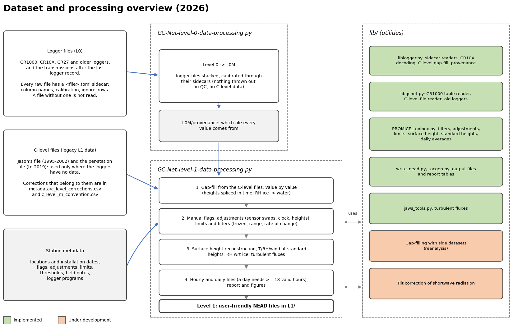
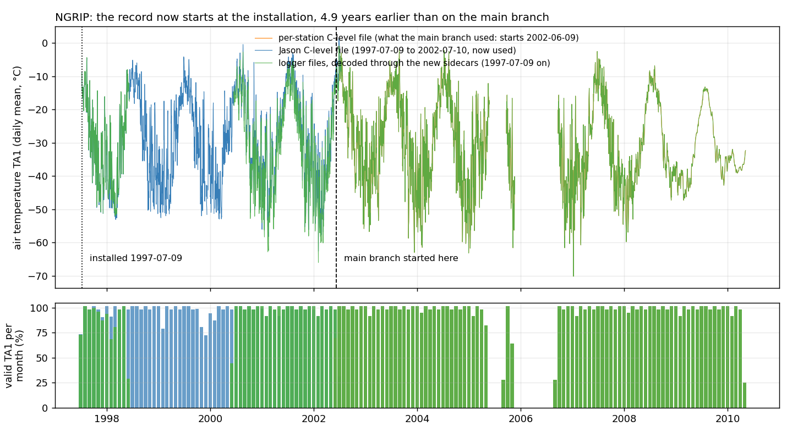
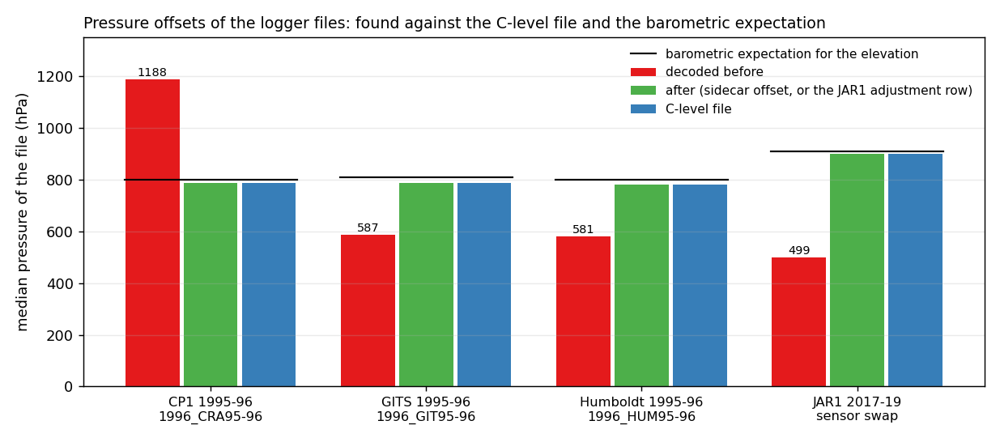
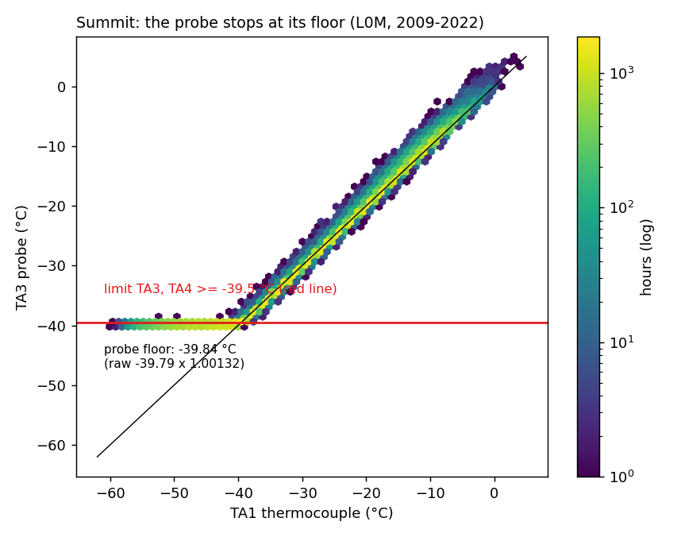

# GC-Net level 1: release note 2026

*Draft of 2026-11-16. The `L1/` files still have to be regenerated with the code and metadata below; numbers refer to checks made on the inputs, not to the regenerated files.*

*2026-11-18: the `L0M/` and `L1/` files in the repository predate part of the sidecar edits (a fresh read of the Swiss Camp sidecars has no ISWR/OSWR/NR before 1999, the `L0M` has 17,204 ISWR hours; the `[[calibration_period]]` blocks of Crawford Point 1 and Swiss Camp and the LAR McGrath constants are not in the `L1/` either). `tools/compare_with_release.py` run on them shows those artefacts (CP1 albedo 1.0 after 2012, Swiss Camp 1996-97 albedo 0.35-0.56, LAR1/LAR2 radiation 2.7 x too low), which disappear when L0 and L1 are rerun.*

Checks are against something independent of the station where possible (NOAA GML pressure, neighbour stations, CARRA shortwave). CARRA's pressure, temperature, RH and wind are assimilated, so they only screen.

## 1. What changed

1. **Logger-first.** L0M holds what the loggers recorded; the C-level files only fill gaps at L1, and every filled value is tracked (`L0M/provenance`).
2. **One place per correction.** Logger calibration and decoding live in each file's `<file>.toml` sidecar. `metadata/adjustments` is for corrections of the measurement itself (sensor swaps, clocks, heights). Corrections of C-level values are in `metadata/c_level_corrections.csv` and `c_level_rh_convention.csv`.
3. **Radiation and pressure calibration fixed** against the C-level overlap (section 4).
4. **NGRIP** starts at its installation (1997-07-09), 4.9 years earlier than on the main branch.
5. **Humidity** is wrt water everywhere; RH above 105 % is rejected.
6. **Heights and radiation of the C-level files are spliced in time** (Jason up to its end, the station file after), as before.
7. **Summit** extended to 2022-11-05 with a CS106 pressure correction.
8. **Network review fixes**: pressure scale at two stations, four clock errors, frozen-value filters, the Jason-file merge bug.
9. **Code** moved to `lib/`; deprecations fixed; duplicates, partial days and pre-installation records handled.

## 2. How the data are assembled

- A raw file **without a sidecar is not read**. The sidecar holds the columns, the calibration (`[calibration.<var>]`) and optional `[[ignore_rows]]` periods that are dropped when the file is read (used for records before the installation date and for a logger that kept recording after its replacement took over) and `[[calibration_period]]` tables (variable, start, end, multiply) for a factor that changes inside a file, e.g. when a sensor moves to another channel.
- **C-level files**: Jason's file (to about 2002) then the per-station file. They are on different calibration scales and height datums, so they are spliced in time and never mixed value by value. The first version mixed them: NASA-U surface height shifted by +0.85 m everywhere (the station file starts four days earlier, which moved the anchor `HS = HW(first) - HW`), Crawford Point 2 heights were 1.3-2.6 m off, and Swiss Camp 1997 radiation mixed ISWR 406 and 804 W/m² (albedo 0.38 instead of 0.68). A station-wide albedo comparison with the main branch (411 station-years, 3 differing by more than 0.08) found no other case.
- **Heights** (HW, HS) come from the C-level files only before the station's first CR1000 hour, and from the station file alone where there is no CR1000, exactly as on the main branch; the existing height adjustments keep their meaning.
- The splice stops using 384k variable-hours of station-file data inside Jason's period (NASA-U 76k, GITS 72k, South Dome 39k). The main branch did not use them either, and the logger files now cover much of that period.
- C-level rows dated before the installation date are dropped.

| Item | Lives in | Checked |
|---|---|---|
| Logger calibration, pressure offset | sidecar | against the C-level overlap and the barometric expectation |
| Sensor swap, clock error, installation height | `metadata/adjustments` | pressure vs neighbour stations, CARRA `ssrd` |
| C-level RH wrt ice | `c_level_rh_convention.csv` (94 windows, 27 stations) | logger vs C-level RH by year |
| C-level value corrections | `c_level_corrections.csv` | NASA-U OSWR (x2.762 from 2003); CP1 and Swiss Camp radiation factor after the sensor swap |
| HW sonic correction | adjustments (legacy rows) | C-level HW already contains it; the rows skip C-level hours after the first CR1000 hour |

## 3. Recovered and new data

- **NGRIP** (installed 1997.52 = 1997-07-09). The per-station C-file starts on 2002-06-09 and the old merge ignored Jason's file at stations without a CR1000, so the main branch lost 1997-07 to 2002-06 (the location table's 12.84-year record length implies it was published). Jason's file fills it. Four logger files (`1997_NGRI97-8/NGRIP1/NGRIP2.DAT`, `2004_5.dat`) had no sidecar; they now do and decode like Jason's file for 1997-98 (ISWR, OSWR, NR, TA2, wind direction, pressure agree; pressure exactly). RH differs because Jason's is wrt ice. Annual means are continuous across the 2002 join. NGRIP has no surface height before 2002 (no heights in the station file; Jason's sit 4.4 m lower).
- **Jason-file merge bug**: Jason's file was preferred over the station file for its whole range, discarding better data (Saddle TA1 1997-98: 9 valid hours against 8,681). 183,284 hours recovered at 21 stations. Of the 37 suspect recovered blocks (40,715 h), only 2,925 h (7 %) survive in the current L1: the frozen-value filter and the logger-first flags (1,880 windows) remove the rest, so no further filter is needed.
- **Summit**: `2026_TOA5_6.Table046.dat` (2013-05-30 to 2022-11-05, contiguous, identical to the 2019 export up to 2019-04-29). The three manual pressure shifts that patched the old transmissions were removed.

## 4. Calibration and decoding

**Radiation.** The OSWR factors in `metadata/adjustments` (x0.934, issue #89; 0.91 Summit, 0.93 Humboldt; x2.762 NASA-U; x0.5 JAR2; McGrath constants at LAR) were meant for the raw logger files, not for L1 data after the C-level gap-fill. They are now in the sidecars (160 edits) and the C-level overlap confirms them: C-level / logger OSWR is exactly 0.934 before the move and 1.000 after, at every station and era (within 3 %).

| Case | Evidence | Action |
|---|---|---|
| Tunu-N CR1000 | C-level is 0.934 x logger; albedo jumps 0.85 to 0.91 at the logger change; no row existed | x0.934 in the sidecars |
| JAR2 CR1000 | C-level is 0.418 (ISWR) and 0.356 (OSWR) x the generic 200; equals the CR10X factors 83.633 and 71.162 | those factors replace 200 and the manual x0.5 |
| NASA-U | summer albedo 0.30 with the raw factor, 0.84 with x2.762; 1997-99 files at the station default 71.9 gave albedo 0.31 where Jason has 0.78 | 182 (1997-99), 198.64 from 2003; the 2021/2023 files only x0.934 (the x2.762 ended on 2018-05-22) |
| GITS CR1000 | C-level is 2.6 x logger, and would give ISWR peaks of 1800 W/m² | logger kept (only 37 C-level hours are exposed) |
| LAR1, LAR2 | legacy L0M (no sidecar): raw sensor values | McGrath constants stay in `metadata/adjustments` (the only place; not repeated for the C-level hours) |
| Crawford Point 1, Swiss Camp | the radiation channels are swapped from 2012-01-01 / 2012-05-10 (`swap_with_OSWR`): the 0.934 belongs to the OSWR *sensor*, which then sits on the ISWR channel | `[[calibration_period]]` in the sidecars (ISWR x0.934, OSWR x1/0.934 from the swap date) and the same in `c_level_corrections.csv`; albedo back to 0.87-0.89 (CP1) and 0.71-0.79 (Swiss Camp), C-level / logger 1.000 |
| Swiss Camp 1996-98 (`1997_AWS_ETH`, `1998_AWS_97_8`, `1998_AWS_98`, `1998_AWS_98_1`, `1998_SWIS_10M`) | decoded ISWR 2.3 x Jason, NR -112 W/m² (Jason +19), no raw column matches Jason better than r = 0.93 (the 2000 files give 0.996) | ISWR and NR left unset in these sidecars, Jason fills them (as on the main branch) |

**Documented and undocumented calibrations.** `metadata/calibration_overview.md` (written by `tools/calibration_overview.py` from the sidecars, the adjustments and `c_level_corrections.csv`) lists every radiation and pressure factor per station and compares it with the instrument tables (`metadata/calibration factors`: SWin, SWref, net-radiometer factors, pressure offset, LiCor factor 0.934 for 2014-2019). Summary:

- *Documented*: ISWR (SWin 200, South Dome 62, NASA-E 71.43), OSWR (SWref x 0.934: 186.8 at the 200-class stations, 71.918 at Swiss Camp and NASA-U, 66.08 NASA-E, 67.985 South Dome), net radiometer (9.29-9.43 / 11.54-11.77, 80 at Swiss Camp, NASA-U and NEEM, 78.74 Summit) and the +400 hPa pressure offset (600 DYE-2, 300 NEEM) of Swiss Camp, Crawford Point 1, NASA-U, GITS, Humboldt, Summit, Tunu-N, DYE-2, JAR1, Saddle, South Dome, NASA-E, NASA-SE, Petermann ELA and NEEM: most of the 1996-2023 logger files.
- *Fitted to the C-level overlap, not documented*: the net-radiometer scales of single files (NR 9.29/10.2-11.2 at JAR1, NASA-SE, Saddle, Crawford Point 1, GITS, NASA-U: 33 station-variables have at least one such scale), a few single-year ISWR/OSWR scales (JAR1 2004-2009, Swiss Camp 1997-98 and 2005, Humboldt 1999 and 2011), the NASA-U OSWR (182, 198.64).
- *No instrument table at all*: Aurora, CP2, JAR2, JAR3, NGRIP, Petermann Glacier, EastGRIP (pressure only), KAR, Swiss Camp 10 m; their scales come from the program headers or the C-level (JAR2 83.633 / 71.162, NGRIP 73.469 / 66.714, Petermann Glacier 73.5).
- *Decided without a document* (section E of the overview, with evidence and independent check): NASA-U ISWR x1.15 and OSWR x2.762, Petermann Glacier 73.5, Crawford Point 1 ISWR x1.139 / x1.105, Swiss Camp OSWR x1.055 / x0.926, the 2012 radiometer swap and its factor placement, LAR1 OSWR x1.285, the OSWR 0.934 extended to the years before 2014 at NASA-E, GITS and NGRIP, GITS CR1000 ISWR 77, Crawford Point 1 / JAR3 / Summit / NASA-U pressure corrections, and the 30 clock corrections (`time_shift` rows at 10 stations).
- CARRA `ssrd` is the independent check for the shortwave decisions, CARRA `sp` dates the clocks but is assimilated; the V11 release is used where nothing independent exists, so it can only show that a change is intended, not that it is right.

**Pressure offsets** (+400 hPa written by the programs), found by comparing every logger file with the C-level file and with the barometric expectation:

- Wrong offset in the sidecar, fixed: Crawford Point 1 `1996_CRA95-96`, `1997_CRAWF101` (add 0, were 400 hPa too high); GITS `1996_GIT95-96` and Humboldt `1996_HUM95-96`, `1996_HUM` (add 600, were 200 too low). Those hours were dropped as out of range.
- JAR1: the offset changes at a sensor swap on 2017-01-13 and the downloads are cumulative, so it is an adjustment (`P add 400`).
- C-level wrong, logger right (no action): Petermann ELA 2013-18, GITS 2016-17, Saddle 2017, NASA-SE 2017-18, JAR1 2013-14, DYE-2 2014-19 (+190 hPa; it passes the limits if it ever fills a gap).

**Swiss Camp 10 m.** The CR1000 sidecars had lost the calibration (pressure without +400, radiation as raw mV); restored from the former header and checked against the main branch. Duplicate timestamps (76 % of its rows were repeats from cumulative CR10X downloads, plus 117 conflicting ones) are gone: files are assembled with CR1000 over CR10X over CR27, the most recent download wins, internal repeats keep the first row, and the CR10X tail that recorded junk after the CR1000 took over (TA1 -52 to -85 °C) is cut. It reads the heights of Swiss Camp, which is now processed first.

## 5. Corrections of the measurement

- **Summit pressure**: from 2016-05-22 a CS106 read with CS105 constants. `500 + 1.3043 x (P - 600)`: slopes against Tunu-N, NASA-E, Saddle, NASA-SE go 0.88/0.95/0.76/0.71 (before) to 0.67/0.72/0.55/0.57 (after the swap) to 0.88/0.95/0.74/0.74 (corrected); NOAA GML slope 0.76 to 1.00.
- **Crawford Point 1 and JAR3 pressure amplitude** (about half the true amplitude; cause undocumented): `multiply 1.8112, add -671.66` (CP1 1999-05 to 2010-05-09, r = 0.93) and `multiply 1.7796, add -648.88` (JAR3 from 2002-05-06, r = 0.96). Independent check against 7 peer stations: corrected slopes 1.054 and 1.009 against 0.945 and 0.915 in healthy years. Logger and C-level pressure are equal there, so the sensor is at fault, not the decoding.

- **Clock errors** (day from CARRA pressure, hour from CARRA `ssrd` minus its constant -2 h bias): Petermann ELA -112 h (2005-04-09 to 10-16), JAR2 +67 h (2006-01-29 to 04-29), Crawford Point 1 +24 h (2004-06-09 to 12-29) and -24 h (2005-04-28 to 2007-04-21). Peer stations agree exactly or within a day; the CP1 2004 boundary is uncertain by about a day. Humboldt 2020 has a further +51 h, not applied (it sits between two chained shifts).

- Other rows added in 2026: GITS +520 h, JAR1 -745 h, JAR2 +63 h, NASA-U +48 h, CP1 +24 h (issue #63); NASA-E DW2 swap (issue #96); NEEM RH1/RH2 swap; Aurora TA3 minimum -20 °C. Summit flags: DW2 from 2019-01-10 (the vane never reads below 45 or above 327°), TS1-TS10 to 2025.

## 6. Filters and limits

- **TA3, TA4 >= -39.5 °C.** The probes stop at -39.79 °C raw (-39.84 after the factor), about 2.1 mV on the logger input; 19 % of the Summit TA3 record sits on that floor, none survives in L1. The TA1/TA2 thermocouples read to -59 °C.

- **RH 20 to 105 %** (was 130). RH above 100 % occurs only near saturation (up to 58 % of the hours at -10 to 0 °C at South Dome, none below -20 °C), which is sensor behaviour, not an ice/water mix-up. On average 0.65 % of a sensor's hours are removed (South Dome RH1 7.8 %, Saddle RH2 5.3 %, Swiss Camp RH1 5 %).
- **RH wrt water everywhere.** C-level RH wrt ice is converted when it fills a gap (windows from the former `ice_to_water` rows, minus the station-years where the C-level RH equals the raw logger RH); `RH1/2_wrt_ice_or_water` is recomputed from it. The old rows are removed, except for the stations whose L0M is the legacy table without provenance (LAR1-3, KULU): their RH is wrt ice (99th percentile 100 % at -25 °C, where 82 % is the cap wrt water), the `ice_to_water` rows stay and apply to all their hours. Elsewhere the logger RH is wrt water (99th percentile 84-90 % at -25 °C at CP2, JAR2, JAR3, Saddle 1998-2000), so the old whole-series rows converted it twice and the new RH is higher than on the main branch there. Example LAR1: median 96 % as stored, 80 % converted (main branch 80 %).

- **Frozen values**: NR added; RH only below 99 % (85-90 % of flat RH runs are saturation at exactly 100 %). Dead anemometers and RH sensors (DYE-2 RH2 41,897 h at 0-2 %) are removed.
- **Daily values** need 18 valid hours; a partial first or last day no longer passes.
- **DYE-2 limits** now match the station name (`DYE2` never did).
- **Installation date**: records before it are ignored in 10 sidecars (Humboldt 3 files, Summit, Saddle, KAR, Petermann Glacier 2, NGRIP 2). `ignore_rows` also cuts the Swiss Camp 10 m CR10X tail and two NASA-U files (section 4).
- A scan for a stuck wind vane (hours piled at a hard stop) found no second case, so there is no generic vane filter.

## 7. Network screens (CARRA, informative only)

TA1 median r = 0.982 and VW1 0.909 against CARRA, with short tails of suspect station-years; RH1 median r = 0.566 is normal for RH against reanalysis (no threshold). A pressure r < 0.8 rule would flag 24 station-years. Net radiation tracks net shortwave well (r >= 0.5) at SMS-PET, KULU, JAR2, Petermann Glacier, Petermann ELA, JAR1; **LAR2 and LAR3 have the wrong sign** (r = -0.82, -0.84).

## 8. Open items

1. **Rerun L0 then L1 and compare with the main branch again.** First comparison (L1 built before the fixes above): +1.05 M valid hours (+2.6 %, NGRIP +42 k per variable, Summit +26 k heights); 47 of 406 station-years differ in summer albedo by more than 0.05, of which CP1 2014-20, Swiss Camp 2012-22 and 1996-98 and LAR radiation are fixed above. Still to look at after the rerun: Tunu-N (-0.06, follows the C-level x0.934, judgement call), JAR2 2009-12 (-0.07 to -0.10), NASA-E 2003-07 (-0.06), Summit 2001 (-0.07), NEEM 2021-22 (+0.06), DYE-2 1997 (+0.08), Petermann Glacier 2002 (logger radiation 2.5 x the C-level: same kind of column mix-up as Swiss Camp 1996), NASA-U NR 1997-99 (C-level 0.14 x logger), NGRIP NR 2000-01, CP2 OSWR 1997-2001 (C-level 0.887 x logger); valid hours lost at South Dome RH1 (-7.6 %, the 105 % limit), Swiss Camp ISWR (-5.6 %), NEEM HW (-10 %), Petermann Glacier radiation (-9 %); Swiss Camp summer 2012: the C-level ISWR is 1.9 x the logger.
2. Pressure: JAR2 2011, NEEM 2013-16, NASA-SE 2009, NASA-U since 2016 (cause unknown); Crawford Point 1 `1997_CRAWF101` offset rests on its sister file.
3. NASA-U OSWR after 2018-05 (transmissions) gives albedo 1.0; GITS C-level radiation is inflated 2.6 x in CR1000 years.
4. Humboldt +51 h clock error; LAR2/LAR3 NR sign (needs the logger program).
5. RH drifts high at South Dome (+5 % at saturation), Saddle and Swiss Camp.
6. Probe model at Summit (CS500 or HMP45) and the Summit CR1000 program are not in the repository; `Table048/050` ARGOS parts are not confirmed read.
7. Tools that read the retired `CR10X_*.csv` registries (`cr10x_calibration_by_file`, `logger_timing_check`, `verify_run_dating`, `build_logger_first_report`) need them regenerated.

8. **Found 2026-11-18 while reading the comparison with V11** (done = already in the metadata, to be checked after the rerun):
   - *Misdated logger runs* (found by matching the daily pressure of every logger file with CARRA `sp` over +-800 days; ISWR cannot show a year error): GITS `1999_GITS9902.DAT` is 1997 data (r 0.989 at 730 days, 0.03 at 0), JAR1 `1998_JAR_97-8.DAT` and `1998_JAR2.DAT` are one year earlier (r 0.94-1.00); `start_year` corrected (done). Still to apply, 1 day too late by `sp`: JAR2 `2000_AWSJR200.DAT` (1999-06 to 1999-12) and Aurora `2000_aurora.dat`, `2001_aurora.dat` (r 0.84-1.00). Humboldt (ISWR vs `ssrd`, monthly): residual shifts of about +24 h in 2000-03, 2004-03 to 07 and 2006-03/04, about +45 h in 2020-04 to 09, +65 h in 2022-04/05 and -70 h in 2003-04; GITS 2000-03, 2002-03, 2006-04, 2013-05, 2015-09, 2019-04 (the +520 h row), 2020-03 are +-24 to +-70 h off. All need the two-stage method (day from pressure, hour from `ssrd`) before a `time_shift` row is written.
   - *JAR1*: RH1 and TA3 recovered from the logger disagree with RH2 / TA4 from 2003-12 to 2005-05 (RH1-RH2 -27 to +35 %, TA3 up to +25 degC, then stuck at -19 degC); flagged (done).
   - *LAR*: LAR1 2009-03-31 to 05-21 and LAR3 2009-10-09 to 12-03 have a near-constant pressure (std 0.3 hPa, neighbours vary by several hPa); flagged (done). LAR2 has none. LAR1 albedo steps from 0.90 to 0.70 at the Dec 2011 maintenance with ISWR unchanged, so OSWR x1.285 from 2011-11-15 (done; no external reference in Antarctica, CARRA does not cover it).
   - *NASA-U*: from the 2018-05-22 visit ISWR/CARRA `ssrd` drops from 1.07 to 0.88 with OSWR/CARRA unchanged (0.86-0.89), so the albedo reads 0.95-0.98 instead of 0.83. ISWR x1.15 from 2018-05-22 (done, empirical).
   - *Radiation drift of the C-level* (not applied): the C-level OSWR factor was 0.91 of the documented value until about 2001 and 0.934 afterwards, but several sidecar scales were fitted to it with 5-7 % noise (NASA-E 60.9-63.8 against 66.08 = 70.7483 x 0.934; GITS `2002_GIT_MEM`, `2007_gits000` 173.7 / 177.8 against 186.8 = 200 x 0.934), which gives the albedo drift of NASA-E 2001-2008 (0.84 to 0.77) and the low GITS values in 2001 and 2006. NASA-E `2011_nasae1` (2006-2008) also has ISWR/CARRA 0.85-0.88 against 0.95 elsewhere and r 0.86 with the C-level.
   - *RH*: the conversion function is not the cause. Where logger and C-level overlap in 2012-2019 the C-level RH wrt ice equals logger RH x Es_water/Es_ice (the function of `RH_ice2water`) within -0.6 to +0.3 % between -40 and -10 degC (Goff-Gratch would be 1-6 % off). In 1999-2008, however, the C-level is 5-10 % below that, increasing towards cold temperatures (a Vaisala-type temperature correction 1/(1.0546-0.00216 T) fits within 1-4 %), which is why the logger RH is 3-10 % above V11 there. The C-level is also clipped at 100 % wrt ice, so a converted C-level RH cannot exceed Es_ice/Es_water (80 % at -25 degC): South Dome RH1 1996-98 (p99 80, 89-92 afterwards).
   - *Documentation checked* (`Gc-net_documentation_Nov_10_2000_outdated.pdf`, `metadata/calibration factors`, CS500 manual): the reference document only lists relative profile coefficients (Table 3: TC, T, RH1 and wind, all within 3 %, e.g. RH1 1.02413 Swiss Camp, 0.97903 NASA-U, 1.02351 GITS, 1.02861 DYE-2); no sidecar carries an RH coefficient, so the C-level RH has up to +-3 % that the logger path lacks, not the 5-10 % found. The CS500 manual gives a temperature dependence of RH as an envelope (+-1 to 1.5 %RH/degC), not a correction formula; the Vaisala 1/(1.0546-0.00216 T) is not in these documents. The calibration table (`calfac_*`) gives SWin / SWref and the LiCor factor (0.934; Humboldt 0.93; Summit 0.91; Petermann ELA 1) for 2014-2019 only: it supports the OSWR scales documented x 0.934 (NASA-E 70.7483 x 0.934 = 66.08, GITS 200 x 0.934 = 186.8, South Dome 72.7891 x 0.934 = 67.985, which the sidecar has) and not the fitted NASA-E (60.9-63.8) and GITS (173.7, 177.8) values.
   - *Field notebooks read so far* (`GC-Net-historical-metadata/Field books`; the scans have no text layer, `pdfimages -j` extracts them): NASA-U 2018 (A. Heilig's 2018 book, 23.5.2018): new radiometers installed (incoming shortwave 77538; reflected LI-COR PY28087, calibrated 15 Oct 2006, "mult. -10.3"), which is the instrument change behind the NASA-U albedo plateau (the program scale for them is not documented). LAR1 was serviced on 2011-11-14 by K. Steffen and Gino (McGrath's notes), the day of the last data before the albedo step. Humboldt 2018-05-24: the logger clock read 2017-08-12 12:00 when it was 2018-05-24 15:00 (254 d 3 h = 6099 h off). Summit 2005-05-26: frost on the NR Lite; radiometer serials S down 24554, S up 24562; South Dome 2005-05-27: S up 28086, S down 28091, ice in the lower net dome, tower leaning 5 degrees south. McGrath 2009-2010: CR10 replaced by CR1000 at NASA-SE 2009-04-26, South Dome 2009-05-15, NASA-SE re-wired 2010-04-30. The other books (1997, 1999-2005 snow pits, 2003-04 Steffen, 2005 Box/Molotch/Huff, 2011-12 Bayou: sensor geometry and snow pits, 2013-2017, 2021, 2022-23) are not read.
   - *Swiss Camp 1996-98*: in the array-11 files the column labelled ISWR is the net radiation (r 0.985-0.998 with the C-level NR, 10 W/m2 per unit); the shortwave is in columns 4, 5 and 7, which are near-duplicates and cannot be told apart without the program. The L0M on disk still has ISWR and NR from these files.
   - *Second pass on the rebuilt L1 (2026-11-18, after the rerun of L0 and L1; CARRA `ssrd` is the independent check for ISWR, V11 for the rest)*:
     - Crawford Point 1 and Swiss Camp: the albedo jump to 1.0 after 2012 is gone (it was the stale L0M); the new albedo equals V11 (0.89-0.90 at Crawford Point 1 in 2014-2020, 0.8 at Swiss Camp since 2015).
     - OSWR scales fitted to the C-level replaced by the documented ones (documented x 0.934, the value of the CR1000 files and of V11; `[calibration.OSWR]` of the sidecars): NASA-E 2003_NASA-NE_1 to 2011_nasae1_clean = 66.0789 (new/V11 OSWR was 0.94 in 2004-2007, albedo 0.77-0.80 against 0.83-0.84 after 2010); GITS 2002_GIT_MEM, 2002_gits_all_01_02, 2007_gits000, 2007_gits_007 = 186.8 (new/V11 0.95); NGRIP 2003_AWSNGRIP03, 2004_NGRIP004, 2010_NGRIP_2010 = 66.714 (new/V11 0.96). To be confirmed after the rerun: albedo of these years back to 0.82-0.85.
     - NASA-E clock: from the service of 2006-05-03 to 2008-11 (file `2011_nasae1.dat`) the ISWR lags CARRA by 4 h in the monthly lag scan where the rest of the record and V11 lag by 2 h (the offset of the scan): `time_shift -2` h in two rows of `metadata/adjustments/NASA-E.csv` (checked 2006-05 to 2007-09, r 0.93-0.99; the 2008 part cannot be checked, little sunlit data).
     - NGRIP 2010: ISWR/CARRA is 0.92-1.0 until the end of August 2009 and 0.17-0.5 from February to 2 May 2010 while OSWR/CARRA is 0.75-0.95 (albedo above 1): sensor covered; ISWR flagged NAN 2010-02-10 to 2010-05-02 (`metadata/flags/NGRIP.csv`). The albedo of 1.18 in 2010 came from it.
     - Petermann Glacier (2002-2006), solved 2026-11-19: the logger ISWR/OSWR are 2.0-2.5 x CARRA `ssrd` in every year with the former scales (186.45 / 188.95 / 187.5 / 186.8); the C-level file holds x0.394 (ISWR) in 2002 only and the same 2.3 x CARRA in 2003-2006, and the 1.5 x CARRA of V11 / the first L1 was an artefact (the L1 filters had removed the highest values). With 73.5 (= 186.45 x 0.394, the value V11 has in 2002) for ISWR **and** OSWR, ISWR/CARRA is 0.89-0.98 in all years (Petermann ELA 0.92-0.96). OSWR: the C-level carries x0.346 in 2002 and x0.97 after, neither supported; a fit NR = a ISWR - b OSWR over summer and spring 2003-2005 gives b/a = 1.03-1.18, i.e. both pyranometers share one factor, and the albedo is then 0.84-0.95 in April-May and 0.58-0.70 in June-August (ablation area, 30 m a.s.l.); so OSWR also 73.5. No document: the calibration file of the 2003 field season (`T_calib_pet.dat`) is not in the repository. The `[[calibration_period]]` blocks written on 2026-11-18 are removed; the scale is set in the five CR10X sidecars. 2002 therefore equals V11 for ISWR and is 12 % higher for OSWR.
     - LAR1: month-by-month the albedo before / after the 2011-11-14 service gives a factor of 1.27-1.33 (median 1.28), so the x1.285 stays (the summer-only albedo of 2012 looks high, 0.93, because only 26 summer hours exist after the service).
     - South Dome: the early RH is not a problem of the new data: the new RH1 is 9.5 to 15.7 points above V11 in 1998-2008 and equal to it afterwards (V11 median 73-80 % before 2009, 88-94 % after; the new series is continuous). V11's early values carry the C-level conversion offset.
     - Crawford Point 1 and Swiss Camp, spring-albedo adjustment (2026-11-19; `metadata/adjustments/Crawford Point 1.csv`, `Swiss Camp.csv`, `multiply` rows with their evidence in comments). Reference: the April-May albedo of dry snow (ISWR > 100 W/m2), taken in the years that are best documented and agree with the network (dry-snow stations 0.82-0.86 in spring, CP2 0.82). Crawford Point 1: 1995-2004, 8 springs at 0.81-0.84 (mean 0.831, reference 0.832), the CR10X era of K. Steffen; from 2005 the albedo is 0.94-0.99 (no service recorded in the winter 2004-05, field books read) and 0.89-0.96 after the CR1000 of 2010-05-09. CARRA `ssrd` identifies ISWR as the channel that moved (ISWR/CARRA 1.05-1.12 in 1996-2004, 0.88-1.05 after 2006, OSWR/CARRA 0.85-0.96 throughout), so ISWR x1.139 (2005-01-01 to 2010-05-09) and x1.105 (from 2010-05-09 22:00), the ratio of the median spring albedo of the period (0.948, 0.919) to the reference. Swiss Camp: reference 1998 to 2012-05 (12 springs 0.78-0.86, mean 0.807, calibrated ISWR 200 / OSWR 77 x 0.934, and the 10 m tower agrees with its summer albedo within 0.05 in 2003-2013); from the radiometer swap of 2012-05-10 the spring albedo is 0.86-0.89 and summer 0.77-0.79 (0.64-0.70 before; the 10 m tower stays at 0.64-0.69), with ISWR/CARRA unchanged at 1.0-1.1, so OSWR x0.926 (0.807 / 0.872); 1995-1997 (Jason file, three springs 0.72-0.78 with OSWR/CARRA 0.71-0.75) OSWR x1.055 (less certain). **These are estimates, not calibrations**: the year-to-year spread of the spring albedo is 0.01-0.02, the summer albedo is then 0.03-0.05 lower than before 2005 (CP1) because the spring-summer difference changed, and spring 2019 at Swiss Camp (0.98, ISWR/CARRA 0.92) stays high. They are listed with the other undocumented choices in `metadata/calibration_overview.md` (section E).
     - Albedo scan of the network (May-August medians): nothing above 0.97 any more; the only low values are the ablation-zone stations JAR1-3 (0.35-0.55).
     - Residual clock errors in the rebuilt L1 (final L1 pressure against CARRA `sp`, month by month, lags of +-10 days, sign checked on the existing Humboldt rows of 2004-08: the lag +1 day there is the one the row `-24` already corrects): JAR2 1999-06-02 to 2000-05-26 (+24 h, `2000_AWSJR200` and the first run of `2002_AWSJR202`, r 0.999 at -1 d against 0.75), Summit 1996-05-13 to 1997-12-03 (+24 h, r 0.99 against 0.8), Aurora whole record (+24 h, r 0.94-0.96 against 0.72-0.84), Humboldt 2004-01-01 to 2004-08-06 (-24 h, C-level data, r 0.995 against 0.67-0.84); the three large Humboldt shifts were 2 days (2019-12-10 and 2020-08-10 rows: 2954 -> 2906, 5604 -> 5556 h) and 7 days (2021-12-01 row: 2954 -> 2786 h) too small in the sense that the shifted data still lagged CARRA by 2 and 7 days (r 0.97 at +2 d against 0.4; 0.95 at +7 d against 0.0-0.5). All applied in `metadata/adjustments/` and to be confirmed by rerunning the L1 pressure scan. The winter parts of the two Humboldt runs have no usable pressure, they are assumed to share the offset of their run. Where a shift end meets the next run, the shifted tail overwrites the first hours of that run (19 h at JAR2 2000-05-27, one day at Humboldt 2004-08-06).
     - Not yet in the L1 built on 2026-11-18: NASA-U ISWR x1.15 (the sidecar was edited after that L0M was built) and all the edits made after the rebuild (OSWR scales, NASA-E time shifts, NGRIP flag, Petermann Glacier scales, the clock errors above, the CP1 and Swiss Camp albedo factors). Rebuild L0 for NASA-U, NASA-E, GITS, NGRIP and Petermann Glacier, then L1 for those and for JAR2, Summit, Aurora, Humboldt, Crawford Point 1 and Swiss Camp (`ONLY` list at the top of both scripts). To check afterwards: Petermann Glacier ISWR/CARRA 0.9-1.0 in 2002-2006 and albedo 0.6-0.7 in summer; spring albedo of Crawford Point 1 and Swiss Camp at their references (0.83, 0.81) in every year, summer albedo of Crawford Point 1 after 2005 (expected about 0.79); NASA-U ISWR/CARRA about 1.0 after 2018.

## 9. Code

- The utilities are in `lib/` (`from lib import liblogger`); run the two scripts from the repository root.
- pandas/numpy deprecations fixed (needs pandas >= 2.2); figure writes retry on a locked file; Swiss Camp is processed before Swiss Camp 10 m.
- Speed and memory (2026-11): `liblogger.read_configured_files` merges the files with one array and integer codes instead of chained `combine_first` on string frames (identical result, tested on 5 stations: 2-4 x faster, no 1 GB peak); the C-level files are read once per station instead of three times; `yearly_diagnostics` forces one time resolution (it spent 170 of 215 s converting datetime units for Summit); L1 figures are closed as soon as saved, the plots of flagged and adjusted data use `ax.plot` on a date axis converted once (matplotlib needed about 3 s per call for a timezone-aware hourly index), the L1 files are formatted and written in chunks (`ptb.write_l1_nead`, byte-identical), intermediate frames are deleted, and `write_nead` no longer re-reads the file it just wrote. Both scripts have an `ONLY` list at the top to rebuild a few stations.
- `tools/calibration_overview.py` regenerates `metadata/calibration_overview.md` (calibration factors by station, documented or not); rerun it after editing a sidecar, an adjustment or `c_level_corrections.csv`.
- Evidence tables: `metadata/logger_first/` (see its README), `metadata/logger_programs/`, `L0M/provenance/`.
